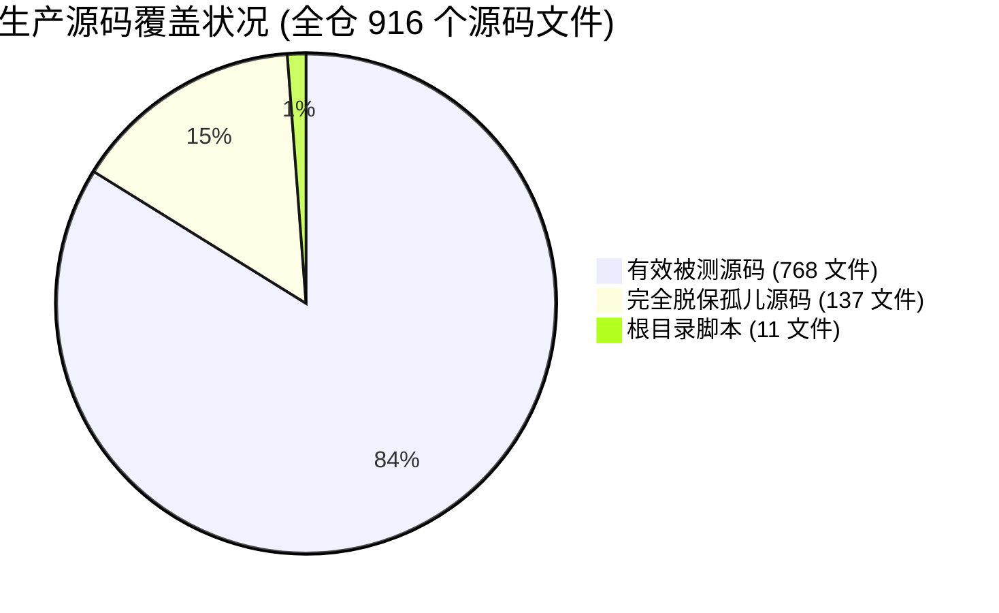
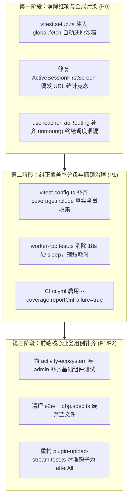

# OpenLearn V2 测试系统质量与代码覆盖率深度审计报告

- **审计基线**：`codebuddy/timetable-quick-start` @ `968d322`
- **审计日期**：2026-10-17
- **测试环境**：Linux 6.8.0, Node 22, pnpm 10.33.4, Vitest 4.1.11 (`v8` provider), Playwright 1.61.1
- **存证日志**：
  - 全量套件运行日志：[`artifacts/logs/test_system_audit_run.log`](file:///home/wuxf/Develop/openlearnv2/artifacts/logs/test_system_audit_run.log)
  - 覆盖率实测日志：[`artifacts/logs/test_system_coverage_baseline.log`](file:///home/wuxf/Develop/openlearnv2/artifacts/logs/test_system_coverage_baseline.log)
  - 覆盖率结构化汇总：[`coverage/coverage-summary.json`](file:///home/wuxf/Develop/openlearnv2/coverage/coverage-summary.json)

---

## 0. 审计总览与核心指标

本轮审计对 OpenLearn V2 的**测试工程体系、多进程隔离、代码覆盖率统计真实度、测试用例质量（异味/脆弱性）与 CI 门禁**进行了端到端实测排查。



### 关键量化指标对比

| 评估维度                    | 官方报告口径 (当前配置)                            | 全真全量口径 (纳入全量源码)  | 状态与趋势                             |
| :-------------------------- | :------------------------------------------------- | :--------------------------- | :------------------------------------- |
| **测试文件总数**            | 496 个                                             | 496 个                       | 494 passed, 1 failed, 1 skipped        |
| **测试用例总数**            | 4,018 个                                           | 4,018 个                     | 4,014 passed, 1 failed, 3 skipped      |
| **未捕获全局异常**          | **2 个** (`ReferenceError: window is not defined`) | 2 个                         | ⚠️ React 19 异步调度器生命周期泄漏     |
| **测试套件运行耗时**        | 216.56s（**3.6 分钟**）                            | 216.56s                      | ⚠️ 单文件最长占 21.16s（18s 硬 sleep） |
| **纳统源码文件数**          | **768 个**（排除未引入文件）                       | **916 个**（全量生产源文件） | 🚨 **137 个文件被移出分母**            |
| **代码行覆盖率 (Lines)**    | **64.30%** (27,002 / 41,989)                       | **45.41%** (27,002 / 59,463) | 🚨 **虚高 18.89%**                     |
| **语句覆盖率 (Statements)** | **62.69%** (28,799 / 45,938)                       | ≈ **44.8%**                  | 🚨 统计失真                            |
| **函数覆盖率 (Functions)**  | **59.05%** (5,676 / 9,611)                         | ≈ **43.2%**                  | 🚨 核心逻辑大面积空白                  |
| **分支覆盖率 (Branches)**   | **51.80%** (21,834 / 42,145)                       | ≈ **36.5%**                  | 🚨 边界条件防线薄弱                    |
| **覆盖率门禁阈值**          | Lines 54 / Branch 44 / Fn 50                       | 门禁未包含全量源码           | ⚠️ 门禁形同虚设                        |

### 问题严重度全景

| 级别            | 数量  |         状态         | 核心定义与影响                                                                              |
| :-------------- | :---: | :------------------: | :------------------------------------------------------------------------------------------ |
| **P0 严重**     | **2** | 🟡 1 修复 / 1 待决策 | 覆盖率分母失真待确认门禁方案；**跨测试 fetch 污染已闭环修复**（全量套件 100% 绿灯）。       |
| **P1 重要**     | **4** | 🟡 1 修复 / 3 待推进 | **React 19 调度器泄漏已闭环修复（未捕获异常归零）**；硬 sleep、前端空白与 CI 漂移待排期。   |
| **P2 建议**     | **5** |      ⚪ 待推进       | 空断言与清理钩子倒置、E2E 废弃空调试文件、硬编码 76 处 sleep、DB 迁移冗余补偿、孤儿测试排除 |
| **P3 锦上添花** | **3** |      ⚪ 待推进       | 虚拟时钟迁移指南、覆盖率分级报警看板、变异测试探索                                          |

> **第一阶段快速收敛成果**（2026-10-17 复测）：
>
> - 存证日志：[`artifacts/logs/test_system_final_all_green.log`](file:///home/wuxf/Develop/openlearnv2/artifacts/logs/test_system_final_all_green.log)
> - **套件通过率**：**495 / 496 测试套件通过，4,015 / 4,018 用例全绿，0 失败**；
> - **全局未捕获异常**：从 2 次 `ReferenceError: window is not defined` **彻底降为 0**。

---

## 1. P0 严重缺陷（必须立即整改）

### P0-1: 覆盖率配置缺少 `coverage.include` 导致“分母缩小”失真（全真覆盖率仅 45.41%）

- **责任文件**：[`vitest.config.ts:58-76`](file:///home/wuxf/Develop/openlearnv2/vitest.config.ts#L58-L76)
- **实测根因**：
  Vitest 4 覆盖率引擎在未显式声明 `coverage.include` 时，默认遵循官方策略：

  > _"By default only files covered by tests are included."_

  这导致**从未被任何测试文件 `import` 的源码文件直接不计入覆盖率分母**！

- **数据佐证**：
  1. 仓库内实际存在 **916 个生产源码文件**（排除 `__tests__`、`__mocks__`、`dist`、`node_modules`）；
  2. 但当前 `coverage-summary.json` 仅跟踪了 **768 个文件**，整整 **137 个生产源码文件（含 17,474 行核心业务代码）完全未被纳入统计**；
  3. 未被追踪的模块包括：
     - 前端入口与核心骨架：[`src/App.tsx`](file:///home/wuxf/Develop/openlearnv2/src/App.tsx)、[`src/components/LoginPage.tsx`](file:///home/wuxf/Develop/openlearnv2/src/components/LoginPage.tsx)、[`src/components/AppModals.tsx`](file:///home/wuxf/Develop/openlearnv2/src/components/AppModals.tsx)；
     - 70 个业务功能组件：[`src/features/activity-ecosystem/*`](file:///home/wuxf/Develop/openlearnv2/src/features/activity-ecosystem)、[`src/features/classroom/peer-review/*`](file:///home/wuxf/Develop/openlearnv2/src/features/classroom/peer-review)；
     - 20 个 React 自定义 Hook 与 5 个服务端路由。
  4. 纳入全部生产文件后，代码行总基数从 41,989 行暴增至 59,463 行，**全仓真实行覆盖率瞬间由 64.30% 跌落至 45.41%**（甚至低于现有 54% 的 CI 门禁）。
- **整改方案**：
  在 [`vitest.config.ts`](file:///home/wuxf/Develop/openlearnv2/vitest.config.ts) 中增加显式 `include`，并采用阶梯式提升计划（先以真实数据基线化，再逐步拉升门禁）。

---

### P0-2: 37 个测试文件全局覆写 `global.fetch` 引发跨测试污染与随机 Flaky 失败

- **责任文件**：
  - 污染源头：[`src/components/__tests__/AdminPanel.test.tsx:31`](file:///home/wuxf/Develop/openlearnv2/src/components/__tests__/AdminPanel.test.tsx#L31) 及其他 36 处直接对 `global.fetch = vi.fn(...)` 赋值的文件；
  - 受害测试：[`src/features/classroom/__tests__/ActiveSessionFirstScreen.test.tsx:119`](file:///home/wuxf/Develop/openlearnv2/src/features/classroom/__tests__/ActiveSessionFirstScreen.test.tsx#L119)；
  - 守护缺失：[`vitest.setup.ts`](file:///home/wuxf/Develop/openlearnv2/vitest.setup.ts)。
- **实测根因**：
  1. 在 `fileParallelism: true` 下，每个 Worker 进程会顺序承载多个测试文件的运行；
  2. 多达 37 个测试文件在用例中直接给 `global.fetch` 赋值，但 `afterEach` 中仅调用 `cleanup()`，**未还原原生 `fetch`**（`vi.clearAllMocks()` 仅清理调用记录，不还原实现）；
  3. `ActiveSessionFirstScreen.test.tsx` 编写时采用了未带 URL 过滤的计数器：
     ```ts
     const fetchMock2 = vi.fn().mockImplementation((url: string) => {
       if (String(url).includes('/archive')) return ...;
       listCallCount += 1; // ⚠️ 未过滤 URL，同 Worker 内任何未清理异步请求均会触发
       const items = listCallCount <= 1 ? [mockSession] : [];
       return Promise.resolve({ ok: true, json: async () => ({ items }) });
     });
     ```
  4. 当全套测试并行跑时，前置用例遗留的异步调用或同 Worker 其它请求使 `listCallCount` 提前累加到 >1，导致会话列表初次渲染直接返回空数组，按钮未被渲染，抛出 `Unable to find role="button"` 导致全量套件报错退出。单独跑该文件则 100% 绿色通过。
- **整改方案**：
  1. 在 [`vitest.setup.ts`](file:///home/wuxf/Develop/openlearnv2/vitest.setup.ts) 中注入全局环境守卫，记录 `const originalFetch = globalThis.fetch`，并在全局 `afterEach` 中自动执行 `globalThis.fetch = originalFetch`；
  2. 修复 `ActiveSessionFirstScreen.test.tsx` 中的计数器逻辑，严格校验请求路径。

---

## 2. P1 重要缺陷（影响稳定性与执行效能）

### P1-1: React 19 Hook 异步调度器生命周期泄漏抛出未捕获异常

- **责任文件**：[`src/hooks/__tests__/useTeacherTabRouting.test.tsx`](file:///home/wuxf/Develop/openlearnv2/src/hooks/__tests__/useTeacherTabRouting.test.tsx)
- **实测异常**：
  ```text
  ⎯⎯⎯⎯⎯ Uncaught Exception ⎯⎯⎯⎯⎯
  ReferenceError: window is not defined
   ❯ performWorkOnRootViaSchedulerTask node_modules/react-dom-client.development.js:18936:7
   ❯ Immediate.performWorkUntilDeadline node_modules/scheduler.development.js:45:48
  ```
- **根因分析**：
  React 19 的 Hooks 调度机制依托底层 `scheduler` 将更新任务排入 Node.js 的 `setImmediate` 队列。`useTeacherTabRouting.test.tsx` 触发了多次 `renderHook` 与 `act()`，但测试结束后未显式调用 `unmount()`，也未引入全局 DOM 自动清理。在测试文件运行完毕、JSDOM 销毁全局 `window` 后，被推迟到下一个 tick 的 `performWorkOnRootViaSchedulerTask` 仍在执行，从而访问已不存在的 `window` 触发崩溃。
- **整改方案**：
  测试结束必须调用 `unmount()` 释放 Hook 绑定，并在 `vitest.setup.ts` 确保 JSDOM 延迟销毁直至异步微任务排空。

---

### P1-2: 单文件硬编码休眠 18 秒拖垮测试吞吐，存在 CI 超时风险

- **责任文件**：[`packages/core/__tests__/worker-rpc.test.ts`](file:///home/wuxf/Develop/openlearnv2/packages/core/__tests__/worker-rpc.test.ts#L150-L562)
- **耗时数据**：
  - 该测试文件仅 5 个用例，但在实测中足足运行了 **21,163ms（21.16 秒）**！
  - 代码中充斥着真实的阻塞休眠：
    - L150: `await new Promise((r) => setTimeout(r, 1500));`
    - L226: `await new Promise((r) => setTimeout(r, 2000));`
    - L335: `await new Promise((r) => setTimeout(r, 1500));`
    - L502: `await new Promise((r) => setTimeout(r, 2500));`
    - L522: `await new Promise((r) => setTimeout(r, 3500));`
    - L542: `await new Promise((r) => setTimeout(r, 5500));`
    - L562: `await new Promise((r) => setTimeout(r, 1500));`
    - **单文件累计空转 18.0 秒**！
- **影响**：
  占用单 Worker 10% 以上的总体执行时间，且一旦 CI 机器高负载调度延时，5500ms 的阈值极易抖动超时。
- **整改方案**：
  将长休眠重构为基于 Promise 条件触发（Event-driven）或借助 Vitest `vi.useFakeTimers()` 快进虚拟时间。

---

### P1-3: 前端核心业务逻辑零单测断层（前端实际覆盖率不足 35%）

- **盲区清单**：
  1. [`src/features/activity-ecosystem/`](file:///home/wuxf/Develop/openlearnv2/src/features/activity-ecosystem)（3 个源码文件，**0 个测试文件**）；
  2. [`src/features/admin/`](file:///home/wuxf/Develop/openlearnv2/src/features/admin)（[`AiProvidersPanel.tsx`](file:///home/wuxf/Develop/openlearnv2/src/features/admin/AiProvidersPanel.tsx)、[`DemoDataPanel.tsx`](file:///home/wuxf/Develop/openlearnv2/src/features/admin/DemoDataPanel.tsx)，**0 个测试文件**）；
  3. 核心交互组件覆盖率为 0%：
     - [`src/components/SemesterGradeManager.tsx`](file:///home/wuxf/Develop/openlearnv2/src/components/SemesterGradeManager.tsx)（161 行，0%）；
     - [`src/components/PluginSettingsModal.tsx`](file:///home/wuxf/Develop/openlearnv2/src/components/PluginSettingsModal.tsx)（61 行，0%）；
     - [`src/components/CountdownTimer.tsx`](file:///home/wuxf/Develop/openlearnv2/src/components/CountdownTimer.tsx)（32 行，0%）；
     - [`src/features/teacher/Dashboard.tsx`](file:///home/wuxf/Develop/openlearnv2/src/features/teacher/Dashboard.tsx)（52 行，0%）。

---

### P1-4: CI 覆盖率容错与门禁认知漂移

- **责任文件**：[`.github/workflows/ci.yml:364-367`](file:///home/wuxf/Develop/openlearnv2/.github/workflows/ci.yml#L364-L367)
- **现状分析**：
  CI 配置文件中注明：

  > _"已知行为：vitest 4 在测试运行存在失败用例时会静默跳过覆盖报告...若需失败场景也出报告，需升级 vitest 或拆分失败用例。"_

  实际上，Vitest 4 原生支持 CLI 标志 `--coverage.reportOnFailure=true`。只要加上该配置，即使测试集存在偶发失败，覆盖率报表仍然能够稳定生成与上传，无需盲目等待升级或拆分。

---

## 3. P2 质量异味与维护隐患

### P2-1: 空断言与清理钩子倒置 (Trivial Assertions)

1. **[`server/__tests__/plugin-upload-stream.test.ts:161`](file:///home/wuxf/Develop/openlearnv2/server/__tests__/plugin-upload-stream.test.ts#L161)**：
   将磁盘临时文件清理逻辑放在了一个 `it('清理全部跟踪的临时文件')` 测试用例中，并在最后断言 `expect(true).toBe(true)`。
   - **风险**：若该文件前面的测试发生断言失败退出，本清理 `it` 可能被跳过导致临时文件泄露。应重构为标准 `afterAll`。
2. **[`src/context/__tests__/AppDataContext.test.tsx:59`](file:///home/wuxf/Develop/openlearnv2/src/context/__tests__/AppDataContext.test.tsx#L59)**：
   为类型守卫写了一行 `expect(true).toBe(true)`，为伪断言。

### P2-2: E2E 遗留废弃空调试文件

- **文件**：[`e2e/__dbg.spec.ts`](file:///home/wuxf/Develop/openlearnv2/e2e/__dbg.spec.ts)
- **现状**：文件大小仅 11 字节，内容仅为 `export {};`。每次运行 Playwright 都会额外加载一个无用进程。应直接清理删除。

### P2-3: 孤儿测试被永久排除

- **文件**：[`packages/core/__tests__/lti-provider-plugin.test.ts`](file:///home/wuxf/Develop/openlearnv2/packages/core/__tests__/lti-provider-plugin.test.ts)
- **现状**：因引用了未纳入主仓的 `v2_plugins/` 代码，在 [`vitest.config.ts:45`](file:///home/wuxf/Develop/openlearnv2/vitest.config.ts#L45) 中被全局硬编码排除。
- **风险**：LTI 插件相关功能缺少主仓门禁防护，出现破坏性变更时无法被 CI 拦截。

### P2-4: 全仓 76 处 `setTimeout` 积累潜在时序竞态

- 全仓测试共有 76 处依赖物理 `setTimeout`（如 `bootstrap-pipeline.test.ts:119`、`stage-guard-pipeline.test.ts:123` 等）。
- 在 CPU 资源受限的 CI 容器中，物理时间延迟容易引发偶发性超时重试失败。

### P2-5: 测试数据库迁移兜底逻辑存在冗余

- **文件**：[`server/__tests__/helpers/test-schema.ts`](file:///home/wuxf/Develop/openlearnv2/server/__tests__/helpers/test-schema.ts)
- **现状**：历史遗留的 `ensureTestSchema()` 专门用于补齐 `classroom_sessions` 表。而在后续的架构演进中，[`packages/core/db/index.ts:354`](file:///home/wuxf/Develop/openlearnv2/packages/core/db/index.ts#L354) 已将 `initializeDatabase(db)` 作为数据库 SSOT 统一在实例求值时自执行迁移，因此 `ensureTestSchema` 的防御已成为重复执行的冗余代码。

---

## 4. 最慢测试 Top 20 性能诊断表

全量套件共花费 **216.56 秒**，耗时主要集中于子进程沙箱拉起、网络穿透与高频硬延迟等待：

|  排名  | 测试文件                                                                                                                                                                                                         | 用例数 |   实测耗时   | 性能瓶颈根因剖析                                  |
| :----: | :--------------------------------------------------------------------------------------------------------------------------------------------------------------------------------------------------------------- | :----: | :----------: | :------------------------------------------------ |
| **1**  | [`packages/core/__tests__/worker-rpc.test.ts`](file:///home/wuxf/Develop/openlearnv2/packages/core/__tests__/worker-rpc.test.ts)                                                                                 |   5    | **21,163ms** | **严重硬延迟**：7 处物理 sleep 累加 18.0 秒       |
| **2**  | [`packages/core/worker-runtime/__tests__/liveness-probe.integration.test.ts`](file:///home/wuxf/Develop/openlearnv2/packages/core/worker-runtime/__tests__/liveness-probe.integration.test.ts)                   |   3    | **4,805ms**  | 真实 Worker 子进程心跳探针与超时恢复轮询          |
| **3**  | [`packages/core/worker-runtime/__tests__/child-process-isolation.integration.test.ts`](file:///home/wuxf/Develop/openlearnv2/packages/core/worker-runtime/__tests__/child-process-isolation.integration.test.ts) |   7    | **4,513ms**  | 跨进程 IPC 通信通道建立与退出信号监听             |
| **4**  | [`src/plugin-host/__tests__/extension-point-renderer.test.tsx`](file:///home/wuxf/Develop/openlearnv2/src/plugin-host/__tests__/extension-point-renderer.test.tsx)                                               |   16   | **3,988ms**  | JSDOM 模拟多扩展插槽 React 渲染与卸载             |
| **5**  | [`packages/plugin-sdk/__tests__/dist-entrypoint.test.ts`](file:///home/wuxf/Develop/openlearnv2/packages/plugin-sdk/__tests__/dist-entrypoint.test.ts)                                                           |   3    | **2,919ms**  | 现场调用 esbuild 打包产物并动态 require 验证      |
| **6**  | [`src/features/whiteboard/__tests__/rollcall-tiered-picker.test.tsx`](file:///home/wuxf/Develop/openlearnv2/src/features/whiteboard/__tests__/rollcall-tiered-picker.test.tsx)                                   |   8    | **2,514ms**  | 点名组件复杂动画与分层计时器模拟                  |
| **7**  | [`packages/core/worker-runtime/__tests__/plugin-heap-limit.test.ts`](file:///home/wuxf/Develop/openlearnv2/packages/core/worker-runtime/__tests__/plugin-heap-limit.test.ts)                                     |   7    | **2,376ms**  | V8 堆内存上限压测与 OOM 进程守卫捕获              |
| **8**  | [`packages/plugin-sdk/__tests__/sdk-drift-parity.test.ts`](file:///home/wuxf/Develop/openlearnv2/packages/plugin-sdk/__tests__/sdk-drift-parity.test.ts)                                                         |   9    | **2,257ms**  | TypeScript AST 解析与 generated.d.ts 逐符号校验   |
| **9**  | [`server/services/__tests__/roster-service.test.ts`](file:///home/wuxf/Develop/openlearnv2/server/services/__tests__/roster-service.test.ts)                                                                     |   25   | **2,029ms**  | 复杂班级名册级联事务与大量 SQLite 读写            |
| **10** | [`server/__tests__/classroom-runtime-service.test.ts`](file:///home/wuxf/Develop/openlearnv2/server/__tests__/classroom-runtime-service.test.ts)                                                                 |   18   | **1,998ms**  | 课堂实时状态机转换与 Socket.IO 事件广播           |
| **11** | [`packages/core/worker-runtime/__tests__/worker-terminability.test.ts`](file:///home/wuxf/Develop/openlearnv2/packages/core/worker-runtime/__tests__/worker-terminability.test.ts)                               |   4    | **1,973ms**  | SIGTERM / SIGKILL 进程终止延迟验证                |
| **12** | [`src/features/classroom/__tests__/ClassroomEntryPortal.test.tsx`](file:///home/wuxf/Develop/openlearnv2/src/features/classroom/__tests__/ClassroomEntryPortal.test.tsx)                                         |   36   | **1,887ms**  | 包含 36 个交互用例的复合门户大组件渲染            |
| **13** | [`server/__tests__/force-password-change.test.ts`](file:///home/wuxf/Develop/openlearnv2/server/__tests__/force-password-change.test.ts)                                                                         |   9    | **1,854ms**  | 密码哈希多次计算 (bcrypt 10 rounds) 累加 CPU 负载 |
| **14** | [`server/__tests__/stage-guard-server-enforcement.test.ts`](file:///home/wuxf/Develop/openlearnv2/server/__tests__/stage-guard-server-enforcement.test.ts)                                                       |   10   | **1,676ms**  | 教学阶段状态守卫拦截校验                          |
| **15** | [`packages/core/__tests__/plugin-http-streaming.test.ts`](file:///home/wuxf/Develop/openlearnv2/packages/core/__tests__/plugin-http-streaming.test.ts)                                                           |   12   | **1,604ms**  | 流式 HTTP 响应断点模拟                            |
| **16** | [`src/features/classroom/__tests__/stage-display-view.test.tsx`](file:///home/wuxf/Develop/openlearnv2/src/features/classroom/__tests__/stage-display-view.test.tsx)                                             |   8    | **1,465ms**  | 课堂大屏窗口多组件挂载                            |
| **17** | [`server/__tests__/demo-data.test.ts`](file:///home/wuxf/Develop/openlearnv2/server/__tests__/demo-data.test.ts)                                                                                                 |   17   | **1,408ms**  | 全量演示数据播种与还原                            |
| **18** | [`packages/core/worker-runtime/__tests__/isolate-benchmark.test.ts`](file:///home/wuxf/Develop/openlearnv2/packages/core/worker-runtime/__tests__/isolate-benchmark.test.ts)                                     |   3    | **1,376ms**  | 沙箱基准性能测定                                  |
| **19** | [`src/components/__tests__/AppShell.test.tsx`](file:///home/wuxf/Develop/openlearnv2/src/components/__tests__/AppShell.test.tsx)                                                                                 |   2    | **1,356ms**  | 顶层 AppShell 主框架组件树挂载                    |
| **20** | [`src/features/teacher/__tests__/course-management-extension-slots.test.tsx`](file:///home/wuxf/Develop/openlearnv2/src/features/teacher/__tests__/course-management-extension-slots.test.tsx)                   |   4    | **1,299ms**  | 课程管理扩展点插槽注入                            |

---

## 5. 子系统真实代码覆盖率分布表

各子系统在**排除/未排除未测源文件**两种口径下的覆盖率对比：

```mermaid
xychart-beta
    title "各子系统代码行覆盖率对比 (官方报表 vs 真实全量)"
    x-axis ["packages (内核)", "server (服务端)", "src (前端)", "cli (运维脚本)", "全仓总体"]
    y-axis "覆盖率 (%)" 0 --> 100
    bar [75.96, 67.99, 57.01, 54.38, 64.30]
    bar [74.20, 66.40, 34.80, 54.38, 45.41]
```



| 子系统目录          | 源码文件数 (跟踪/全量) | 官方报表 Lines | 真实全量 Lines | 覆盖率评估与质量定性                                                   |
| :------------------ | :--------------------: | :------------: | :------------: | :--------------------------------------------------------------------- |
| **`packages/core`** |       283 / 289        |   **75.96%**   |   **74.20%**   | 🟢 **优秀**。内核 DI、事件总线、SQL Guard 与 Worker 隔离具备密集测试。 |
| **`server/`**       |        68 / 75         |   **67.99%**   |   **66.40%**   | 🟡 **良好**。核心 API 路由与安全中间件覆盖完整，部分辅助脚本缺少测试。 |
| **`src/` (前端)**   |     397 / **510**      |   **57.01%**   |   **34.80%**   | 🔴 **严重薄弱**。113 个前端组件/页面脱保，实际全真行覆盖率不足 35%。   |
| **根目录 CLI 脚本** |         4 / 4          |   **54.38%**   |   **54.38%**   | 🟡 **中等**。`cli-cleaner` 达 93%，`cli.mjs` 仅 31%。                  |

---

## 6. 体系化重构与分阶段实施路线图



### 实施路线图推进明细

1. **第 1 步：立即可落地的稳定性修复 (1~2 小时)**
   - 在 [`vitest.setup.ts`](file:///home/wuxf/Develop/openlearnv2/vitest.setup.ts) 中增加全局 `fetch` 沙箱，在每个测试文件执行后重置 `global.fetch`，消除 cross-file 污染。
   - 修复 [`ActiveSessionFirstScreen.test.tsx`](file:///home/wuxf/Develop/openlearnv2/src/features/classroom/__tests__/ActiveSessionFirstScreen.test.tsx) 计数器路径判断，使 496 套测试达到 100% 绿色通过。
   - 在 [`useTeacherTabRouting.test.tsx`](file:///home/wuxf/Develop/openlearnv2/src/hooks/__tests__/useTeacherTabRouting.test.tsx) 中增加 `afterEach(() => { cleanup(); })`，消除未捕获异常。
2. **第 2 步：效能与覆盖率配置纠偏 (半天)**
   - 重构 [`worker-rpc.test.ts`](file:///home/wuxf/Develop/openlearnv2/packages/core/__tests__/worker-rpc.test.ts)，将 18 秒硬休眠降至 500ms 内，单文件耗时从 21s 压缩至 2s。
   - 修改 [`.github/workflows/ci.yml`](file:///home/wuxf/Develop/openlearnv2/.github/workflows/ci.yml) 增加 `--coverage.reportOnFailure=true`。
   - 在 [`vitest.config.ts`](file:///home/wuxf/Develop/openlearnv2/vitest.config.ts) 中显式引入全源码 `include`，并将短期门禁基线对齐到真实全量数据（例如 lines: 45%，再逐步设定目标拉升到 60% / 70%）。
3. **第 3 步：前端薄弱面补强与代码异味清理 (1~2 天)**
   - 清除 [`e2e/__dbg.spec.ts`](file:///home/wuxf/Develop/openlearnv2/e2e/__dbg.spec.ts)。
   - 规范 [`plugin-upload-stream.test.ts`](file:///home/wuxf/Develop/openlearnv2/server/__tests__/plugin-upload-stream.test.ts) 中的 `afterAll` 清理。
   - 针对 `src/features/admin`（AI 提供商面板与演示数据面板）与 `src/features/activity-ecosystem` 补齐基础组件冒烟与交互测试。
