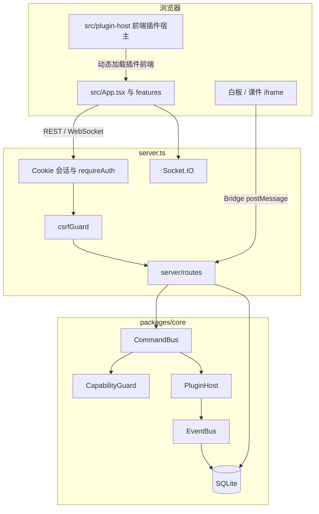

# OpenLearn V2 结构梳理与代码审计报告

> **审计日期**：2026-10-13
> **审计对象**：`openlearn-next@0.6.0`（仓库 `OpenLearn-Next-V2`，分支 `main`）
> **方法**：只读代码审查 + 干净环境实测。本次未修改任何业务代码。
> **环境**：Node.js v22.14.0，pnpm 10.33.4，Linux
> **范围**：仓库结构、请求与数据流、安全、依赖、类型与代码质量、性能、可维护性、测试与 CI、文档，以及 `pnpm install` / `pnpm audit` / `npm audit` / `pnpm lint` / `pnpm lint:strict` / `pnpm lint:eslint` / `pnpm test` / `pnpm build` 的实际结果。

仓库里已有多份历史审计（仓库根目录 `audit-*.md`、`docs/architecture/security-remediation-report.md` 等）。那些文档描述的是更早版本的修复记录。本报告只记录 **当前树** 上仍然存在、并且能在源码或本次命令输出里对上的问题。

---

## 1. 项目概览

OpenLearn V2（包名 `openlearn-next`）是一个插件驱动的教育操作系统 / LMS。教师与管理员用它管理班级、课表、教案、作业、课件和课堂实时互动；学生进入课堂、提交作业、使用白板与课件。AI Agent 通过命令总线调用已注册工具，完成出题、批改和学情类操作。

设计主线是「微内核 + 插件」：Express 组装根启动内核，内核把命令总线、事件总线、能力守卫、插件宿主和 SQLite 接在一起。交互课件跑在无 `allow-same-origin` 的 iframe 沙箱里，经 Bridge SDK 与宿主通信。

### 1.1 技术栈

| 层         | 选型                                                                                                                 |
| ---------- | -------------------------------------------------------------------------------------------------------------------- |
| 前端       | React 19、Vite 6、Tailwind CSS 4、TypeScript 5.8、Zustand 5                                                          |
| 后端       | Express 4、Socket.IO 4、better-sqlite3、tsx（开发）、esbuild（生产打包）                                             |
| 安全组件   | helmet、express-rate-limit、bcryptjs、AES-256-GCM（AI Key）、自研 CSRF 门控                                          |
| 课堂与内容 | konva / react-konva、reveal.js、pptx-preview、jspdf、exceljs、recharts、react-markdown                               |
| AI         | OpenAI 兼容 HTTP。密钥存在 SQLite，经管理后台配置。代码中保留 `@google/genai` 的类型与文案痕迹，运行时对话走自研网关 |
| 测试       | Vitest 4（jsdom，按 worker 隔离临时 SQLite）、Playwright                                                             |
| 包管理     | pnpm workspace（`packages/core`、`plugin-sdk`、`plugin-test-kit`、`bridge-sdk`）                                     |

直接依赖与开发依赖见根目录 `package.json`。引擎要求 Node `>=20`。本次在 Node 22 上安装与构建。

### 1.2 构建与运行

| 命令                             | 作用                                                               |
| -------------------------------- | ------------------------------------------------------------------ |
| `pnpm install --frozen-lockfile` | 按锁文件安装                                                       |
| `pnpm dev`                       | `tsx server.ts`，Express + Vite HMR，默认端口 9000                 |
| `pnpm build`                     | Bridge SDK → Vite 前端 → 插件构建 → esbuild 打出 `dist/server.cjs` |
| `pnpm start`                     | `node dist/server.cjs`                                             |
| `pnpm lint`                      | `tsc --noEmit`（**非**严格模式）                                   |
| `pnpm lint:strict`               | `tsc --noEmit -p tsconfig.strict.json`                             |
| `pnpm lint:eslint`               | ESLint                                                             |
| `pnpm test`                      | Vitest                                                             |
| `pnpm test:e2e`                  | Playwright                                                         |
| `docker compose` / `Dockerfile`  | 多阶段镜像：`pnpm install` → `pnpm build` → `pnpm prune --prod`    |

默认账号在空库时写入：`admin` / `admin`（administrator）、`teacher` / `teacher`（teacher）。学生初始口令策略见第 3 节。AI 密钥不放在环境变量里，由管理后台写入 `ai_providers.api_key`。

复制 `.env.example` 为 `.env`。与安全相关的变量包括 `ENCRYPTION_KEY`、`ALLOWED_ORIGINS`、`TRUST_PROXY`、`OPENLEARN_WORKER_ISOLATE`、`OPENLEARN_PLUGIN_PERMISSION`。数据库默认路径 `packages/core/db/educational_os.db`。

---

## 2. 目录与模块结构

约 **1303** 个 `.ts` / `.tsx` 文件，**424** 个测试文件，**21** 个 SQL 迁移。`src/App.tsx` 已收成 134 行装配壳；体积转移到少数巨型视图。

```
├── server.ts                 # 组装根：安全头、CORS、限流、路由注册、Socket.IO
├── server/                   # 路由、中间件、领域服务、AI Agent
├── src/                      # React 壳、features、plugin-host、Zustand
├── packages/core/            # 内核：总线、插件宿主、worker、DB、AI、课堂运行时
├── packages/plugins/         # 内置插件（builtin、vfs、assignment-eval 等）
├── packages/plugin-sdk/      # 插件类型与 DI Token（发布物在 dist/）
├── packages/plugin-test-kit/
├── packages/bridge-sdk/      # iframe Bridge 源码
├── packages/activity-ecosystem/
├── migrations/               # SQLite 版本迁移（结构的单一来源）
├── e2e/                      # Playwright
├── docs/                     # 架构、插件、部署文档
└── .github/workflows/ci.yml
```

`packages/core` 在一个 `kernelContainer` 里叠了多套子系统：`command-bus`、`event-bus`、`capability`、`capability-system`、`capability-governance`、`classroom-runtime`、`lesson-engine`、`plugin-host`、`worker-runtime`、`ai`、`analytics-engine`、`bootstrap`、`db`。它们都挂在 `packages/core/kernel/index.ts` 上，并不是死目录，但职责边界已经叠了三层「能力」和两套「课堂运行时」（内核 `classroom-runtime` 与 `server/services/classroom-runtime-service.ts`）。

### 2.1 模块关系



### 2.2 关键数据流

**登录。** `POST /api/auth/login`（`server/routes/roster.ts`）按入口区分教师与学生。教师走 `users.password_hash` 的 bcrypt（遗留 SHA-256 会升级）。学生走 `students.password`，并在个人口令失败后解密 `classes.class_passcode`（AES-256-GCM 密文，前缀 `olenc1:`）再做常量时间比较。教师接口返回原文，列表接口不返回该列。成功后写入 `client_sessions`，下发 HttpOnly Cookie `edu_os_token`（7 天绝对过期，空闲 24 小时）。

**一次教学写操作。** 浏览器带 Cookie 调用 REST。`requireAuth` 解析会话并可选检查角色。路由或 CommandBus handler 写 SQLite，必要时经 Socket.IO 房间广播。高危命令在内核拦截器里做能力检查；管理员 actor 可绕过审批。

**AI 对话。** `POST /api/agent/chat` 读取 `ai_providers`，用 `ENCRYPTION_KEY` 解密 API Key，再经 `server/ai-agent.ts` 的 `fetchWithRetry` 调用 OpenAI 兼容接口。模型返回的 function call 回到 CommandBus，最多循环数轮。

**插件。** 管理员上传 ZIP 或从社区注册表安装。`executionMode` 缺省为 `inline`：插件代码与宿主同进程。`worker` 使用 worker_threads，`process` 才进入子进程和 Node 权限模型。前端插件由 `src/plugin-host` 以 Blob URL 动态 import。

**课件。** 教师上传的 HTML 经 `/runtime` 直出，套上独立的宽松 CSP，放进 `sandbox="allow-scripts allow-forms allow-downloads"` 且不含 `allow-same-origin` 的 iframe。Bridge SDK 把 `postMessage` 的 `targetOrigin: 'null'` 归一成 `'*'`。

---

## 3. 审计发现

严重程度按「未授权的人能看到或改到什么、以及默认部署是否会踩中」来定。

### 3.1 高

#### H-1 班级作业、提交与成绩缺少对象级授权

| 项   | 内容                                                                                                                                                                                                                                                                                                                                                                                                             |
| ---- | ---------------------------------------------------------------------------------------------------------------------------------------------------------------------------------------------------------------------------------------------------------------------------------------------------------------------------------------------------------------------------------------------------------------- |
| 位置 | `server/routes/roster.ts` 约 1103、1123、1157 行；`server/routes/assignments.ts` 第 10–16 行；`server/services/assignment-service.ts` 第 73–76 行                                                                                                                                                                                                                                                                |
| 问题 | `GET /api/classes/:id/progress`、`GET /api/classes/:classId/lessons/:lessonId/progress`、`GET /api/classes/:classId/dashboard`、`GET /api/classes/:classId/assignments` 只调用了 `requireAuth()`。没有角色限制，也没有「调用者属于该班」的校验。dashboard 查询返回作业、`assignment_submissions`（含 `content`、分数、反馈）、学生姓名和点名统计。作业列表是 `SELECT * FROM assignments`，`content` 列原样返回。 |
| 影响 | 任意已登录学生只要知道 `classId`，就能读取该班作业全文、同学提交和分数。学生自己的仪表盘用 `SELECT c.*`（`roster.ts` 约 1241 行）把班级行交给前端，因此本班 `classId` 是已知的。班级主键是 8 字节随机串，跨班穷举不现实；**班内横向越权是现实路径**。任意教师同样可以读取自己未任教的班级，只要持有 id。                                                                                                         |
| 建议 | 这些接口改为教师/管理员，并校验班级归属（任课教师或已选课学生）。学生可见的作业 DTO 去掉参考答案与他人提交。dashboard 的 `SELECT c.*` 改成显式列，至少去掉 `class_passcode`。补一条「学生 A 读取学生 B 所在班的 dashboard 必须 403」的路由测试。                                                                                                                                                                 |

#### H-2 登录与写请求限流可以被伪造的客户端 IP 冲掉

| 项   | 内容                                                                                                                                                                                                                                                                                                                                                                                                     |
| ---- | -------------------------------------------------------------------------------------------------------------------------------------------------------------------------------------------------------------------------------------------------------------------------------------------------------------------------------------------------------------------------------------------------------- |
| 位置 | `server.ts` 第 161–172、257–265、271–277、294–298 行                                                                                                                                                                                                                                                                                                                                                     |
| 问题 | 未设置 `TRUST_PROXY` 时代码默认 `app.set('trust proxy', 1)`。登录限流的 key 是 `` `${ip}:${user}` ``。注释写的是「轮换 X-Forwarded-For 也不能稀释同一用户名的计数」，实现把 IP 放进了 key，轮换转发头就会得到新桶。学生登录体用的是 `studentId`，限流器只读 `username` / `studentName`，学生桶的用户名部分是空字符串。写请求限流（每分钟 60 次）使用 express-rate-limit 的默认 IP key，同样吃 `req.ip`。 |
| 影响 | 直连部署（前面没有会覆盖该头的反向代理）上，攻击者可以为每个 `X-Forwarded-For` 拿到独立的 5 次/分钟登录预算，对 `admin` 或学生口令做在线猜测。同一 NAT 后的真实课堂则会因为空用户名挤在一个桶里，出现误伤。依赖公告 `proxy-addr`（见 M-9）与这个默认信任叠加。                                                                                                                                           |
| 建议 | 限流 key 使用规范化后的用户名或学号，IP 只作为第二因子且不单独分桶。`TRUST_PROXY` 默认改为 `false`，仅在文档化的反代层数上显式打开。把 `proxy-addr` 升到 `>=2.0.8`。为学生登录把 `studentId` 纳入 key。                                                                                                                                                                                                  |

#### H-3 种子口令可登录，强制改密只拦住写请求

| 项   | 内容                                                                                                                                                                                                                                            |
| ---- | ----------------------------------------------------------------------------------------------------------------------------------------------------------------------------------------------------------------------------------------------- |
| 位置 | `packages/core/db/index.ts` 第 111–122 行；`server/routes/roster.ts` 第 564–571、681–683 行；`server/middleware/auth.ts` 第 154–171 行                                                                                                          |
| 问题 | 空库播种 `admin/admin` 与 `teacher/teacher`。教师入口在「密码等于用户名」时给会话打上 `mustChangePassword`。学生个人口令仍是字面量 `123456` 时同样打标。`enforcePasswordChanged` 对 GET/HEAD/OPTIONS 直接放行。`PLAYWRIGHT_TEST` 会关掉这道闸。 |
| 影响 | 未改密的种子管理员可以登录并读取用户、成绩、数据库状态和 AI 提供商配置（密钥是掩码，见 M-6）。写操作返回 403，读操作足够带走名册与成绩。公网或校内默认可达的实例在第一次改密之前处于这个状态。                                                  |
| 建议 | 生产启动时若检测到种子口令哈希仍匹配默认口令，拒绝对外监听或只开放改密与登出。`mustChangePassword` 会话的 GET 也限制在会话、改密和登出。不要用环境变量整段关闭这道闸；E2E 使用独立种子。                                                        |

#### H-4 第三方插件默认在宿主进程内执行

| 项   | 内容                                                                                                                                                                                                                                                                                                                                                               |
| ---- | ------------------------------------------------------------------------------------------------------------------------------------------------------------------------------------------------------------------------------------------------------------------------------------------------------------------------------------------------------------------ |
| 位置 | `packages/core/plugin-host/types.ts` 第 398–400 行；`packages/core/plugin-host/install.ts` 第 582–590 行；`server/routes/plugins.ts` 安装与 `install-from-url`（管理员）                                                                                                                                                                                           |
| 问题 | `normalizeExecutionMode` 对缺失或无法识别的值返回 `inline`。社区一键安装与 ZIP 安装沿用 manifest 里的模式，manifest 不写就进宿主进程。进程隔离、权限旗标和堆上限只在 `executionMode: 'process'` 时生效。`.env.example` 已写明 Node 权限模型约束不了网络。插件网关还允许 manifest 把单条路由标成 `auth: false`（`server/routes/plugin-api-gateway.ts` 约 307 行）。 |
| 影响 | 管理员安装的社区包或 ZIP 获得与服务器进程相同的文件系统、数据库和内存。这是整站远程代码执行，而不是沙箱内的插件故障。前端还会把插件源码包成 Blob URL 执行（`server.ts` CSP 注释，`scriptSrc` 含 `blob:`）。                                                                                                                                                        |
| 建议 | 非 `@openlearn/` 内置插件默认 `process`，`inline` 仅允许显式白名单。社区安装路径拒绝 `auth: false`，除非经过额外审批。在管理界面上把执行模式显示成实际落库的值。                                                                                                                                                                                                   |

#### H-5 插件 SDK 的 `dist/` 不在构建与 CI 里生成，干净环境无法类型检查，生产进程无法加载 SDK

| 项   | 内容                                                                                                                                                                                                                                                                                                                                                                                                                                               |
| ---- | -------------------------------------------------------------------------------------------------------------------------------------------------------------------------------------------------------------------------------------------------------------------------------------------------------------------------------------------------------------------------------------------------------------------------------------------------- |
| 位置 | `packages/plugin-sdk/package.json`（`main` / `types` 指向 `./dist/index.js` 与 `./dist/index.d.ts`）；`.gitignore` 第 3 行 `dist/`；根脚本 `build`；`.github/workflows/ci.yml` 的 Type check 步骤；`Dockerfile` 的 `pnpm run build`；产物 `dist/server.cjs` 内多处 `require("@openlearn/plugin-sdk")`                                                                                                                                              |
| 问题 | SDK 发布入口是构建产物，源码在 `index.ts`。`pnpm build` 与 CI 都不会运行 `packages/plugin-sdk/build.mjs`。`dist/` 被 gitignore，仓库里没有这份产物。                                                                                                                                                                                                                                                                                               |
| 影响 | 本次干净安装后，`pnpm lint` **直接失败**，16 条 `TS2307 Cannot find module '@openlearn/plugin-sdk'`。单独执行 SDK 构建后，同一条命令通过。把 `packages/plugin-sdk/dist` 移走后，`require('@openlearn/plugin-sdk')` 抛出 `MODULE_NOT_FOUND`（找不到 `dist/index.js`）。因此 CI 的类型检查步骤、以及未先构建 SDK 的 `pnpm start` / 镜像入口，会以同样方式失败。Vitest 因为在 `vitest.config.ts` 里把包别名到 `index.ts`，所以测试不依赖这份 `dist`。 |
| 建议 | 把 SDK 构建放进 `pnpm build`、Docker 构建和 CI 的 `pnpm lint` 之前（或增加 `prepare`）。提交前用一条「移动 dist 后 require 必须失败、构建后必须成功」的冒烟测试锁住这条链。                                                                                                                                                                                                                                                                        |

### 3.2 中

#### M-1 AI 热路径的出站请求会跟随重定向，SSRF 复检没有覆盖到这里

| 项   | 内容                                                                                                                                                                                                                                        |
| ---- | ------------------------------------------------------------------------------------------------------------------------------------------------------------------------------------------------------------------------------------------- |
| 位置 | `packages/core/ai/utils/fetch-with-retry.ts` 第 56–61 行；调用方 `server/ai-agent.ts`、`server/services/grading-service.ts`、`server/services/schedule-service.ts`                                                                          |
| 问题 | 社区安装与「测试 AI 提供商」已改用 `fetchWithSafeRedirects`（DNS 与逐跳复检）。对话、批改和课表仍用裸 `fetch`，默认跟随重定向。失败响应体会拼进 Error message。                                                                             |
| 影响 | 管理员配置的提供商 URL 若 302 到链路本地或云元数据地址，请求会带上解密后的 Bearer token，响应可能回到教师可见的错误或模型上下文。提供商 URL 本身只有管理员能改，所以这不是匿名 SSRF，而是已承认并在测试端点修过、热路径还留着的同一类缺口。 |
| 建议 | 热路径改为 `fetchWithSafeRedirects`，或在 `fetch-with-retry` 内默认 `redirect: 'manual'` 并复用 `isSafeExternalUrl`。错误信息只保留状态码，不回传响应体。                                                                                   |

#### M-2 全局 JSON 体上限 110MB，且发生在鉴权之前

| 项   | 内容                                                                                                                                                                |
| ---- | ------------------------------------------------------------------------------------------------------------------------------------------------------------------- |
| 位置 | `server.ts` 第 287–298 行                                                                                                                                           |
| 问题 | `express.json({ limit: '110mb' })` 对所有路由生效，用来容纳可配置的课件 base64 上传。解析发生在路由级鉴权之前。写限流是每 IP 每分钟 60 次，而 IP 又受 H-2 影响。    |
| 影响 | 未登录客户端可以反复提交接近 110MB 的 JSON，把 Node 进程堆顶起来。上传大小的真实业务上限（1–90MB）挡不住这个解析器上限。                                            |
| 建议 | 默认 JSON 上限降到常规 API 所需的体积（例如 1MB）。只在 `/api/upload` 等上传路由上使用更大的解析器，并放在鉴权之后。上传改为流式或 multipart，避免 base64 进 JSON。 |

#### M-3 学生口令仍接受明文与无盐 SHA-256

| 项   | 内容                                                                                                                                                                                                                                                                                                                                                                                                                                                         |
| ---- | ------------------------------------------------------------------------------------------------------------------------------------------------------------------------------------------------------------------------------------------------------------------------------------------------------------------------------------------------------------------------------------------------------------------------------------------------------------ |
| 位置 | `server/routes/roster.ts` 第 600–633 行                                                                                                                                                                                                                                                                                                                                                                                                                      |
| 问题 | bcrypt（`$2` 前缀）之后，仍接受 64 位十六进制 SHA-256，以及「库存字符串与提交口令全等」的明文分支，匹配后升级为 bcrypt。`docs/architecture/security-remediation-report.md` 将 SEC-09 记为「已移除明文比较」。当前源码与该结论不一致。新建学生在 `server/services/roster-service.ts` 里会哈希，这条分支主要吃旧行和任何把明文写入 `students.password` 的路径。班级口令不再明文落库：写入时 AES-256-GCM 加密，登录解密后常量时间比较；站点备份里这一列是密文。 |
| 影响 | 仍是明文的学生行可以用该明文登录。SHA-256 无盐，相同口令哈希相同。班级临时口令已改为密文落库，数据库备份不再直接暴露口令原文；解密仍依赖单独保管的 `ENCRYPTION_KEY` 或 `storage/encryption-key`。                                                                                                                                                                                                                                                            |
| 建议 | 学生登录只接受 bcrypt。迁移脚本把剩余明文与 SHA-256 行标成必须重置，而不是在登录时继续比较明文。班级口令已加密存储；教师接口仍返回原文，对外列表不返回该列。                                                                                                                                                                                                                                                                                                 |

#### M-4 生产 CORS 对本机来源带着凭证放行

| 项   | 内容                                                                                                                                                                                                                                               |
| ---- | -------------------------------------------------------------------------------------------------------------------------------------------------------------------------------------------------------------------------------------------------- |
| 位置 | `server.ts` 第 341–383、386–414 行                                                                                                                                                                                                                 |
| 问题 | `isOriginAllowed` 在生产环境仍把 hostname 为 `localhost`、`127.0.0.1`、`[::1]`、`0.0.0.0` 的 Origin 视为允许，并设置 `Access-Control-Allow-Credentials: true`。非生产环境则任意 Origin 放行。另外，Origin 的 host 与请求 `Host` 头相同即视为同源。 |
| 影响 | 教师机器上任意本地网页（另一个 localhost 端口）可以携带 `edu_os_token` 读取接口响应。把 Host 与 Origin 绑在一起，会让 DNS 重绑定到本机服务时看起来像同源。                                                                                         |
| 建议 | 生产环境只允许 `ALLOWED_ORIGINS` 与真实对外主机名。本机来源仅在 `NODE_ENV !== 'production'` 放行。为对外主机名维护显式允许列表，不要只用 Host 反射。                                                                                               |

#### M-5 `/plugins` 静态目录与部分学生接口没有按人收口

| 项   | 内容                                                                                                                                                                                                                                                                                                                                                      |
| ---- | --------------------------------------------------------------------------------------------------------------------------------------------------------------------------------------------------------------------------------------------------------------------------------------------------------------------------------------------------------- |
| 位置 | `server.ts` 第 305–331 行；`server/routes/roster.ts` 第 728–760、975–990、1021–1055 行                                                                                                                                                                                                                                                                    |
| 问题 | `/uploads` 除头像外会校验会话；`/plugins` 使用 `express.static` 且无鉴权。`GET/POST /api/students/:id/read_notifications` 任意登录用户可读写任意学生的已读标记。`DELETE /api/students/:id/gdpr-delete` 的注释写「管理员专用」，`requireAuth` 却包含 `teacher`。`POST /api/students/:id/progress` 允许学生把自己的完成度和 `progress_percent` 写成任意值。 |
| 影响 | 插件源码可被匿名拉取。已读通知可被篡改（低敏感）。任一教师可永久删除任意学生。学生可把自己的课时进度标成完成，若进度进入成绩或解锁逻辑，会污染学情。                                                                                                                                                                                                      |
| 建议 | 插件静态文件改为登录后访问，或只暴露明确的公开资源。通知接口校验 `session.userId === :id`。GDPR 删除限定 administrator。进度写入由服务端根据课件事件计算，学生请求不能直接写 `completed` / `progress_percent`。                                                                                                                                           |

#### M-6 AI Key 对全体教师展示前 4 位与后 4 位；解密对非密文原样返回

| 项   | 内容                                                                                                                                                                                                                                                                                              |
| ---- | ------------------------------------------------------------------------------------------------------------------------------------------------------------------------------------------------------------------------------------------------------------------------------------------------- |
| 位置 | `server/utils/crypto.ts` 第 20–22 行；`server/routes/plugins.ts` 第 907–920 行；`packages/core/di/api-key-crypto.ts` 第 44–109、129–133 行                                                                                                                                                        |
| 问题 | `GET /api/ai-providers` 对教师和管理员开放。`maskApiKey` 保留首尾各 4 个字符。`decryptApiKey` 在字符串不是 `iv:tag:cipher` 三段十六进制时把原值当明文返回。`getEncryptionKey` 在 `.env` 已有空的 `ENCRYPTION_KEY=` 时会生成只活在内存里的密钥，重启后旧密文无法解密。密钥长度没有校验为 32 字节。 |
| 影响 | 每位教师都能看到每个提供商密钥的局部内容。历史明文 key 会按明文参与掩码与上游调用。空的密钥行会导致重启后全部提供商不可用，并在日志路径上制造「解密失败」。                                                                                                                                       |
| 建议 | 列表接口对非管理员返回 `hasKey: true`，不返回任何密钥字符。非密文存储视为配置错误并拒绝调用上游。启动时校验 `ENCRYPTION_KEY` 为 64 位十六进制，否则拒绝启动而不是换一把临时钥匙。                                                                                                                 |

#### M-7 主 tsconfig 未开启 strict，严格检查当前不能通过

| 项   | 内容                                                                                                                                                                                                                                                            |
| ---- | --------------------------------------------------------------------------------------------------------------------------------------------------------------------------------------------------------------------------------------------------------------- |
| 位置 | `tsconfig.json`、`tsconfig.strict.json`；失败文件见第 4 节                                                                                                                                                                                                      |
| 问题 | 默认 `pnpm lint` 只打开 `noImplicitThis`、`alwaysStrict`、`strictBindCallApply`。`strict`、`noImplicitAny`、`strictNullChecks` 在另一份配置里。CI 会跑 `pnpm lint:strict`，但干净安装会先死在 H-5，严格检查的失败被挡住。SDK 构建之后，严格检查仍有 14 条诊断。 |
| 影响 | IDE 与 `pnpm lint` 的绿，不代表空值与隐式 any 已被挡住。严格模式里的空值调用会在命令面板和退出票等路径上变成运行时异常。                                                                                                                                        |
| 建议 | 修掉第 4 节列出的严格错误，然后把 `strict: true` 挪进主 `tsconfig.json`，删除双轨。                                                                                                                                                                             |

#### M-8 ESLint 不在 CI 中，当前有 5060 条警告

| 项   | 内容                                                                                                                                                                                                         |
| ---- | ------------------------------------------------------------------------------------------------------------------------------------------------------------------------------------------------------------ |
| 位置 | `eslint.config.js`；`.github/workflows/ci.yml`（无 `pnpm lint:eslint`）                                                                                                                                      |
| 问题 | 本次 `pnpm lint:eslint` 结果为 **0 error、5060 warning**。规则把 `@typescript-eslint/no-explicit-any` 设为 warn。源码里 `: any` 约 1812 处，`any` 词元约 4007 处。空 `catch` 约 188 处（规则允许空 catch）。 |
| 影响 | 类型漏洞和吞掉的错误不会让合并变红。巨型文件（见 M-10）里的 `any` 让后续修改失去编译器保护。                                                                                                                 |
| 建议 | CI 增加 ESLint，先以「error 必须为 0、warning 不得增加」作为门槛，再按目录把 `no-explicit-any` 升为 error。空 catch 至少记录日志。                                                                           |

#### M-9 依赖审计发现生产可利用项，CI 却把这一步设成不阻断

| 项   | 内容                                                                                                                                                                                                                                                                        |
| ---- | --------------------------------------------------------------------------------------------------------------------------------------------------------------------------------------------------------------------------------------------------------------------------- |
| 位置 | `.github/workflows/ci.yml` 的 `security-audit`（`continue-on-error: true`）；`pnpm-workspace.yaml` 的 overrides                                                                                                                                                             |
| 问题 | 本次对官方 registry 执行 `pnpm audit`，退出码 1：**36 项 = 1 critical、11 high、18 moderate、6 low**。`npm audit` 因没有 `package-lock.json` 以 `ENOLOCK` 失败，这与 CI 注释一致。生产路径上需要处理的是下面几条，其余 high 位于 eslint、jsdom、vite、tailwind 的开发依赖： |
| 影响 | critical 的 `proxy-addr` 直接加强 H-2。`engine.io` 的不匹配协议 DoS 打在 Socket.IO 上，课堂长连接会受影响。CI 绿灯不代表这些公告已被处理。                                                                                                                                  |
| 建议 | 升级 `proxy-addr`（经 Express）、`socket.io` / `engine.io`、`express-rate-limit` 的 `ip-address`、exceljs 嵌套的 `uuid`。用 pnpm overrides 钉死。audit 步骤对生产依赖的 critical/high 改为失败即红；开发依赖可单独列出。                                                    |

生产相关公告（本次 `pnpm audit` 原文）：

| 级别     | 包                   | 路径                              | 公告要点                                                                                         |
| -------- | -------------------- | --------------------------------- | ------------------------------------------------------------------------------------------------ |
| critical | proxy-addr `<2.0.8`  | `express > proxy-addr`            | IPv4 映射 IPv6 导致 IP 欺骗（GHSA-jqcg-44mw-7w3h）                                               |
| high     | engine.io            | `socket.io > engine.io`           | 协议版本不匹配导致 DoS                                                                           |
| moderate | uuid                 | `exceljs > uuid`                  | v3/v5/v6 在传入 buffer 时缺少边界检查                                                            |
| moderate | ip-address           | `express-rate-limit > ip-address` | 子网判断与 Address6 解析问题（两条）                                                             |
| low      | dompurify `<=3.4.15` | `jspdf > dompurify`               | 特定 `IN_PLACE` 用法下的 DOM XSS（两条）。jspdf 在前端打包里，需确认没有把不可信 HTML 送进该 API |

#### M-10 巨型模块与前端包体积

| 项   | 内容                                                                                                                                                                                                                                                                                                                                                |
| ---- | --------------------------------------------------------------------------------------------------------------------------------------------------------------------------------------------------------------------------------------------------------------------------------------------------------------------------------------------------- |
| 位置 | `src/features/whiteboard/InteractiveWhiteboard.tsx`（4379 行）、`src/components/LiveClassroomView.tsx`（2811 行）、`src/components/AdminPanel.tsx`（2025 行）、`server/routes/classroom.ts`、`server/routes/roster.ts`、`packages/plugins/builtin.ts`                                                                                               |
| 问题 | 本次 `pnpm build` 成功，同时报告循环分包 `vendor-utils -> vendor-react -> vendor-utils`，以及多个超过 500KB 的 chunk：`vendor-icons` 854KB（gzip 158KB）、`index` 646KB（gzip 190KB）、`vendor-pdf` 626KB（gzip 187KB）、`vendor-charts` 515KB（gzip 142KB）。`LiveClassroomView` 单独 430KB（gzip 113KB）。服务端 bundle `dist/server.cjs` 1.6MB。 |
| 影响 | 课堂页首屏要拉图标全集、图表和课堂视图。这些文件的任何小改都会产生无法审阅的 diff，也是 `any` 最密的地方。                                                                                                                                                                                                                                          |
| 建议 | 图标按使用到的集合引入，而不是整包 `lucide-react`。pdf / pptx / charts 保持路由级懒加载并核对是否仍打进首屏。把白板、课堂视图、花名册路由按功能拆文件，每次只搬一块并带上现有测试。                                                                                                                                                                 |

#### M-11 白板代码沙箱与笔记 HTML

| 项   | 内容                                                                                                                                                                                                                                                                                                                                      |
| ---- | ----------------------------------------------------------------------------------------------------------------------------------------------------------------------------------------------------------------------------------------------------------------------------------------------------------------------------------------- |
| 位置 | `src/features/whiteboard/widgets/CodeSandboxWrapper.tsx` 第 60–109 行；`src/components/plugin-center/utils/pluginCenterUtils.ts` 第 4 行；`src/components/StudentPrivateNotesEditor.tsx` 第 187、262–268 行                                                                                                                               |
| 问题 | 代码沙箱把持久化在白板元素里的字符串交给 `new Function`，跑在同源 Worker 里。Worker 的默认同源 `fetch` 会带上页面 Cookie。插件中心用 `new Function` 在页面里执行插件源码。私人笔记用 `innerHTML` 写回富文本。`react-markdown` 多处使用，未发现 `rehype-raw`；默认不渲染原始 HTML。全库 `dangerouslySetInnerHTML` 为 0（与现有测试一致）。 |
| 影响 | 能编辑白板代码块的人，可以让点击「运行」的教师或学生以自己的会话调用同源 API。这是协作白板的代码执行，隔离停在「没有 DOM」，没有停在「没有会话」。笔记 HTML 若被其他角色打开，就是存储型 XSS。                                                                                                                                            |
| 建议 | 代码沙箱使用无凭证的 opaque origin（独立 iframe sandbox，且不带 Cookie），或禁止 `fetch`。插件预览放在 sandbox iframe。笔记保存前做白名单消毒，渲染时不用原始 `innerHTML`。                                                                                                                                                               |

#### M-12 测试有一处与环境耦合的失败；覆盖率与 E2E 不是硬门禁

| 项   | 内容                                                                                                                                                                                                                                   |
| ---- | -------------------------------------------------------------------------------------------------------------------------------------------------------------------------------------------------------------------------------------- |
| 位置 | `packages/core/worker-runtime/__tests__/child-process-isolation.integration.test.ts` 第 127–130 行；`vitest.config.ts` 排除 `lti-provider-plugin.test.ts`；`ci.yml` 的 `browser-workflow-e2e` 只跑 `e2e/lesson-classroom-flow.spec.ts` |
| 问题 | 子进程隔离测试要求宿主机环境里存在匹配 `KEY                                                                                                                                                                                            | SECRET | TOKEN | AUTH`的变量，否则断言失败。本次环境没有这类变量，于是失败。该测试证明的是`buildMinimalEnv`的返回值，本来不需要宿主真的持有密钥。CI 的浏览器任务只跑一条 spec，其余`e2e/*.spec.ts` 不在默认门禁里。覆盖率阈值写在 Vitest 配置中（行 54% 等），覆盖率 job 在测试失败时会跳过报告。 |
| 影响 | 干净 CI 或无密钥环境会红在一条与产品缺陷无关的用例上；有 `GITHUB_TOKEN` 的 GitHub 托管 runner 则会绿，结果不可迁移。大量浏览器流程没有门禁。                                                                                           |
| 建议 | 测试自己 `process.env.TEST_SECRET = 'x'` 再调用 `buildMinimalEnv`，断言该键不在结果里。把其余 Playwright spec 分批纳入 CI，或明确哪些是手动。覆盖率 job 在低于阈值时失败。                                                             |

### 3.3 低

#### L-1 Cookie 的 Secure 与 HSTS 默认关闭

`server/routes/roster.ts` 约 706–714 行：`Secure` 仅在 `req.secure`、`X-Forwarded-Proto: https` 或 `ENABLE_HTTPS=true` 时附加。`server.ts` 里 HSTS 要 `ENABLE_HSTS=true` 或生产且 `FORCE_HTTPS=true`。校内部署若走明文 HTTP，会话 Cookie 可被同一局域网窃听。在信任了客户端转发头的前提下（H-2），`X-Forwarded-Proto` 也可被用来影响 Secure 标志。建议公网部署强制 HTTPS 与 Secure；明文教室网络要在部署文档里写成已知风险。

#### L-2 登录错误区分「用户不存在」和「密码错误」

`server/routes/roster.ts` 约 547–557 行。教师登录对未知用户名返回 `User not found`，对错误密码返回 `Incorrect password`。可以枚举账号。建议两者都返回同一条文案，审计日志再区分原因。

#### L-3 未使用的 `child_process` 导入

`server.ts` 第 22 行导入 `exec` 与 `spawn`，源码只使用 `spawn` 打开本地浏览器（约 679 行，参数以数组传递，不是 shell 拼接）。`exec` 是死导入。建议删掉 `exec`。打开浏览器的 URL 应只允许本机回环。

#### L-4 `CHANGELOG.md` 的 Unreleased 自相矛盾，README 徽章过期

`CHANGELOG.md` 开头的 Unreleased 既声明删除国家智慧教育连接器，后续条目又描述把该连接器写成真实网关并默认停用。同一节同时记载已经不存在的文件。根 `README.md` 徽章写着 “1282 passed”，本次 Vitest 是 3463 通过。`CLAUDE.md` 仍提到 `packages/mfe-*`，当前 `packages/` 下没有这些目录。`docs/architecture/platform-foundation-audit-report.md` 自标过时。建议把 Unreleased 收成「相对 0.6.0 仍未发布的差异」，徽章改为 CI 状态而不是手写数字。

#### L-5 历史审计文档散落在仓库根目录

`audit-2026-09-25.md`、`audit-2026-10-03.md`、`audit-plugin-system-2026-10-06.md`、`audit-round2-2026-10-04.md`、`docs-drift-audit-2026-10-03.md` 与 `docs/` 里的正式文档并列。新人无法判断哪一份仍然有效。建议根目录只留指针，正文放进 `docs/architecture/archive/`，并在文首写明被本报告取代的范围。

#### L-6 文档与漂移门禁是有的，覆盖的是架构文档而不是这条运行时链

`audit-tools/` 与 CI job `docs-drift-audit` 会对比架构文档和代码。它没有覆盖 H-5（SDK dist）、H-2（限流 key 与注释相反）、M-3（与 9 月安全报告相反）。建议给这三类「注释 / 旧报告 / 构建入口」各加一条会失败的测试。

### 3.4 已核对、当前不成立的问题

这些是审计时专门找过、在当前树上没有再开成漏洞的项，避免和旧报告重复计数：

- 前端没有 `import.meta.env` / `VITE_` 形式的 API Key。AI Key 不进前端包。列表接口返回掩码而不是完整密钥。
- 未发现 `dangerouslySetInnerHTML`。生产 CSP 的 `scriptSrc` 不含 `'unsafe-inline'`（开发环境仍有 `'unsafe-eval'`，给 Vite HMR）。
- 登录 Cookie 为 HttpOnly、`SameSite=Lax`。会话 id 使用 `crypto.randomBytes`。
- 全局写请求有 `csrfGuard`（`server/middleware/csrf.ts`）。课件沙箱的少数路径在豁免表里，SameSite 仍是底线。
- `/api/upload` 要求教师或管理员。此前 `exec(\`pdfinfo "${filePath}"\`)`的命令注入在当前`server.ts`中未再出现；浏览器启动使用`spawn` 的参数数组。
- 社区插件下载与 AI 提供商测试使用 `isSafeExternalUrl` / `fetchWithSafeRedirects`。
- 新用户与新建学生走 bcrypt。个人进度与个人 dashboard 有「只能读自己」的检查（班级聚合接口没有，见 H-1）。
- SQL 查询普遍使用占位符。`/api/db-status` 用 `sqlite_master` 的表名拼进 `SELECT count(*)`，表名来自数据库自身而不是请求参数，并且该接口要求教师或管理员。

---

## 4. 实测结果

命令均在仓库根目录、本次干净工作区执行。除安装依赖、构建 SDK 的本地 `dist/`（gitignored）和本报告外，没有改业务源码。

| 步骤         | 命令                                 | 结果                                                                                                                                                                                                                                                                                                                                             |
| ------------ | ------------------------------------ | ------------------------------------------------------------------------------------------------------------------------------------------------------------------------------------------------------------------------------------------------------------------------------------------------------------------------------------------------ |
| 安装         | `pnpm install --frozen-lockfile`     | 成功。695 个包，约 5.2s。registry 为 `https://registry.npmjs.org/`                                                                                                                                                                                                                                                                               |
| 依赖审计     | `pnpm audit`                         | **失败（退出码 1）**。36 项：1 critical、11 high、18 moderate、6 low。明细见 M-9                                                                                                                                                                                                                                                                 |
| 依赖审计     | `npm audit`                          | **失败**。`ENOLOCK`：没有 `package-lock.json`。与 CI 注释一致，应使用 pnpm                                                                                                                                                                                                                                                                       |
| 类型检查     | `pnpm lint`（SDK 未构建）            | **失败（退出码 2）**。16 条 `TS2307`，全部是找不到 `@openlearn/plugin-sdk`                                                                                                                                                                                                                                                                       |
| SDK 构建     | `node packages/plugin-sdk/build.mjs` | 成功，写出 gitignored 的 `packages/plugin-sdk/dist/`                                                                                                                                                                                                                                                                                             |
| 类型检查     | `pnpm lint`（SDK 已构建）            | **通过**。约 21s，无诊断                                                                                                                                                                                                                                                                                                                         |
| 严格类型检查 | `pnpm lint:strict`                   | **失败（tsc 退出码 2）**。14 条诊断，4 个文件：`AdaptiveExitTicketModal.tsx`（`coreQuestion` / `challengeQuestion` 可能为 undefined）、`copilot-reflection-engine.ts`（`number \| null` 赋给 `number`）、`command-palette.tsx` 与 `quick-insert-menu.tsx`（隐式 any，以及 `getCommand` / `getItem` 可能为 undefined）                            |
| ESLint       | `pnpm lint:eslint`                   | **进程退出码 0**。`✖ 5060 problems (0 errors, 5060 warnings)`                                                                                                                                                                                                                                                                                    |
| 测试         | `pnpm test`                          | **失败（退出码 1）**。423 个测试文件：1 失败、421 通过、1 跳过。用例 3467：1 失败、3463 通过、3 跳过。耗时 224.50s。唯一失败：`child-process-isolation.integration.test.ts`「子进程拿不到宿主密钥」——环境中没有匹配 `KEY\|SECRET\|TOKEN\|AUTH` 的变量，`expected 0 to be greater than 0`。跳过的文件是配置里排除的 `lti-provider-plugin.test.ts` |
| 生产构建     | `pnpm build`                         | **通过**。约 10.5s。Vite 3626 个模块，9.55s。有循环分包警告和 >500KB chunk 警告。`dist/server.cjs` 1.6MB。Bridge SDK 脚本报告编译成功，且相对已跟踪的 `server/utils/bridge-sdk.ts` 无 diff                                                                                                                                                       |

未在本次执行：`pnpm test:e2e`（需要浏览器与长时间服务）、`pnpm test:coverage`、Windows 平台探测 job。CI 里 E2E 只包含一条课堂流程 spec。

---

## 5. 改进路线图

按「先堵住数据泄露和默认部署踩坑，再收紧工程质量」排序。每一项都对应上面的编号。

### P0 — 先做

1. **给班级与作业接口加上对象级授权（H-1）。** 学生不能读到他人提交、分数和作业 `content` 中的答案；响应里去掉 `class_passcode`。
2. **修正限流与代理信任（H-2、M-9）。** 升级 `proxy-addr`，默认不要信任 `X-Forwarded-For`，限流按账号而不是按可伪造 IP 分桶。
3. **种子口令在改密完成前不能读取业务数据（H-3）。**
4. **第三方插件默认进程隔离（H-4）。**
5. **把 SDK 构建放进 `pnpm build`、Dockerfile 和 CI，并放在 `tsc` 之前（H-5）。** 这是当前 CI 类型检查会红的直接原因。

### P1 — 接着做

6. AI 出站统一走带重定向复检的 fetch（M-1）。
7. 把 110MB JSON 限制缩小到上传路由，并放在鉴权之后（M-2）。
8. 学生登录只接受 bcrypt；班级口令不再明文回传（M-3）。
9. 收紧生产 CORS（M-4），插件静态目录要登录（M-5），GDPR 删除仅管理员，进度不能由学生自报完成。
10. AI Key 列表对教师只返回「是否已配置」（M-6）。
11. 修完 14 条严格诊断后启用主配置 `strict`（M-7）。ESLint 进 CI（M-8）。生产依赖 high 及以上的 audit 改为阻断（M-9）。
12. 隔离测试改为自备环境变量（M-12）。

### P2 — 持续做

13. 拆分白板、课堂视图和管理面板，图标与 pdf 不要进入首屏大包（M-10）。
14. 代码沙箱去掉同源 Cookie（M-11）。
15. 整理 Unreleased 变更日志、README 徽章和根目录旧审计（L-4、L-5）。
16. 扩展 CI 里的 Playwright 覆盖面，给覆盖率阈值真实的失败条件（M-12）。
17. 为公网部署写明 HTTPS、HSTS、`TRUST_PROXY` 的具体取值（L-1）。

---

## 6. 结论

这是一个测试量很大（三千余条用例）、安全控制已经铺开（会话 Cookie、CSRF、CSP、bcrypt、AI Key 加密、课件 iframe 沙箱、出站 URL 检查）的单体 LMS。当前最需要处理的不是缺少这些机制，而是几处机制没有接到真正的边界上：班级数据没有按人授权，限流信任了客户端 IP，插件默认跑在宿主进程里，以及插件 SDK 的构建产物没有进入安装、CI 和生产启动。

本次干净环境的事实是：依赖装得上，生产前端和服务器 bundle 打得出来，默认类型检查在补上 SDK 构建后能通过，严格类型检查和完整测试套件目前不能通过，依赖审计有 1 个 critical 和 11 个 high。
