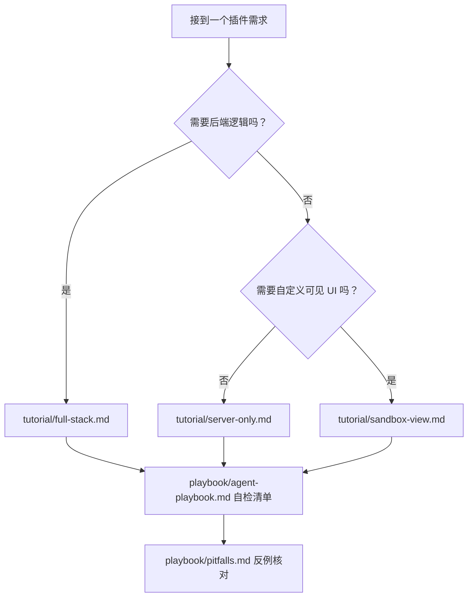

# OpenLearnV2 插件开发手册（AI Agent 版）

> 面向 **AI Agent** 与插件作者的单一事实来源（Single Source of Truth）。
> 全部契约、字段、默认值、限制条件均**从源码抽取**，不是人工誊抄。
> 每页末尾标注**取证位置**（仓库路径 → 符号名 → 行号区间），可按需回源核验。

**基线信息**

| 项          | 值                                      | 取证                                    |
| :---------- | :-------------------------------------- | :-------------------------------------- |
| 平台版本    | `0.7.7`                                 | `package.json`                          |
| 插件 SDK    | `@openlearn/plugin-sdk@3.7.5`           | `packages/plugin-sdk/package.json`      |
| 测试工具包  | `@openlearn/plugin-test-kit@3.3.3`      | `packages/plugin-test-kit/package.json` |
| 宿主运行时  | Node.js `20.x / 22.x / 24.x`（推荐 22） | `AGENTS.md`                             |
| 课件 Bridge | `@openlearn/bridge-sdk`                 | `packages/bridge-sdk/src/bridge.js`     |
| 数据库      | SQLite（`better-sqlite3`，同步 API）    | `packages/core/db/`                     |

> **枚举表是机器生成的，不要凭记忆或凭训练语料写。**
> 7 张权威事实表在 `contracts/`，由 `python3 audit-tools/agent_facts.py` 从源码抽取，
> CI 会校验它们与源码不漂移。你要写的每一个能力名 / Token 名 / 槽位名 / op 名，
> 都应该能在那里查到。

---

## 我该从哪一页开始？



**默认选 `server-only`。** 只有确实需要前端运行期桥接或自定义页面时才升级模板。

---

## 目标路由反查表（"我要做 X → 读哪页"）

> 这是给 AI 用的**反查索引**。先在这里定位，再进对应页面读细节，不要通读全手册。

| 我要做的事                              | 去读                                         | 关键小节                                                         |
| :-------------------------------------- | :------------------------------------------- | :--------------------------------------------------------------- |
| 决定用哪种插件形态                      | {doc}`playbook/agent-playbook`               | §1 决策树：选模板                                                |
| 写 manifest                             | {doc}`reference/manifest`                    | §1 顶层字段总表 / §2 `requires` 格式 / §4 `contributes` 校验强度 |
| 让界面出现在宿主某个位置                | {doc}`reference/contributes-slots`           | §0 四组命名空间 / §3 逐槽位 `slotProps`                          |
| 往沙箱里画一个自定义页面                | {doc}`tutorial/sandbox-view`                 | §3 HTML 放哪 / §5 Bridge 确切成员                                |
| 注册一个命令                            | {doc}`reference/command-and-event`           | §2 `registerHandler` 实际行为 / §4 default-deny                  |
| 发布一个 AI Action（给 Agent 用的工具） | {doc}`reference/ai-actions`                  | §1 `ActionDescriptor` / §3 `inputSchema` 类型必须大写            |
| 声明并申请权限                          | {doc}`reference/capabilities`                | §1 一次命令派发的完整管线 / §4 能力是怎么被授予的                |
| 用 `ctx.resolve` 拿宿主服务             | {doc}`reference/token-reference`             | §3 31 个可解析 Token                                             |
| 建表 / 存数据                           | {doc}`reference/database`                    | §2 `PluginDatabaseAPI` / §3 `ensureTable` 的 SEC 校验            |
| 定时任务 / 后台长任务                   | {doc}`reference/background-and-config`       | §3 `ctx.services.processManager`                                 |
| 暴露 REST / SSE 接口                    | {doc}`reference/http-api`                    | §2 `IPluginHttpRouter` / §4 匹配顺序                             |
| 读配置                                  | {doc}`reference/background-and-config`       | §2 `ctx.config`                                                  |
| 知道 `ctx` 上到底有什么                 | {doc}`reference/plugin-context`              | §1 完整签名 / §2 `services` 的 `null` 语义                       |
| 查某个服务能干什么                      | {doc}`reference/platform-services`           | §1 `ctx.services` 的 9 个成员                                    |
| 打包 / 签名 / 上架                      | {doc}`reference/publishing-and-distribution` | 全页                                                             |
| SDK 升级 / 版本兼容                     | {doc}`reference/versioning-and-migration`    | 全页                                                             |
| 看日志 / 排障                           | {doc}`reference/debugging-and-logging`       | 全页                                                             |
| 写测试                                  | {doc}`reference/testing`                     | §2 `createMockContext` / §3 Mock 与生产宿主的差异                |
| **不知道会踩什么坑**                    | {doc}`playbook/pitfalls`                     | §A–§E 全部                                                       |
| **想知道某个结论凭什么**                | {doc}`reference/source-map`                  | §2 按主题 → 权威源文件                                           |
| **两套文档说法冲突**                    | {doc}`facts-ledger`                          | §0 裁决速查（15 条）                                             |

---

## 三条最高优先级的现实校准

在写第一行代码前，先接受这三条。它们与「一般插件框架」的直觉**相反**，是模型出错率最高的地方。

```{warning} ⚠ 与 LLM 先验冲突
1. **第三方插件的前端拿不到 React。** ZIP 插件的 `frontend.js` 在 `sandbox="allow-scripts"`
   的**隐藏不透明源 iframe**（`/plugin-sandbox/frame`）里执行。它有**自己的** `document`，
   但拿不到宿主 DOM、没有 `window.HostSharedDeps`、没有网络（CSP `connect-src 'none'`），
   而且这个文档 `display: none`，**画什么都不会被用户看见**。在沙箱里
   `registerExtensionPoint` 传 `component: () => import(...)`，函数过不了
   `postMessage` 的结构化克隆，浏览器直接抛 `DataCloneError`。
   → 自定义可见 UI 的唯一正道：在 manifest 的 `contributes` 里声明 `view: "xxx.html"`，
     由宿主挂载**可视沙箱**，页面内用 `window.OpenLearnPluginBridge` 通信。

2. **`ctx.services.*` 的运行时类型是 `T | null`。** 声明在 `manifest.optional` 里的依赖若
   版本不匹配，宿主不阻止激活，而是把对应 key **置为 `null`**。按类型直接链式调用会运行时空指针。
   → 消费可选服务前必须判空。

3. **表名不能硬编码。** `ctx.db.ensureTable('configs', ...)` 实际建出的表是
   `plugin_{pluginId}_{configs}`。裸写 `FROM configs` 查不到任何东西。
   → 一律用 `ctx.db.table('configs')` 生成表名。
```

---

## 机器可读的事实表

`contracts/` 下的 JSON 由 `audit-tools/agent_facts.py` 从源码抽取，CI 校验不漂移。
**要写枚举值，先查这里，不要凭印象。**

| 文件                                | 内容                                           | 数量       |
| :---------------------------------- | :--------------------------------------------- | :--------- |
| `contracts/capabilities.json`       | 能力的三套登记：命令闸门 / 方法级 / 运行时权限 | 19 / 8 / 7 |
| `contracts/tokens.json`             | 可解析 Token；SDK 导出与可解析集合的差         | 31 / 32    |
| `contracts/slots.json`              | `ExtensionSlot` 成员 + 有渲染调用点的 anchor   | 120 / 8    |
| `contracts/contributes-groups.json` | `contributes` 的 A 严格键 / B 宽松键           | 71 / 38    |
| `contracts/bridge-ops.json`         | frame 通道 op / view 通道 wire op              | 10 / 8     |
| `contracts/forbidden-tables.json`   | SQL 禁写表黑名单                               | 40         |
| `contracts/versions.json`           | 版本基线                                       | —          |

---

## 页面导航

```{toctree}
:maxdepth: 2
:numbered: 1
:caption: 一、先读这两页

playbook/agent-playbook
playbook/pitfalls
```

```{toctree}
:maxdepth: 2
:numbered: 1
:caption: 二、教程

tutorial/agent-tutorial
tutorial/server-only
tutorial/full-stack
tutorial/sandbox-view
```

```{toctree}
:maxdepth: 2
:numbered: 1
:caption: 三、声明层

reference/manifest
reference/contributes-slots
```

```{toctree}
:maxdepth: 2
:numbered: 1
:caption: 四、服务端运行时

reference/plugin-context
reference/platform-services
reference/token-reference
reference/command-and-event
reference/ai-actions
reference/capabilities
reference/database
reference/http-api
reference/background-and-config
```

```{toctree}
:maxdepth: 2
:numbered: 1
:caption: 五、前端运行时

reference/frontend-sandbox
```

```{toctree}
:maxdepth: 2
:numbered: 1
:caption: 六、发布、版本与排障

reference/publishing-and-distribution
reference/versioning-and-migration
reference/debugging-and-logging
```

```{toctree}
:maxdepth: 2
:numbered: 1
:caption: 七、测试、隔离与回源

reference/testing
reference/isolation-and-security
reference/agent-quickstart
reference/source-map
```

```{toctree}
:maxdepth: 2
:numbered: 1
:caption: 八、事实裁决

facts-ledger
```

---

## 文档约定

| 记号                  | 含义                                                               |
| :-------------------- | :----------------------------------------------------------------- |
| **必须** / `MUST`     | 违反则插件装不上、激活失败或进入 `ERROR` 状态（硬约束）            |
| **应当** / `SHOULD`   | 违反不报错但会产生错误行为（静默失效、归属错乱等）                 |
| **禁止** / `MUST NOT` | 反模式；多数情况下平台会静默容忍但功能不生效                       |
| `⚠ 与 LLM 先验冲突`   | 该处与训练语料中常见的插件框架写法不一致，模型极易写错，已单独标注 |
| _取证_                | 页面末尾的源码路径 → 符号名 → 行号区间，结论可回源核验             |
| `未验证`              | 快照中未直接取证，仅为推断，使用前请回源确认                       |

---

## 与平台主文档的关系

本手册是平台 `docs/` 的**专精子树**，只覆盖「第三方插件开发」这一件事，做到更深。
平台主文档仍覆盖架构、部署、运维、管理员、发布日志等主题。

**两者的可信度不同**：平台 `docs/` 里 `release-notes/` 与 `audit/` 是**历史快照**，
不是当前事实；`docs/agent/facts-ledger.md` §4 说明了两套文档的关系与已知冲突。
