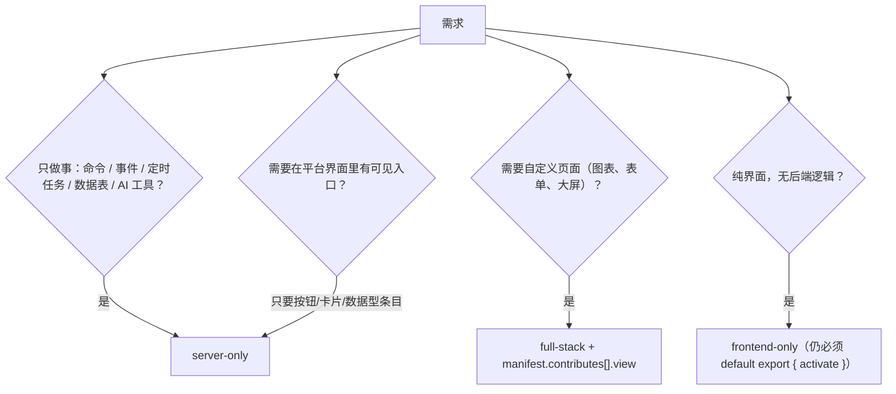

# Agent 工作手册

本页是给 **AI Agent** 的执行规程。目标：一次生成即可安装、即可激活、即可通过 CI 的插件。
按顺序执行，不要跳步。

---

## 0. 三条最高优先级的现实校准

在写第一行代码前，先接受这三条。它们与「一般插件框架」的直觉相反，是模型出错率最高的地方。

```{warning} ⚠ 与 LLM 先验冲突
1. **第三方插件的前端拿不到 React。** ZIP 插件的 `frontend.js` 在 `sandbox="allow-scripts"`
   的**隐藏不透明源 iframe**（`/plugin-sandbox/frame`）里执行。它有**自己的** `document`，
   但拿不到宿主 DOM、没有 `window.HostSharedDeps`、没有网络（CSP `connect-src 'none'`），
   而且这个文档 `display: none`，**画什么都不会被用户看见**。在沙箱里
   `registerExtensionPoint` 传 `component: () => import(...)`，函数过不了
   `postMessage` 的结构化克隆，浏览器直接抛 `DataCloneError`。
   → 自定义可见 UI 的唯一正道：在 manifest 的 `contributes` 里声明 `view: "xxx.html"`，
     由宿主挂载**可视沙箱**，页面内用 `window.OpenLearnPluginBridge` 通信。
     见 [前端沙箱能力边界](../reference/frontend-sandbox.md)。

2. **`ctx.services.*` 的运行时类型是 `T | null`。** 声明在 `manifest.optional` 里的依赖若
   版本不匹配，宿主不阻止激活，而是把对应 key **置为 `null`**。按类型直接链式调用会运行时空指针。
   → 消费可选服务前必须判空。

3. **表名不能硬编码。** `ctx.db.ensureTable('configs', ...)` 实际建出的表是
   `plugin_{pluginId}_{configs}`。裸写 `FROM configs` 查不到任何东西。
   → 一律用 `ctx.db.table('configs')` 生成表名。
```

---

## 1. 决策树：选模板



| 模板            | 产物                             | 适用                                                                | 照做教程                       |
| :-------------- | :------------------------------- | :------------------------------------------------------------------ | :----------------------------- |
| `server-only`   | `index.js` + zip                 | 后端能力扩展、数据落库、AI Action、批处理任务                       | {doc}`../tutorial/server-only` |
| `full-stack`    | `index.js` + `frontend.js` + zip | 需要运行期前端桥接（轮询、命令面板条目、命名空间存储）+ `view` 页面 | {doc}`../tutorial/full-stack`  |
| `frontend-only` | `index.js` + `frontend.js` + zip | 只做前端桥接；**不能**渲染 React 组件，也没有任何服务端 handler     | {doc}`../tutorial/agent-tutorial` §2    |

**默认选 `server-only`。** 只有确实需要前端运行期桥接或自定义页面时才升级模板。
自定义可见界面的完整走法在 {doc}`../tutorial/sandbox-view`。

---

## 2. 生成前的强制信息收集

缺少下列任一信息时，**先问用户，不要猜**（猜出来的 ID/能力名会直接导致装不上或 403）：

- [ ] 插件 `id`（第三方惯例 `@author/name`，由 `plugin-sdk init` 自动生成）与人类可读 `name`
- [ ] 需要哪些**能力**：只能从 [19 个真实能力字符串](../reference/capabilities.md) 里选，**不得杜撰**
      （`storage:*`、`ai:chat`、`process:execute` 等**不存在**）
- [ ] 命令类型命名：`{pluginId}.{verb}` 全限定形式（见 [命令命名空间隔离](../reference/command-and-event.md) §2.1）
- [ ] 事件类型命名：**过去式**，`{pluginId}.{resource}_{past}`
- [ ] 是否需要出网：需要则列出域名，写入 `manifest.network.outbound` **且**等待管理员在
      `plugin_network_grants` 中批准（清单不自动授权）
- [ ] 目标宿主版本（`engines.openlearn`）

---

## 3. 生成顺序（推荐 pipeline）

```
1. manifest 先行 —— 把所有对外声明（requires/optional/capabilities/contributes/api/classroomTools）
   写在最前面，它是校验最早、报错最便宜的地方。
2. 数据层 —— ctx.db.ensureTable(...) + ctx.db.table(...)，或 migrations/ 声明式 SQL。
3. 命令 Handler —— 每个 Handler 只做一件事，返回可 JSON 序列化的对象。
4. AI Action —— capabilityRequired 必须与 Handler 实际需要的权限一致；高危操作设 isHighRisk。
5. 事件订阅/发布 —— 发布时带 correlationId。
6. 可选服务判空 + 降级路径。
7. 前端（若需要）—— 只写 view HTML + Bridge，或数据型 registerExtensionPoint。
8. 单元测试 —— 用 @openlearn/plugin-test-kit 的 createMockContext 断言注册结果。
9. 自检 —— 见下方 §4 清单，逐条核对。
```

---

## 4. 交付前自检清单

### manifest

- [ ] `id` / `name` / `version` / `main` 四个必填齐全；`main` 指向实际入口文件名（脚手架模板为 `index.js`）
- [ ] `id` **不含冒号 `:`**（zod 直接拒绝；防止 actor `plugin:{id}` 伪造）
- [ ] `requires` / `optional` 每一项匹配 `^@scope/domain:IName(@[\^~]?x.y.z(-pre)?)?$`
- [ ] `capabilitiesProposed` 全部取自真实能力表，无杜撰
- [ ] `contributes` 的每个 slot 名在 [槽位全集](../reference/contributes-slots.md) 中存在；未知 slot 会被 `.passthrough()` 静默放行但**没有渲染器消费它**
- [ ] 第三方可见 UI 用 `view` 声明，不写 `component`

### 服务端

- [ ] `export default { manifest, activate, deactivate? }`，`activate(ctx)` 为 async
- [ ] 所有 `ctx.db` 建表都过 `ctx.db.table()` 取名
- [ ] `better-sqlite3` 调用**不加** `await`（同步 API）
- [ ] 消费 `optional` 服务前判 `null`
- [ ] 命令 Handler 返回值可 JSON 序列化（不返回 Buffer / 函数 / Date 实例）
- [ ] `ActionDescriptor.inputSchema` 用**大写** GenAI 类型：`OBJECT/STRING/NUMBER/INTEGER/BOOLEAN/ARRAY`
- [ ] 长耗时任务走 `ctx.services.processManager`，不在 Handler 里 `while` 阻塞
- [ ] 定时器/订阅在 `deactivate` 或宿主资源追踪范围内清理（宿主会随插件停用回收 Handler/订阅，**但不会回收你手写未注册的 `setInterval`**）
- [ ] 没有 `require('fs')` / `child_process` / 未白名单的 npm 包 —— `ctx.require()` 只放行 7 个共享模块

### 前端

- [ ] `frontend.js` **default export 一个带 `activate` 函数的对象**（宿主逐字检查 `typeof plugin.activate !== 'function'`，不满足即插件进错误态）
- [ ] 不在隐藏帧里画界面（它有 `document`，但 `display:none`，且 CSP 禁 style/img）
- [ ] 不用 `React`、不用 `fetch`/`WebSocket`
- [ ] 只用 10 个桥接 op：`api.get|post|del`、`storage.get|set|delete`、`ui.register`、`ui.toast`、`command.invoke`、`context.get`
- [ ] 实时性按**轮询**设计（2–5s），定时器在 `deactivate()` 里 `clearInterval`
- [ ] `registerExtensionPoint` 的 `commandType` 写**全限定名**（运行期注册不走 manifest 前缀化）
- [ ] 自定义页面 = `view` HTML + `window.OpenLearnPluginBridge`

### 测试与构建

- [ ] `npx @openlearn/plugin-sdk build` 成功产出 zip
- [ ] `pnpm test` 用 `createMockContext` 断言：命令已注册、AI Action 已注册、Handler 返回符合预期
- [ ] 正式分发用 `build --key` 或 `sign` 产出 Ed25519 签名

---

## 5. 失败态速查（现象 → 根因 → 修法）

| 现象                                             | 根因                                                     | 修法                                                                  |
| :----------------------------------------------- | :------------------------------------------------------- | :-------------------------------------------------------------------- |
| 装不上，报 `manifest.main 必须指定入口文件路径`  | 缺 `main`                                                | 补 `main: "index.js"`                                                 |
| 装不上，报 `manifest.id 不能包含 ":"`            | id 含冒号                                                | 改 id                                                                 |
| 装不上，报 `requires/optional 条目格式无效`      | 少了 `@scope/domain:` 前缀                               | 写成 `@openlearn/core:ICommandBusService@^1.0.0`                      |
| 激活即 `ERROR`，日志 `missing activate function` | 前端入口没导出 `activate`                                | 改成 `export default { activate, deactivate }`                        |
| 控制台 `DataCloneError`                          | 想把组件函数穿过 postMessage                             | 改用 `view` 沙箱页                                                    |
| 界面空白但插件状态 `active`                      | 在隐藏帧里画了 DOM（用户看不到），或 `view` 被 zod strip | UI 移到 `view` 页面                                                   |
| `Refused to connect`                             | 沙箱内 `fetch`/`WebSocket` 被 CSP 拦                     | 用 `frontendApi` 经宿主代发                                           |
| `Unsupported sandbox bridge op "xxx"`            | 用了未登记的桥方法                                       | 回到 10 个 op 里找替代                                                |
| SQL 报 `no such table: configs`                  | 硬编码表名                                               | 用 `ctx.db.table('configs')`                                          |
| 命令报 `COMMAND_CAPABILITY_DENIED`               | 能力未授予，或执行角色回退集合里没有该能力               | 管理员写 `plugin_capability_grants`；核对角色能力集                   |
| 命令被拒且插件直接 `ERROR`                       | 试图注册**别的插件 UUID 前缀**的命令                     | 只注册自己前缀下的命令                                                |
| 两个插件同名门禁有一个不生效                     | 未传 `owner`                                             | `registerGuard(guard, ctx.pluginId)`                                  |
| 定时器任务被算到别的插件头上                     | `setPluginOwner` 是全局单值                              | 用包装层 `spawn(..., ownerHint)` / `registerInterval(..., ownerHint)` |

---

## 6. 禁止清单（写出来就等着返工）

- 禁止在 `capabilitiesProposed` 里写 `*` 或杜撰能力名。
- 禁止把 `manifest.api.baseRoute` 当能力用 —— **它无任何路由作用**，真实路径固定为 `/api/plugins/{manifest.id}/*`。
- 禁止在 `frontend.js` 里 `import React`、`import 'react'`、或把 react 配成 external 后指望宿主注入。
- 禁止用 `ctx.resolve('@openlearn/core:SomeInternalThing')` 拿未公开的内部服务 —— 字符串 resolve 只允许命中
  [`PLUGIN_RESOLVABLE_TOKENS`](../reference/token-reference.md) 白名单，越界会**显式报错**。
- 禁止假设 `ctx.pluginId === manifest.id` —— 它是 `plugins` 表的行 UUID，且命名空间前缀规则在
  inline / worker 两种模式下取值不同。
- 禁止把高危操作设 `isHighRisk: false` 以绕过审批 —— 内核另有高危命令拦截。
- 禁止依赖 `window.HostSharedDeps`（沙箱 realm 内为 `undefined`）。

---

## 取证

| 结论                                 | 位置                                                                                                  |
| :----------------------------------- | :---------------------------------------------------------------------------------------------------- |
| 前端沙箱双轨制、10 个 op、轮询结论   | `docs/plugin/frontend-sandbox-capability-boundary.md`；`server/utils/plugin-view-bridge.ts`           |
| `activate` 硬契约、iframe 上下文形状 | `packages/plugin-sdk/scaffold/templates/full-stack/src/frontend.tsx`                                  |
| `services` 为 `T \| null`            | `packages/core/plugin-host/types.ts`（`PluginContext`，审计 E-4）                                     |
| manifest zod 规则                    | `packages/core/esm-loader/manifest-schema.ts`                                                         |
| 命令命名空间隔离                     | `docs_plugin_guide.md` §6.1；`packages/core/plugin-host/plugin-namespace.ts`                          |
| 表名沙箱                             | `packages/core/plugin-host/types.ts`（`PluginDatabaseAPI`）                                           |
| 能力真值集与角色回退                 | `docs/reference/plugin-capability-matrix.md`、`docs/plugin/plugin-manifest-spec.md` §2.3              |
| resolve 白名单                       | `packages/core/di/interfaces.ts`（`PLUGIN_RESOLVABLE_TOKENS`，审计 E-2）                              |
| owner/ownerHint 归属                 | `packages/core/di/interfaces.ts`（`IProcessService`，B-5）；`IStageGuardService.registerGuard`（I-3） |
| `baseRoute` 无作用                   | `packages/core/esm-loader/manifest-schema.ts`（`apiSchema`，审计 P1）                                 |
