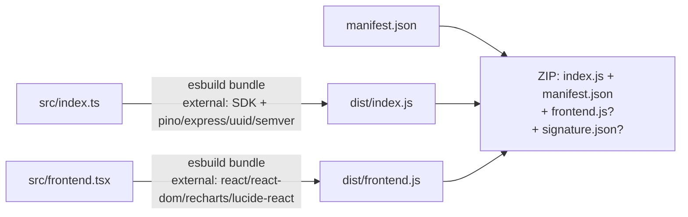

# 发布与分发

> **适用范围**：`@openlearn/plugin-sdk@3.7.5` / OpenLearnV2 v0.7.7
> 解决一个问题：**插件写完了，怎么变成一个能被装上的 ZIP？ZIP 里到底该有什么？**

---

## 0. 先纠正四个先验

```{danger} ⚠ 与 LLM 先验冲突 1：ZIP 里只有三个文件
**ZIP 不是「把项目目录打包」，只装四样东西**：

| ZIP 内路径 | 来源 | 必需 |
| :--- | :--- | :--- |
| `index.js` | `dist/index.js`（`src/index.ts` 的 esbuild 产物） | ✅ |
| `manifest.json` | 项目根的 `manifest.json` | ✅ |
| `frontend.js` | `dist/frontend.js`（`src/frontend.tsx` 的产物） | 仅当项目有 `src/frontend.tsx` |
| `signature.json` | `sign` 或 `build --key` 生成 | 仅当签名 |

**`views/` 下的 HTML、`storage/` 下的静态资源、`node_modules`、源码 —— 一律不进 ZIP。**
`build` 命令不做「目录打包」，它只逐个 `zip.file(...)` 那三个文件。
```

```{danger} ⚠ 与 LLM 先验冲突 2：`storage/` 里的静态资源不会自动进包
宿主安装时**会**解出 ZIP 里 `storage/` 开头的条目（`install.ts` 的 `storageEntries` 过滤），
但 **SDK 的 `build` 不会把 `storage/` 塞进 ZIP**。
→ 想让图片/字体/模板随插件分发，**必须自己把 `storage/` 加进 ZIP**，否则运行期
读不到资源，且**没有任何报错**。
```

```{warning} ⚠ 与 LLM 先验冲突 3：`@openlearn/plugin-sdk` 不会被打进包
后端 bundle **不包含 SDK**，也不包含宿主提供的 `pino` / `express` / `uuid` / `semver`。
这些由宿主在运行期提供。所以**不要**把 SDK 设成 `dependencies` 想「打进包里带过去」——
那会让产物重复且可能版本冲突。SDK 应该留在 `devDependencies`。
```

```{warning} ⚠ 与 LLM 先验冲突 4：`sign` 要 Ed25519 私钥，不是任意密钥
签名用的是 **Ed25519** 私钥（PEM 文件）。用 RSA 密钥会在 `createPrivateKey` 阶段直接抛错。
`build --key <pem>` 会在打包时顺手签；`sign --key <pem> <zip>` 则对已有 ZIP 单独签。
```

---

## 1. 三个命令

```bash
# 初始化脚手架（交互式；--template 可选 server-only / full-stack）
npx @openlearn/plugin-sdk init

# 构建：产出 dist/index.js 与 dist/frontend.js
npx @openlearn/plugin-sdk build

# 监听重建
npx @openlearn/plugin-sdk build --watch        # 或 -w

# 构建并签名（一步到位）
npx @openlearn/plugin-sdk build --key publisher.pem

# 对已有 ZIP 单独签名
npx @openlearn/plugin-sdk sign --key publisher.pem my-plugin.zip
```

| 参数 | 含义 |
| :--- | :--- |
| `--watch` / `-w` | 监听源码变化自动重建 |
| `--key <file>` / `--sign <file>` / `-k <file>` | Ed25519 私钥 PEM 路径；`build` 时给则一并签名 |
| `--publisher <name>` | 签名里的发布者名；不给则取 `manifest.author`，再不给则 `community` |

> `build` 需要 `jszip`（作为 devDependency）。缺了会明确报错
> `Error: jszip not found. Install it: npm install --save-dev jszip`。
> 构建本身用 `esbuild`；项目没装 esbuild 时会尝试回退到 SDK 自带的副本。

---

## 2. `build` 到底做了什么



**关键点**

1. **后端产物 `dist/index.js`**：esbuild 打包 `src/index.ts`。
   `@openlearn/plugin-sdk` 及其传递依赖 `pino` / `express` / `uuid` / `semver` 被标记为 external。
2. **前端产物 `dist/frontend.js`**：仅当项目存在 `src/frontend.tsx` 才产出。
   `react` / `react-dom` / `recharts` / `lucide-react` 是 external —— 它们由宿主在
   frame 沙箱里提供（见 {doc}`frontend-sandbox`）。
3. **前端裸模块守卫**：构建时会对 `frontend.js` 跑 `frontendBareSpecifierGuard`，
   产物里残留 `import 'xxx'` 这类裸模块说明符会被判失败 —— 因为 frame 沙箱的
   加载器按「浏览器原生模块」执行，裸说明符解析不了。这道守卫自 **SDK 3.7.4** 起生效。
4. **没有 `src/frontend.tsx` 但 manifest 声明了 `contributes` / `view`**：
   构建会打印提示，按「纯声明式插件」处理，**不算错误**。

---

## 3. ZIP 里到底装了什么

```bash
# 构建完成后直接看
unzip -l dist/my-plugin.zip
```

期望输出形如：

```
  index.js          ← 后端 bundle
  manifest.json     ← manifest 原文
  frontend.js       ← 仅当有 src/frontend.tsx
  signature.json    ← 仅当签名
```

**想额外带 `storage/` 静态资源**，在 `build` 之后自己补：

```javascript
// scripts/with-assets.mjs —— 在 build 之后追加 storage/ 条目
import { readdirSync, readFileSync, statSync } from 'node:fs';
import { join, relative } from 'node:path';
import JSZip from 'jszip';

const zipPath = 'dist/my-plugin.zip';
const zip = await JSZip.loadAsync(readFileSync(zipPath));
const root = 'storage';

function walk(dir) {
  for (const name of readdirSync(dir)) {
    const abs = join(dir, name);
    if (statSync(abs).isDirectory()) walk(abs);
    else zip.file(relative('.', abs), readFileSync(abs));
  }
}
if (statSync(root).isDirectory()) walk(root);

await zip.generateAsync({ type: 'nodebuffer' }).then((b) =>
  import('node:fs').then((fs) => fs.writeFileSync(zipPath, b)),
);
```

> 宿主安装时会对 `storage/` 条目做 **Zip Slip 校验**（路径含 `..` 直接拒绝），
> 并对解压总量做 **ZIP bomb 限额**校验。超限会报
> `ZIP bomb prevention: storage assets total N bytes exceeds limit`。

---

## 4. 签名

```bash
# 生成 Ed25519 私钥（只需一次）
openssl genpkey -algorithm ed25519 -out publisher.pem

# 用它构建
npx @openlearn/plugin-sdk build --key publisher.pem
```

**签名做了什么**

1. 从 ZIP 里**移除**已有的 `signature.json`，在**未签名内容**上算 SHA-256 完整性哈希；
2. 组装 attestation 载荷：

   ```
   openlearn-plugin-attestation-v2\n<manifest.id>\n<manifest.version>\n<integrity-sha256-hex>
   ```

3. 用 Ed25519 私钥对该载荷签名，结果写回 ZIP 内的 `signature.json`；
4. 对最终 ZIP（含 `signature.json`）再算一次外层哈希，供外部注册表元数据比对。

**要点**

- 私钥**绝不能**进仓库。CI 里用 secret 注入。
- `sign` 子命令签名的是**已经存在的 ZIP**，且会先清掉旧的 `signature.json` 再重签 —— 重复签名不会叠加。
- 改过 `manifest.json` 或任一产物后，签名即失效，必须重新签。

---

## 5. 安装

在 OpenLearn 插件中心上传 `.zip`，或走命令行的插件安装接口。安装流程：

1. 读 ZIP 里的 `manifest.json`，跑 `manifestSchema` 校验；
2. 解出 `index.js` / `frontend.js`；
3. 解出 `storage/` 条目（若存在），逐条做 Zip Slip 与体积校验；
4. 自动安装 manifest 里声明的依赖（`requires` / `optional`）；
5. 注册贡献、落库、置状态机。

安装期失败会给出具体阶段（`extracting` / …）与原因，见下面速查表。

---

## 6. 排障速查

| 现象 | 根因 | 修法 |
| :--- | :--- | :--- |
| `Error: jszip not found` | 缺 `jszip` 依赖 | `npm i -D jszip` |
| `Error: Private key file not found: xxx.pem` | `--key` 路径相对 cwd 解析 | 用相对项目根的路径，或先 `cd` 到项目根 |
| `createPrivateKey` 抛错 | 用的是 RSA 密钥 | 换成 Ed25519：`openssl genpkey -algorithm ed25519` |
| 装上后前端白屏，控制台 `Uncaught SyntaxError: Cannot use import statement` | `frontend.js` 里有裸模块说明符 | 用 SDK ≥ 3.7.4 构建；自检产物里有没有 `import 'xxx'` |
| 装上后报 `missing activate function` | SDK 版本太老，生成的是 `export default function Component()` 模板 | 升到 SDK ≥ 3.7.5 并重新 `init` |
| `ERR_MODULE_NOT_FOUND: Cannot find package 'uuid'` | SDK < 3.7.5 缺 `uuid` 运行时依赖 | 升 SDK 到 3.7.5；临时绕过是手工在 `package.json` 补 `"uuid": "^14.0.2"` |
| 插件装上了但界面空白，**无任何报错** | manifest 里声明的 `view` HTML 没进 ZIP（`build` 不收 `views/`） | 见 §3，手工把视图 HTML 加进 ZIP；并确认 `manifest.contributes` 的键没被 zod strip |
| 图片/模板读不到，404 | `storage/` 资源没进 ZIP | 同上 |
| `Security Violation: Zip Slip detected in asset path "..."` | ZIP 条目路径含 `..` | 重新打包，路径不要带 `..` |
| `ZIP bomb prevention: storage assets total N bytes exceeds limit` | `storage/` 解压后超限 | 压缩资源体积或改用外链 |
| `manifest.id 不能包含 ":"` | actor 命名空间保护 | 改 id（详见 {doc}`manifest`） |
| 安装后插件状态是 `ERROR` | manifest 校验失败 | 看安装日志的具体字段错误，对照 {doc}`manifest` §1 字段表 |
| 签名校验失败 | 产物在签名之后被改过 | 重新 `build --key` 一次，或先 `sign` 再上传 |

---

## 7. 自检清单

```bash
# 逐条可 grep 判定
unzip -l dist/my-plugin.zip | grep -q 'index.js'          # 有后端产物
unzip -l dist/my-plugin.zip | grep -q 'manifest.json'     # 有 manifest
# 有 src/frontend.tsx 才要求 frontend.js
test -f src/frontend.tsx && unzip -l dist/my-plugin.zip | grep -q 'frontend.js'
# 需要静态资源时，storage/ 条目必须在包里
test -d storage && unzip -l dist/my-plugin.zip | grep -q 'storage/'
# 前端产物不得有裸模块说明符
! grep -qE "^import ['\"]" dist/frontend.js
# manifest 与签名一致
unzip -p dist/my-plugin.zip manifest.json | grep -q '"version"'
```

- [ ] `dist/` 里的 ZIP 用 `unzip -l` 确认过内容清单
- [ ] 私钥没进仓库（`git check-ignore publisher.pem` 或已加 `.gitignore`）
- [ ] `manifest.json` 的 `id` 不含 `:`，`main` 字段存在
- [ ] `manifest.json` 的 `version` 与已发布版本号不同（重装会被拒绝或被当作同版本）
- [ ] `engines.openlearn` 覆盖目标宿主版本（见 {doc}`versioning-and-migration`）
- [ ] SDK 版本 ≥ 3.7.5
- [ ] 签名在**最后一次改动产物之后**生成

---

## 取证

| 结论 | 位置 |
| :--- | :--- |
| CLI 的三个子命令与参数 | `packages/plugin-sdk/cli.mjs` → `main`（L669–L712） |
| ZIP 只装 `index.js` / `manifest.json` / `frontend.js` | `packages/plugin-sdk/cli.mjs` → `build`（L546–L551） |
| 私钥参数 `--key` / `--sign` / `-k`，缺失即报错 | `packages/plugin-sdk/cli.mjs` → `build`（L557–L566） |
| `--publisher` 与发布者回退顺序 | `packages/plugin-sdk/cli.mjs` → `build`（L559–L560） |
| 签名流程与 attestation 载荷格式 | `packages/plugin-sdk/cli.mjs` → `signZip` / `buildAttestationPayload`（L227–L259） |
| attestation 前缀 `openlearn-plugin-attestation-v2` | `packages/plugin-sdk/cli.mjs` → `ATTESTATION_V2_PREFIX`（L227） |
| 后端 external 依赖与 SDK 不打包 | `packages/plugin-sdk/cli.mjs` → `build`（L411–L420 注释段） |
| 前端 external：react / react-dom / recharts / lucide-react | `packages/plugin-sdk/cli.mjs` → `build`（L451 附近） |
| 前端裸模块守卫 | `packages/plugin-sdk/cli.mjs` → `frontendBareSpecifierGuard` |
| 宿主解出 `storage/` 条目 | `packages/core/plugin-host/install.ts` → `storageEntries`（L358–L360） |
| Zip Slip 校验与 ZIP bomb 限额 | `packages/core/plugin-host/install.ts`（L365–L400） |
| `manifest.id` 禁止含 `:` | `packages/core/esm-loader/manifest-schema.ts` → `manifestSchema`（L795） |
| SDK 版本沿革（3.7.0/3.7.1/3.7.4/3.7.5） | `packages/plugin-sdk/CHANGELOG.md` |
