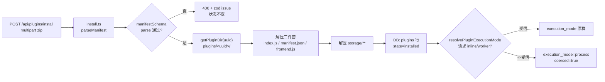
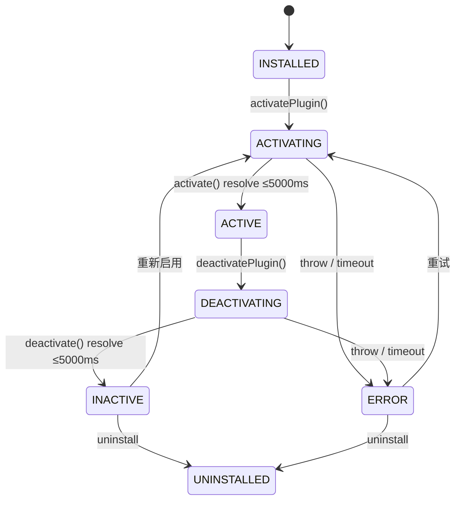
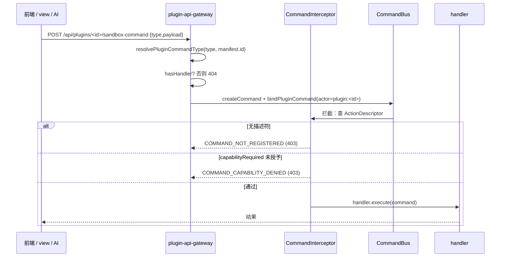
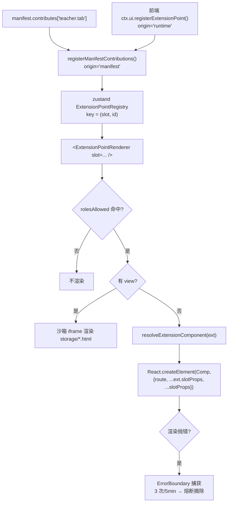
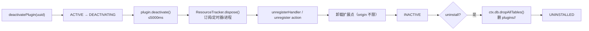

# 关键执行链路

每条链路给出：**起点 → 终点 → 逐跳文件与符号 → 状态变化 → 失败分支**。
所有行号来自平台 `0.7.8` / commit `4f41c9b`。

---

## 链路 A：插件如何进入系统（安装）



| 步骤 | 文件 | 符号 / 行为 |
| --- | --- | --- |
| 1. 解析 manifest | `packages/core/plugin-host/install.ts` | `extractManifest(sourceCode)`（L101）；`main` 缺省回落 `'index.js'`（L106） |
| 2. 校验 | `packages/core/esm-loader/manifest-schema.ts` | `manifestSchema.parse()`（L787） |
| 3. 落盘 | `install.ts` | `getPluginDir(pluginId)`（L160）、`package.zip`（L327） |
| 4. 提取前端产物 | `install.ts` | `zip.file('frontend.js')`（L337） → `plugins/<uuid>/frontend.js` |
| 5. 提取静态资源 | `install.ts` | 谓词 `name.startsWith('storage/') && !zip.files[name].dir`（L359） |
| 6. 模式求值 | `execution-policy.ts` | `resolvePluginExecutionMode(manifestId, requested, env, sourcePath)`（L116） |

**失败分支**：

| 触发 | 结果 | 证据 |
| --- | --- | --- |
| `manifest.id` 含 `:` | zod refine 失败，安装 400 | `manifest-schema.ts`（L792-795） |
| `manifest.main` 为空 | zod 失败 | 同文件（L798） |
| ZIP 内 `storage/` 缺失 | **不报错**，`view` 页面 404 | 解压谓词只匹配该前缀 |
| 请求 `inline` 但不受信 | **不报错**，静默改写为 `process` | `resolvePluginExecutionMode` 返回 `coerced:true` |

---

## 链路 B：插件如何被激活



| # | 动作 | 文件 → 符号 |
| --- | --- | --- |
| 1 | 校验状态迁移合法（`INSTALLED/INACTIVE/ERROR → ACTIVATING`） | `lifecycle.ts → validateTransition`（L120 前） |
| 2 | 置 `ACTIVATING` | `lifecycle.ts`（L122-123） |
| 3 | `import()` 载入 `plugins/<uuid>/index.js` | `packages/core/esm-loader/node-loader.ts`；超时抛 `EsmLoadTimeoutError(ACTIVATION_TIMEOUT_MS)`（`lifecycle.ts` L467） |
| 4 | 构造 `PluginContext` | `context-builder.ts → buildContext` |
| 5 | 调 `plugin.activate(ctx)` | 由 `lifecycle.ts` 调度，整体受 5s 超时保护 |
| 6 | 置 `ACTIVE` | 成功后 `setPluginState(pluginId, ACTIVE)` |

**失败与自愈**：

| 现象 | 处理 | 证据 |
| --- | --- | --- |
| 上次进程崩在 `ACTIVATING` | 重试前先 `ACTIVATING → ERROR` | `lifecycle.ts`（L89-91）`Recovering stuck ACTIVATING state` |
| 上次崩在 `DEACTIVATING` | 重试前先 `DEACTIVATING → INACTIVE` | `lifecycle.ts`（L665-666） |
| `activate()` 抛错 | 状态 → `ERROR`，资源回滚 | `PluginActivateError`（`errors.ts` L53） |
| 停用与激活竞态 | 停用请求等待激活跑完（最多 10s） | `waitForLifecycleIdle(pluginId, 10_000)`（`lifecycle.ts` L651） |

> **激活期是能力门禁的判定窗口**：`process`/`worker` 下，`activate()` 内调用任何非 `get*` RPC
> 都需要 `capabilitiesProposed` 非空（ServiceHost Barrier 2）。激活期越干净，插件越容易装上就能跑。
> 见 [capabilities-and-security.md](../plugin-system/capabilities-and-security.md) §3。

---

## 链路 C：命令派发（default-deny 全链）



| 环节 | 规则 | 证据 |
| --- | --- | --- |
| 补前缀 | 已以 `${manifest.id}.` 开头 → 原样；UUID v7 前缀 → 原样；否则前置 | `plugin-namespace.ts → resolvePluginCommandType`（L62-67） |
| 无 handler | 404 `No handler registered for command type "<type>".` | `server/routes/plugins.ts`（sandbox-command 分支） |
| 无描述符 | 403 `COMMAND_NOT_REGISTERED` | default-deny 拦截器（`docs/agent` 与 `troubleshooting` 一致） |
| 能力不足 | 403 `COMMAND_CAPABILITY_DENIED` | 同上 |
| 执行期异常 | 500 + `sendSafeError` 脱敏 | `server/routes/plugins.ts` |

**四种位置的命令名语义**（写错不报错，只在运行期 403）：

| 写在哪 | 写什么 | 是否自动加前缀 |
| --- | --- | --- |
| `commandBus.registerHandler(type, …)` | 短名 `lab_seat.check_in` | ✅ |
| `actionRegistry.register({ commandType })` | 短名 | ✅ |
| `manifest.classroomTools[].commandType` / `contributes.*` | 短名 | ✅ |
| 运行期 `ctx.ui.registerExtensionPoint({ slotProps:{ commandType } })` | **必须全限定** `<manifest.id>.xxx` | ❌ |
| view 页面 `bridge.invokeCommand(type)` | 短名或全限定都行（服务端会补） | ✅ |

---

## 链路 D：一个槽位如何被渲染出来



| 规则 | 值 | 证据 |
| --- | --- | --- |
| 注册主键 | `(slot, id)`，同键幂等覆盖 | `plugin-host-store.ts → registerExtensionPoint` |
| props 合并顺序 | `route` → `...ext.slotProps` → `...slotProps`（后者覆盖前者） | `extension-point-renderer.tsx`（L519-536） |
| 组件形态 | 直接组件，或带 `__isLazyFactory = true` 的 lazy 工厂 | `types.ts → ExtensionPointConfig.component` 注释（L274-282） |
| 角色门控 | `rolesAllowed`，**注册时**求值一次 | `types.ts`（L290） |
| `origin` 语义 | `manifest` = 数据贡献，前端崩了也保留；`runtime` = 随前端健康度生死 | `types.ts`（L303-315） |
| 熔断阈值 | 3 次 / 5 分钟滑窗 | `extension-breaker.ts`（L14-15） |

> **为什么 `origin` 很重要**：v0.7.0 的「Tab 闪现后消失」根因就是插件前端加载失败时把 manifest 贡献一并摘掉。
> 现在 `origin:'manifest'` 的条目在 `catch` 分支被 `preserveManifestContributions` 保留。

---

## 链路 E：插件如何退出系统



| 宿主自动做的事 | 插件**不需要**做的事 |
| --- | --- |
| 退订 `eventBus.subscribe` 注册的 handler | 手动 `unsubscribe`（但重复激活场景必须自己保证幂等） |
| 注销 `commandBus.registerHandler` | 手动 `unregisterHandler` |
| 注销 `actionRegistry.register` | 手动 `unregister` |
| 清空扩展点（含 manifest 贡献） | 手动 `unregisterExtensionPoint` |
| `dropAllTables()`（仅 uninstall） | 手动 DROP TABLE |

**插件必须自己清理的**（宿主管不到）：

1. 自建 `setInterval` / `setTimeout`；
2. 第三方 SDK 连接（MQTT/WebSocket 客户端）；
3. 模块级可变状态（`let cache = ...`）—— 重复激活会累积；
4. `process` 模式下 `ctx.services.processManager.registerInterval` 之外的常驻任务。

**失败分支**：`deactivate()` 超时 → `PluginDeactivateTimeoutError(pluginId, 5000)`（`errors.ts` L72），状态置 `ERROR`；
下一次启用会先做 `DEACTIVATING → INACTIVE` 自愈，再走正常激活。

---

## 时序汇总（一张图看完四条边界）

```text
[浏览器] 前端插件  --postMessage(call/op)-->  FrontendPluginHost  --fetch-->  /api/plugins/:id/*
                                                   |                              |
                                                   |（inline 才有）                 v
                                                   +-------------------------> PluginHost(主进程)
                                                                                  |
                                     process/worker RPC <-------------------------+
                                              |
                                              v
                                     ServiceHost(Barrier 1/2/3) --> CommandBus/EventBus/DB
```
