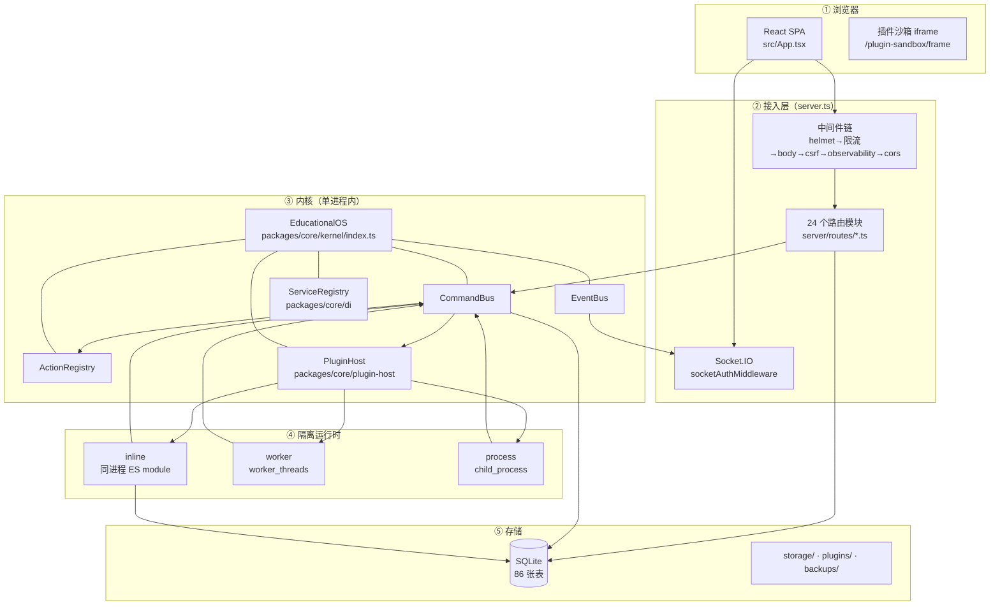

# 平台总览：OpenLearn-Next 是怎么拼起来的

> 读者：需要在不读 22 万行代码的前提下，判断「一个新功能该落在哪一层」的 AI Agent。
> 路径约定：所有路径相对本仓库 `openlearn-next` 根；`[P]` = 外部示例插件仓库 `openlearn-plugin-lab-seat`。

---

## 0. 一句话定位

OpenLearn-Next 是一个**单体进程的模块化教育操作系统**：Express + Socket.IO 提供 HTTP/实时入口，
一个自研内核（`EducationalOS`）持有命令总线、事件总线、DI 容器与插件宿主，
前端是单页 React 应用但**没有路由表**，页面由扩展槽位拼装而成。

---

## 1. 规模基线

| 层           | 文件数（不含测试） | 行数    | 入口                                                                    |
| ------------ | ------------------ | ------- | ----------------------------------------------------------------------- |
| 服务端入口   | 1                  | 751     | `server.ts`                                                             |
| 服务端模块   | 99                 | 37,719  | `server/`（`routes/` 24 个、`middleware/` 6 个、`services/`、`utils/`） |
| 前端         | 521                | 125,645 | `src/App.tsx`                                                           |
| 内核子系统   | 322                | 47,913  | `packages/core/`（29 个子目录）                                         |
| 内置插件     | 9                  | 6,448   | `packages/plugins/`                                                     |
| Plugin SDK   | 10                 | 9,209   | `packages/plugin-sdk/`                                                  |
| 插件测试工具 | 1                  | 645     | `packages/plugin-test-kit/`                                             |
| 活动生态     | 7                  | 768     | `packages/activity-ecosystem/`                                          |
| E2E          | 32                 | 7,796   | `e2e/`                                                                  |

合计约 **228k 行** TS/TSX。数据库 **86 张表**，迁移脚本 **45 个** SQL 文件。

---

## 2. 五层结构



**关键判定**：跨层调用必须顺着箭头；反向（如 `packages/core/**` import `server/**`）在仓库里不存在，
是硬约束而非约定。

---

## 3. 三条数据通路（选错就白干）

| 通路         | 起点                   | 终点                        | 何时用                                       | 证据                                                  |
| ------------ | ---------------------- | --------------------------- | -------------------------------------------- | ----------------------------------------------------- |
| **命令**     | 前端 / AI Agent / 插件 | `CommandBus` → handler      | 需要**授权检查**、需要被 AI 看见、需要跨进程 | `packages/core/kernel/index.ts` L303 `setInterceptor` |
| **HTTP API** | 前端 / 外部系统        | `server/routes/*.ts`        | 纯 CRUD、文件流、SSE、需要 REST 语义         | `server/routes/` 共 24 个文件                         |
| **事件**     | 内核 / 插件            | `EventBus` → Socket.IO 房间 | 服务端已发生的事实广播给前端                 | `server/event-routing.ts` → `SOCKET_ROUTES`（L263）   |

**判据**：若操作需要权限分级（学生不能给分），必须走**命令**；只走 HTTP 路由等于绕过能力闸门。
若操作只是读数据，走 HTTP 路由最省事。

---

## 4. 进程与线程边界

```text
主进程（唯一）
├── Express + Socket.IO
├── EducationalOS 内核（CommandBus / EventBus / ActionRegistry / ServiceRegistry）
├── PluginHost（状态机 + 表归属 + SQL 守卫）
├── inline 插件 ──────────── 同进程，直接拿 better-sqlite3 实例
├── worker 插件 ─────────── worker_threads，经 service-proxy ↔ service-host RPC
└── process 插件 ────────── child_process，同一套 RPC + 额外网络预载（plugin-net-preload.cjs）
```

| 事实                 | 值                                | 证据                                                                                 |
| -------------------- | --------------------------------- | ------------------------------------------------------------------------------------ |
| 未受信插件的执行模式 | 强制 `process`                    | `packages/core/plugin-host/execution-policy.ts → resolvePluginExecutionMode`（L116） |
| SQL 守卫作用面       | 仅 `process` / `worker`           | `packages/core/worker-runtime/service-host.ts` L1216（全仓唯一调用方）               |
| `ctx.config` 作用面  | 仅 `inline`                       | `packages/core/plugin-host/context-builder.ts` L1143；`service-host.ts` 无 `config`  |
| `ctx.provide` 作用面 | 仅 `inline`                       | `service-host.ts` / `service-proxy.ts` 均无 `provide` 实现                           |
| 沙箱专用服务         | 9 个 `BASE_WORKER_SERVICE_TOKENS` | `packages/core/worker-runtime/worker-manager.ts` L77-87                              |

---

## 5. 启动顺序（`server.ts`）

| 阶段           | 行号      | 做什么                                                                             |
| -------------- | --------- | ---------------------------------------------------------------------------------- |
| 配置装载       | 前 200 行 | 读 `process.env`、解析 CORS 白名单、初始化目录                                     |
| 安全头         | L211      | `helmet`（CSP / X-Frame-Options / HSTS 由 `ENABLE_HSTS` 控制）                     |
| 写请求限流     | L287      | `writeLimiter`；`/api/classroom/sessions/:id/view-state` 走独立 `viewStateLimiter` |
| 大体积解析     | L~300     | `mountLargeBodyParsers(app)`，必须在全局 parser **之前**                           |
| 全局 parser    | L303-304  | `express.json({ limit: '2mb' })` + urlencoded                                      |
| CSRF           | L307      | `csrfGuard`（`Sec-Fetch-Site/Dest` 判定 + 豁免清单）                               |
| 可观测         | L308      | `requestObservability()`（请求 id、慢请求、日志）                                  |
| 静态资源       | L312/L338 | `/uploads` 需 session；`/plugins` 需 token                                         |
| 沙箱页         | L371-390  | `/plugin-sandbox/view-bridge.js`、`/plugin-sandbox/frame`                          |
| CORS           | L396      | `createCorsMiddleware()`                                                           |
| 构建路由上下文 | L~400     | 组装 `ctx: ServerContext`（含 `app`、`io`、`db`、限流器、AI 工具函数）             |
| Socket.IO      | L416-421  | `createHttpServer` → `new Server(...)` → `socketAuthMiddleware`                    |
| 强制改密       | L423      | `enforcePasswordChanged`（种子账号）                                               |
| 注册路由       | L430-537  | 依次 `registerXxxRoutes(ctx)`，顺序见 `architecture/module-map.md` §3              |
| 错误兜底       | L608      | 全局 error handler                                                                 |

---

## 6. 前端没有路由表

`src/App.tsx`（157 行）是全部装配逻辑，只有 4 个分支：

```text
sessionLoading          → 加载态
!session                → LoginPage
session.mustChangePassword → ForcedPasswordChangeGate
其余                    → AppHeader + AppShell + AppStatusBar + RightSidebar + 浮层群
```

`AppShell`（`src/components/AppShell.tsx`，35 行）只按角色 lazy-load 三个壳：

```tsx
activeRole === 'student' ? useWorkspacePreview ? <StudentWorkspacePreview /> : <StudentView /> : <TeacherView />;
```

**结论**：新增「页面」不是加路由，而是给 `TeacherView` / `StudentView` 内部**注册扩展槽位**。
槽位清单见 [extension-points-and-slots.md](../plugin-system/extension-points-and-slots.md)（120 个）。
`?studentShell=workspace` 是唯一走 URL 开关的分支，用于 C 组迁移预览。

---

## 7. 可扩展点四类

| 类型              | 载体                                                             | 谁在用               | 文档                                                                            |
| ----------------- | ---------------------------------------------------------------- | -------------------- | ------------------------------------------------------------------------------- |
| **插件**          | `manifest.json` + `index.js` + 可选 `frontend.js`                | 第三方 / 内置        | [plugin-system/](../plugin-system/) 全目录                                      |
| **扩展槽位**      | `contributes` 声明式 或 `ctx.ui.registerExtensionPoint()` 运行期 | 插件前端             | [extension-points-and-slots.md](../plugin-system/extension-points-and-slots.md) |
| **命令 + Action** | `commandBus.registerHandler` + `actionRegistry.register`         | 内核 / 服务端 / 插件 | [commands-and-events.md](../api/commands-and-events.md)                         |
| **活动生态**      | `packages/activity-ecosystem` + `IActivityRegistryToken`         | 研究活动类插件       | [ai-and-assessment.md](../subsystems/ai-and-assessment.md)                      |

---

## 8. 本文与其它文档的边界

| 想知道                                       | 去哪                                                 |
| -------------------------------------------- | ---------------------------------------------------- |
| 目录 → 职责 → 关键符号                       | [module-map.md](module-map.md)                       |
| 一个 HTTP 请求如何变成命令、如何被拦         | [request-lifecycle.md](request-lifecycle.md)         |
| 插件四层运行面（内核/传输/前端/沙箱）        | [plugin-runtime-planes.md](plugin-runtime-planes.md) |
| 5 条端到端调用链（安装/激活/派发/渲染/停用） | [execution-flows.md](execution-flows.md)             |
| 内核子系统逐个说明                           | [../subsystems/](../subsystems/)                     |
| HTTP 路由清单                                | [../api/http-api.md](../api/http-api.md)             |
| 环境变量                                     | [../api/configuration.md](../api/configuration.md)   |
