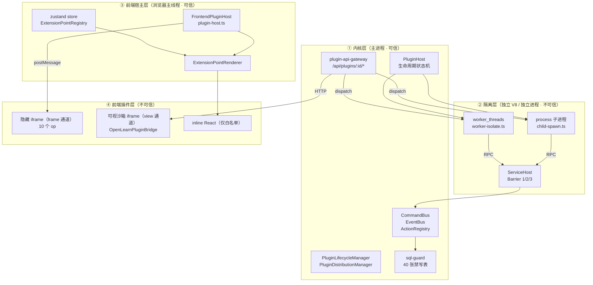
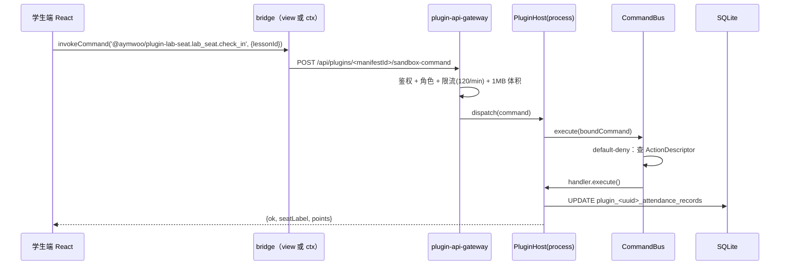

# 插件运行面：一个内核 + 三条进程边界 + 两套前端通道

> 本文件只讲**插件**的运行面。整平台五层结构见 [platform-overview.md](platform-overview.md)。

**结论先行**：OpenLearn 的插件系统是「**一个内核 + 三条进程边界 + 两套前端通道**」。
插件代码永远不直接跑在主进程的 Express 或 React 树里（除被显式信任的 inline），
其余一律经 RPC 代理访问内核服务；UI 只有四条合法出口（声明式数据、`view` 沙箱页面、inline React、白板挂件）。

---

## 1. 四层运行面



| 层         | 代码位置                                                                                   | 信任假设 | 崩溃影响       |
| ---------- | ------------------------------------------------------------------------------------------ | -------- | -------------- |
| ① 内核     | `packages/core/**`、`server/routes/plugins.ts`、`server/routes/plugin-api-gateway.ts`      | 可信     | 全站           |
| ② 隔离     | `packages/core/worker-runtime/**`、`packages/core/plugin-host/plugin-lifecycle-manager.ts` | 不可信   | 仅该插件       |
| ③ 前端宿主 | `src/plugin-host/**`                                                                       | 可信     | 页面级         |
| ④ 前端插件 | `dist/frontend.js`、`storage/*.html`                                                       | 不可信   | 该扩展点被摘除 |

**证据**：`packages/core/plugin-host/types.ts → PluginExecutionMode（L390）` 用三行表格定义了 `inline / worker / process` 的隔离强度；`packages/core/plugin-host/execution-policy.ts → resolvePluginExecutionMode（L116）` 是唯一把「请求的模式」收成「实际模式」的函数。

---

## 2. 插件从磁盘到运行时的位置变化

```text
上传 ZIP
  └─ install.ts                      解压 → plugins/<DB-UUID>/
        ├── manifest.json            校验 manifestSchema
        ├── index.js                 = manifest.main
        ├── frontend.js             可选
        └── storage/**              只解压此前缀（静态资源 / view 页面）
  └─ DB: plugins 表                   id=UUID v7, manifest=JSON 原文, execution_mode=求值结果
  └─ 激活
        ├── esm-loader/node-loader   import() 载入 index.js
        └── context-builder          构造 PluginContext，包装每个服务调用
```

| 事实         | 值                                                                | 证据                                                                 |
| ------------ | ----------------------------------------------------------------- | -------------------------------------------------------------------- |
| 安装目录     | `plugins/<DB-UUID>/`（仓库根，`.gitignore` 显式忽略 `/plugins/`） | `packages/core/plugin-host/install.ts → getPluginDir（L160 调用点）` |
| 只解压的前缀 | `storage/`                                                        | `install.ts` 解压谓词 `name.startsWith('storage/')`（L359 / L756）   |
| ZIP 落盘副本 | `plugins/<UUID>/package.zip`                                      | `install.ts`（L327 / L716）                                          |
| DB 主键      | UUID v7，**不等于** `manifest.id`                                 | `packages/core/plugin-host/plugin-namespace.ts → 注释（L27-43）`     |

---

## 3. 三条进程边界

### 3.1 inline（同进程同线程）

- 判定：`isTrustedInProcessPlugin()` 返回 `true`。
- 来源仅两处：`OPENLEARN_TRUSTED_INLINE_PLUGINS`（支持 `*` 与 `前缀*` 通配）、源码路径位于内置 `packages/plugins/`。
- 在 Vitest（`process.env.VITEST` 存在）下默认放行，除非显式设 `OPENLEARN_ENFORCE_PLUGIN_ISOLATION=1`。
- 证据：`execution-policy.ts → isTrustedInProcessPlugin（L91）`、`matchesTrustedInlinePattern（L45）`。

### 3.2 worker（独立 V8，同进程）

- `worker_threads.Worker`，共享 `process.env` 与内存空间。
- 前端 side 对应 `BrowserWorkerManager` + `ServiceHost`（`src/plugin-host/service-host.ts → ServiceHost（L74）`）。
- 证据：`packages/core/plugin-host/types.ts → PluginExecutionMode` 注释表格。

### 3.3 process（独立子进程，第三方默认）

- `child_process` + 最小 env 白名单，自带权限裁剪与配额（`packages/core/worker-runtime/plugin-permission.ts`、`plugin-quota.ts`、`liveness-monitor.ts`）。
- **任何未受信插件，无论 manifest 自述什么，都会被改写成 `process`**，并在 `PluginInfo.isolation_mode` 上体现。
- 证据：`execution-policy.ts → resolvePluginExecutionMode（L116-137）`，`coerced: true` 时 `reason` 明确写出改写原因。

> ⚠️ **最常见误解**：manifest 里写 `executionMode: 'inline'` 不生效。该字段原样落库但不参与判定；
> 前端也只读服务端求值后的值（`src/plugin-host/plugin-host.ts` L714-720 注释）。

---

## 4. 两套前端通道（不是一回事）

| 维度                    | `frame` 通道                                                 | `view` 通道                                |
| ----------------------- | ------------------------------------------------------------ | ------------------------------------------ |
| 载体                    | 隐藏 iframe（`display:none`），载入 `PLUGIN_FRAME_PATH`      | 可视沙箱 iframe，载入插件 `storage/*.html` |
| 日志可见                | 否                                                           | 是（用户能看见）                           |
| 协议                    | `{channel, type:'call', op, args}` → `{type:'reply'}`        | `window.OpenLearnPluginBridge` 对象方法    |
| op 数                   | **10**                                                       | **8**（wire op）+ `ui.resize` 独立消息     |
| 方法级门禁（Barrier 3） | **有**（`checkMethodPolicy`）                                | **无**                                     |
| 越界错误                | `Unsupported sandbox bridge op "xxx"`                        | 由桥接侧抛错                               |
| 证据                    | `src/plugin-host/plugin-host.ts → answerSandboxCall（L585）` | `docs/agent/contracts/bridge-ops.json`     |

frame 的 10 个 op（穷举，`answerSandboxCall` L604-649 逐条分发）：

```text
api.get   api.post   api.del
storage.get   storage.set   storage.delete
command.invoke
ui.register   ui.toast
context.get
```

`ui.register` 会强制写入 `pluginId` 与 `origin:'runtime'`（L635-639），**插件不能伪造归属**。

---

## 5. 数据流：一次「学生签到」的端到端路径

以示例插件 `@aymwoo/plugin-lab-seat` 为真实样本：



关键点：**命令名在注册与执行两侧都必须过 `resolvePluginCommandType(type, manifest.id)`**，
否则注册键与执行键不同 → `No handler registered for command`。
证据：`packages/core/plugin-host/plugin-namespace.ts → resolvePluginCommandType（L62）`。

---

## 6. 系统边界（本仓库不覆盖什么）

| 边界                                  | 说明                                                                                | 状态     |
| ------------------------------------- | ----------------------------------------------------------------------------------- | -------- |
| 白板图元渲染器扩展                    | 宿主 React 侧实现，非插件公开 API；`whiteboard.renderer` 槽位可注册但契约随版本变动 | `待确认` |
| 插件市场审核/运营                     | 仓库内只有签名校验（`PluginSignatureError` 家族），无审核流程                       | `不适用` |
| 课程包/courseware 运行时注入          | `ICoursewareRuntimeScriptRegistry` 存在，但 ZIP 插件无法声明式使用                  | `待确认` |
| 内核内置插件（`packages/plugins/**`） | 属平台代码，走 preload 路径，不受 `resolvePluginExecutionMode` 约束                 | `已验证` |
