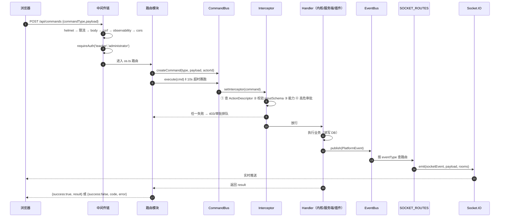

# 请求生命周期：从 HTTP 到命令到插件再回到浏览器

> 这条链路回答一个高频问题：**「我调了一个接口，为什么变成 403 / 500 / 点了没反应？」**
> 每一跳都给出判定点与错误出口，按顺序排查即可定位。

---

## 0. 全链概览



---

## 1. 中间件链（顺序固定，改动会破安全语义）

`server.ts` 的挂载顺序即执行顺序：

| #   | 中间件                                     | 行号     | 拒绝时返回                                                    |
| --- | ------------------------------------------ | -------- | ------------------------------------------------------------- |
| 1   | `helmet`                                   | L211     | 不拒绝，只加头（CSP / X-Frame-Options / HSTS）                |
| 2   | 写请求限流 `writeLimiter`                  | L287     | 429；`view-state` 端点走独立 `viewStateLimiter`，不占全站配额 |
| 3   | `mountLargeBodyParsers`                    | L~300    | 413（仅特定上传端点放宽）                                     |
| 4   | `express.json({limit:'2mb'})` / urlencoded | L303-304 | 413                                                           |
| 5   | `csrfGuard`                                | L307     | 403（`Sec-Fetch-Site/Dest` 判定 + 豁免清单）                  |
| 6   | `requestObservability()`                   | L308     | 不拒绝，注入 `req.requestId`、慢请求日志                      |
| 7   | `/uploads` 鉴权静态                        | L312     | 401（需有效 session）                                         |
| 8   | `/plugins` token 静态                      | L338     | 401 / 403                                                     |
| 9   | `createCorsMiddleware()`                   | L396     | 403（不在白名单）                                             |
| 10  | `enforcePasswordChanged`                   | L423     | 403（种子账号未改密时的写操作）                               |

**硬约束**：第 2 步必须在第 4 步之前 —— 先限流再解析 body，否则恶意超大 JSON 会先消耗 CPU/内存。
第 3 步必须在第 4 步之前 —— 否则大文件上传会被 2MB 全局限制挡掉。

---

## 2. 路由层：三种鉴权写法

| 写法                                      | 含义                   | 例                                                 |
| ----------------------------------------- | ---------------------- | -------------------------------------------------- |
| `requireAuth('teacher', 'administrator')` | 必须是这些**角色**之一 | `POST /api/commands`（`server/routes/os.ts` L112） |
| `requireScopedAuth('authenticated')`      | 任意已登录用户         | `GET /api/commands/registered`（L134）             |
| 无守卫                                    | 公开端点               | `/api/health`、登录                                |

角色守卫在**路由层**，能力守卫在**内核层**。两者不重复：路由层管「这个 URL 谁能进」，
内核层管「这条命令谁能执行」。学生能调到 `/api/commands` 之外，但执行 `assignment.grade` 仍会被拦。

---

## 3. 命令派发：四道闸门

入口只有一处：`POST /api/commands`（`server/routes/os.ts` L112-132）。

```ts
const cmd = kernelContainer.commandBus.createCommand(commandType, payload, getActorId(req));
const result = await Promise.race([
  kernelContainer.commandBus.execute(cmd),
  new Promise((_, reject) =>
    setTimeout(() => reject(new Error(`Command execution timed out after 10s: ${commandType}`)), 10_000),
  ),
]);
```

**10 秒硬超时**是路由层的，与插件激活/停用的 5 秒超时是两套。超时抛普通 `Error` → 5xx。

### 3.1 闸门顺序（`packages/core/kernel/index.ts → setInterceptor`，L303-401）

```text
① 查 actionRegistry.getActionByCommandType(type)
   ├─ 查到 → 继续
   └─ 查不到 → 403 COMMAND_NOT_REGISTERED（default-deny，L392-399）

② action.inputSchema 存在 → validateJsonSchema(payload, schema)
   └─ 有错 → 抛 [PayloadValidationError]（无 status/code → 走 500）
      注意：只认全大写 'OBJECT'/'ARRAY'/'STRING'/'NUMBER'/'BOOLEAN'，小写等于不校验

③ action.capabilityRequired 且 actor 非管理员 → capabilityGuard.check(actorId, cap)
   └─ 不通过 → 403 COMMAND_CAPABILITY_DENIED（L335-340）

④ action.isHighRisk 且未获批准 → 写 pending_commands + publish approval.requested + 抛错
   └─ 抛 [Security] Command ... requires human approval（无 status/code → 500）
      插件 actor（plugin: 前缀）不能自带 metadata.approved 绕过（L344-346）
```

管理员判定（L315-328）：`command.actorId` 为 `role:administrator` / `admin` / `usr_admin` / `admin-demo`，
或以 `user:` 开头且以 `:administrator` / `:admin` 结尾。**`plugin:` 前缀一律走能力表**。

### 3.2 描述符与实现必须成对

| 只注册 handler                        | 只注册描述符                                |
| ------------------------------------- | ------------------------------------------- |
| 命令永远 403 `COMMAND_NOT_REGISTERED` | 描述符存在但无可执行体，派发时 handler 缺失 |

自查：

```bash
node scripts/plugin-command-audit.mjs          # 平台侧审计
grep -c "registerHandler" <插件>/src/index.ts  # 与 commandType 集合比对
```

真实事故记录见 [lab-seat-walkthrough.md](../examples/lab-seat-walkthrough.md) §5。

---

## 4. 事件与实时推送

命令 handler 成功后发布 `PlatformEvent`：

```ts
eventBus.publish({
  id,
  type: 'lesson.created',
  source: 'plugin.<ctx.pluginId>',
  payload,
  timestamp,
  correlationId: command.id,
});
```

`server/event-routing.ts → SOCKET_ROUTES`（L263 起，共 **19 条**）把内核事件翻译成 socket 事件与房间：

| 内核事件                                                                     | socket 事件                    | 房间                               |
| ---------------------------------------------------------------------------- | ------------------------------ | ---------------------------------- |
| `assignment.graded`                                                          | `assignment-graded-toast`      | `user:<studentId>`（只投被评分者） |
| `assignment.submitted`                                                       | `assignment-submitted-toast`   | 课节/班级                          |
| `whiteboard.element_drawn`                                                   | `whiteboard-sync`（历史名）    | 课节 + `WHITEBOARD_BROADCAST_ROOM` |
| `whiteboard.element_updated` / `batch_drawn` / `element_deleted` / `cleared` | `whiteboard-sync`              | 同上                               |
| `whiteboard.quiz_answered`                                                   | `whiteboard-quiz-answered`     | 课节                               |
| `exambank.survey.published` / `closed`                                       | `exambank-survey-state`        | 课节                               |
| `exambank.answer.submitted`                                                  | `exambank-stats-update`        | 课节                               |
| `classroom.lock_changed`                                                     | `class-lock-status-changed`    | 班级                               |
| `student.notification_acknowledged`                                          | `student-acknowledged`         | 用户                               |
| `student.progress_updated`                                                   | `student-progress-updated`     | 用户                               |
| `courseware.attempt_updated`                                                 | `courseware-attempt-updated`   | 课节                               |
| `lesson.progress_mode_changed`                                               | `lesson-progress-mode-changed` | 课节                               |
| `segment.gate_overridden` / `gate_override_revoked`                          | `segment-gate-changed`         | 课节/班级                          |
| `points.awarded`                                                             | `classroom:points_awarded`     | 班级                               |

**要点**：socket 事件名**不保证**等于内核事件名（`whiteboard-sync` 是历史遗留名）。
新增事件若只 publish 不登记 `SOCKET_ROUTES`，前端收不到 —— 这是「后端日志正常、前端不刷新」的第一嫌疑点。

Socket 握手鉴权：`io.use(socketAuthMiddleware)`（`server.ts` L421），`mustChangePassword` 会话直接拒绝。

---

## 5. 错误出口：一个契约两种纪律

所有路由错误都经 `server/utils/error-handler.ts → sendSafeError`（L27）。

```ts
// 响应体固定形状
{ success: false, code?: string, error: string }
```

| 分支                    | 行为                                                        | 代码   |
| ----------------------- | ----------------------------------------------------------- | ------ |
| `err.status` 在 400–599 | 采用该状态码，否则用调用方传入的 `status`（默认 500）       | L36-40 |
| **4xx**                 | `error` 透传原文；`err.code` **透传**                       | L61-79 |
| **5xx**                 | `error` 在生产环境替换为 `fallbackMessage`；`code` **丢弃** | 同上   |
| `5xx` 且生产            | 额外上报 `captureError`（含 requestId / userId / path）     | L42-59 |

**推论**：想让前端按机器码分支，错误必须带 `status` 且落在 4xx。
插件抛 `new Error('...')` 不带 `status` → 500 → 前端只能看到「Internal server error」。

---

## 6. 排错决策树

```text
接口返回 401 → 没 session / session 过期 → 看 auth.ts
接口返回 403 + code=COMMAND_NOT_REGISTERED   → 缺 ActionDescriptor
接口返回 403 + code=COMMAND_CAPABILITY_DENIED → capabilitiesProposed 没声明，或该角色没被授予
接口返回 403 无 code                           → csrfGuard / CORS / enforcePasswordChanged / 路由 requireAuth
接口返回 429 → writeLimiter 或 AI 限流
接口返回 500 且日志有 [PayloadValidationError] → inputSchema 与 payload 不匹配（或大小写混用导致反向行为）
接口返回 500 且日志有 "requires human approval" → 高危命令进了 pending_commands，需人工批准
接口返回 500 且日志有 "timed out after 10s"    → handler 挂死（常见于 process 插件 RPC 未回）
接口 200 但前端不刷新                          → 事件没登记 SOCKET_ROUTES，或房间算错
点了没反应（无网络请求）                        → 前端槽位的 commandType 写了短名，应全限定
```

---

## 7. 交叉引用

| 想知道                       | 去哪                                                                                             |
| ---------------------------- | ------------------------------------------------------------------------------------------------ |
| 命令与事件的完整目录         | [../api/commands-and-events.md](../api/commands-and-events.md)                                   |
| 19 条能力真值 / 3 道 Barrier | [../plugin-system/capabilities-and-security.md](../plugin-system/capabilities-and-security.md)   |
| 错误码全表                   | [../plugin-system/error-handling-and-cleanup.md](../plugin-system/error-handling-and-cleanup.md) |
| 路由清单与鉴权级别           | [../api/http-endpoints.md](../api/http-endpoints.md)                                             |
