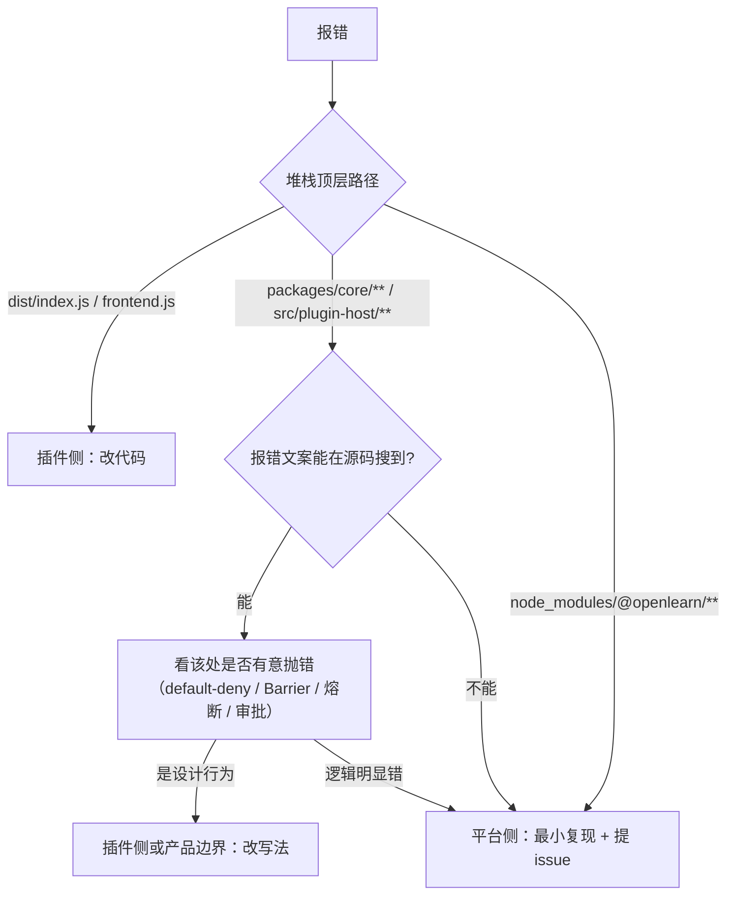

# 故障排查

**用法**：按「现象」列定位，先看「归属」再动手。**归属错 = 修错地方**。
错误码全集见 [error-handling-and-cleanup.md](../plugin-system/error-handling-and-cleanup.md) §2。

---

## 0. 五要素（缺任何一项都不要下结论）

```text
① 平台版本（GET /health 的 version，或 package.json）
② SDK 版本（package.json 依赖 / node_modules/@openlearn/plugin-sdk/package.json）
③ 执行模式（DB plugins.execution_mode：inline / worker / process）
④ 堆栈顶层 3-5 帧的路径（dist/index.js → 插件侧；packages/core/** → 平台侧）
⑤ 触发动作（点击？AI？定时？HTTP？）
```

---

## 1. 构建期

| 现象                                                       | 归属 | 原因                                                   | 修法                                                                               |
| ---------------------------------------------------------- | ---- | ------------------------------------------------------ | ---------------------------------------------------------------------------------- |
| `✖ frontend 产物里有裸模块说明符`                          | 插件 | 沙箱 iframe 用 `Blob` + 动态 `import()`，无 importmap  | 删掉 `import React` / 第三方包的裸导入；依赖必须打进 bundle                        |
| `TS2305: Module has no exported member`                    | 插件 | 用了 3.8.0 才移除的导出，或拼错名                      | 查 [api-reference.md](api-reference.md) §1                                         |
| `Cannot find package 'uuid'`                               | 环境 | SDK 未声明 `uuid` 运行时依赖（3.7.4 缺陷，3.7.5 已修） | `npm i -D uuid zod` 或升 SDK                                                       |
| `TS2693: 'PluginRuntimeComposition' only refers to a type` | 插件 | 3.7.2 起该符号 type-only                               | 改 `import type`；宿主内部类从 `packages/core/plugin-host/*.js` 取（插件本不该用） |
| esbuild 报 `Could not resolve "x"`                         | 插件 | 依赖未安装或拼错                                       | 装依赖，或改用 `ctx.require` 白名单模块                                            |

---

## 2. 安装期

| 现象                                        | 归属 | 原因                                                  | 修法                                                      |
| ------------------------------------------- | ---- | ----------------------------------------------------- | --------------------------------------------------------- |
| 上传后提示 manifest 校验失败                | 插件 | zod 拒绝：`main` 缺失、`id` 含 `:`、`requires` 格式错 | 对照 [manifest-reference.md](manifest-reference.md) §1/§2 |
| 「ZIP 结构不正确」                          | 插件 | ZIP 根多套了一层目录                                  | 根必须直接是 `index.js` + `manifest.json`                 |
| 安装成功但插件中心看不到                    | 环境 | DB 写入失败 / 目录权限                                | 看服务日志 `[PluginHost]`                                 |
| 声明了 `api.baseRoute` 却报路径不对         | 插件 | `baseRoute` 是 no-op                                  | 真实路径恒为 `/api/plugins/{manifest.id}/*`               |
| 社区插件提示 `COMMUNITY_INTEGRITY_REQUIRED` | 插件 | 未声明 `integrity`                                    | 走 `build --key` 签名，或由管理员放行                     |

---

## 3. 激活期

| 现象                                                            | 归属      | 原因                                                                                         | 修法                                                                      |
| --------------------------------------------------------------- | --------- | -------------------------------------------------------------------------------------------- | ------------------------------------------------------------------------- |
| 激活 500，日志 `Capability denied … only 'get' methods allowed` | 插件/配置 | `capabilitiesProposed` 为空（或声明了但管理员没勾选授予），而 `activate()` 调了非 `get*` RPC | ① 声明至少一条真实能力；② 重装时勾选「确认授予」                          |
| 激活失败 `Plugin "x" activation failed: …`                      | 插件      | `activate()` 抛错                                                                            | 看 `cause`；缩小到最小复现                                                |
| 激活 60s 后超时                                                 | 插件      | `activate()` 里有同步阻塞 / 等待外部 IO                                                      | 挪到首个命令里做；5s 是硬上限                                             |
| `SemverMismatchError`                                           | 插件      | `requires` 版本范围与宿主不符                                                                | 放宽范围或升级宿主                                                        |
| `TOKEN_NOT_FOUND`                                               | 插件      | `requires` 漏声明，或 Token 名不在 31 条白名单                                               | 见 [context-and-services.md](../plugin-system/context-and-services.md) §3 |
| 只有 `listPlugins` 里能看到，`status=error`                     | 插件      | 载入阶段失败（`main` 指向错 / 语法错）                                                       | 检查 ZIP 内文件名与 `manifest.main` 一致                                  |
| 激活成功但 `execution_mode=process`（本想要 inline）            | 产品边界  | 未受信插件被强制改写                                                                         | 进 `OPENLEARN_TRUSTED_INLINE_PLUGINS`，或改 `view` 方案                   |

---

## 4. 运行期：命令派发

| 现象                                                        | 归属      | 原因                                                            | 修法                                                                 |
| ----------------------------------------------------------- | --------- | --------------------------------------------------------------- | -------------------------------------------------------------------- |
| 403 `COMMAND_NOT_REGISTERED`                                | 插件      | 该 `commandType` 没有 `ActionDescriptor`（default-deny）        | 补 `actionRegistry.register({ commandType, capabilityRequired, … })` |
| 403 `COMMAND_HANDLER_NOT_REGISTERED`                        | 插件      | 有描述符无 handler                                              | 补 `commandBus.registerHandler(type, { execute })`                   |
| 403 `COMMAND_CAPABILITY_DENIED`                             | 插件/配置 | `capabilityRequired` 与授予集合不逐字相等                       | 用 19 条真值；管理员勾选授予                                         |
| 404 `No handler registered for command type "<type>"`       | 插件      | 命令名不匹配（命名空间规则）                                    | 运行期 `slotProps.commandType` 必须全限定                            |
| 500 `Cannot read properties of undefined (reading 'React')` | 插件      | 沙箱前端用了 React                                              | 改 `view`，或进 inline 白名单                                        |
| `DataCloneError`                                            | 产品边界  | `process` 插件给 `registerExtensionPoint` 传了 `component` 函数 | 改数据型贡献或 `view`                                                |
| `handler.execute is not a function`                         | 插件      | 传了裸函数                                                      | 改 `{ execute }` 对象                                                |

### 4.1 命名空间的三种写法（按位置）

| 位置                                                            | 写法                                   | 宿主补前缀 |
| --------------------------------------------------------------- | -------------------------------------- | ---------- |
| `registerHandler('lab_seat.check_in')`                          | 短名                                   | ✅         |
| `actionRegistry.register({ commandType: 'lab_seat.check_in' })` | 短名                                   | ✅         |
| `manifest.classroomTools[].commandType`                         | 短名                                   | ✅         |
| `manifest.contributes.*[].commandType`                          | 短名                                   | ✅         |
| `ctx.ui.registerExtensionPoint({ slotProps:{ commandType } })`  | **全限定** `@acme/x.lab_seat.check_in` | ❌         |
| `bridge.invokeCommand(type)`（view）                            | 短名或全限定均可                       | ✅         |

> 不确定时**一律写全限定名** —— 它在所有位置都能解析。

---

## 5. 运行期：界面

| 现象                        | 归属             | 原因                                | 修法                                              |
| --------------------------- | ---------------- | ----------------------------------- | ------------------------------------------------- |
| 入口出现但点开空白          | 插件             | `view` 被 zod strip                 | 查 DB `manifest.contributes.*.view`；补槽位白名单 |
| 入口出现但 iframe 404       | 插件             | `storage/` 没进 ZIP                 | 自写打包脚本补目录                                |
| 整个入口都不出现            | 插件             | 槽位名拼错 / `rolesAllowed` 不匹配  | 对照 `slots.json`                                 |
| Tab 闪现后消失              | 产品边界（已修） | v0.7.0 前熔断越权摘除 manifest 贡献 | 升级；或用 `origin:'manifest'`                    |
| 插件被自动停用 + 扩展点报错 | 产品边界         | 熔断器 3 次 / 5 分钟                | 修渲染错误后重新启用                              |
| 学生端一弹浮层白板消失      | 插件             | 浮层写了 `w-full` / `flex-1`        | 改 `position: fixed`                              |
| 页面内容被截断 / 双滚动条   | 插件             | `view` 未调 `ui.resize()`           | 在 `onInit` 与状态变化时调用                      |
| 中文看不清                  | 插件             | 字号 < 13px                         | 提到 ≥ 13px                                       |

---

## 6. 运行期：数据与网络

| 现象                                  | 归属     | 原因                                                                    | 修法                                                                         |
| ------------------------------------- | -------- | ----------------------------------------------------------------------- | ---------------------------------------------------------------------------- |
| `SQL 被拒` / 表名错误                 | 插件     | 命中 40 张禁写表，或未用 `ctx.db.table()`                               | 用 `ctx.db.table(name)`；自有表前缀化                                        |
| `no such table: xxx`                  | 插件     | `ensureTable` 没 `await`，或迁移未跑                                    | `await ctx.db.ensureTable(...)`；用 `ctx.db.migrate` 而非 `migrations/*.sql` |
| 声明式迁移不执行                      | 产品边界 | CLI 不打包 `migrations/`                                                | 改用 `ctx.db.migrate()`                                                      |
| 401（`api.routes` 写了 `auth:false`） | 配置     | `auth:false` 只是申请                                                   | 管理员批准公开路由，或改 `auth:true`                                         |
| 429                                   | 环境     | 默认 120/min，机房共享出口 IP                                           | 提高 `rateLimit.max` 或减少轮询频率                                          |
| 413                                   | 插件     | 请求体 > 1MB                                                            | 分片或改走 `storage/`                                                        |
| 504                                   | 插件     | handler 未在超时内返回                                                  | 异步化 / 加缓存                                                              |
| 远程前端 `fetch` 拿不到数据           | 插件     | frame 沙箱是 opaque origin（`sandbox="allow-scripts"`），`fetch` 不可用 | 用 `ctx.services.frontendApi` / `invokeCommand`                              |
| 收不到实时事件                        | 插件     | 宿主不向 iframe 推事件                                                  | 改轮询                                                                       |

---

## 7. 归因决策（插件侧 vs 平台侧）



**判为平台侧的 4 个必要条件**（缺一即只能给「待定」）：

1. 官方脚手架原始产物或 ≤50 行最小插件稳定复现；
2. 版本号 + 复现步骤 + 完整堆栈齐全；
3. 报错点在宿主/内核/SDK 范围内，而非插件代码；
4. 已排除：版本不匹配、产物未重建、浏览器缓存、权限未审批、插件冲突、被强制改成 `process`。

**常见误判**：报错文案由平台打印 ≠ 平台缺陷。`Import of "crypto" is not allowed`、
`only 'get' methods allowed`、`auth:false 仍 401` 都是**按设计行事**。

---

## 8. 一次完整的排查示例（真实路径）

**现象**：教师点「一键排座」无反应，控制台 403 `COMMAND_NOT_REGISTERED`。

```text
① 前端派发的 type 是什么？
   DevTools → Network → /api/commands → payload.commandType
   → "@aymwoo/plugin-lab-seat.lab_seat.assign_seats"

② 后端有没有这个 handler？
   SELECT 1 → 查 plugins 表 manifest → contributes.classroom.seating.toolbar[0].commandType
   → "lab_seat.assign_seats"（短名）

③ handler 注册了吗？
   插件 activate() 里有 commandBus.registerHandler('lab_seat.assign_seats', …) ✔

④ 那问题在描述符：actionRegistry.register 里 commandType 写的是什么？
   → 缺失 / 拼成了 'lab_seat.assign'（少个 s）

⑤ 修：补/改 ActionDescriptor，commandType 与 handler 逐字一致。
```

**根因**：default-deny 只看 ActionDescriptor 是否存在，不看 handler。
`packages/core/kernel/index.ts`（L339 附近）是判定点。

---

## 9. 排查工具速查

```bash
# 平台版本
node -p "require('./package.json').version"

# 插件落在哪
sqlite3 packages/core/db/educational_os.db \
  "SELECT id,status,execution_mode,substr(manifest,1,200) FROM plugins"

# 某个 view 有没有被 strip
sqlite3 packages/core/db/educational_os.db \
  "SELECT json_extract(manifest,'$.contributes') FROM plugins WHERE id='<uuid>'"

# ZIP 里到底有什么
unzip -l dist/*.zip

# 端口与日志
ss -ltnp | grep 9000
grep -n "\[Plugin:" logs/*.log | tail -50
```

> 端口默认 **9000**（`pnpm dev`），不是 3000/5173。
