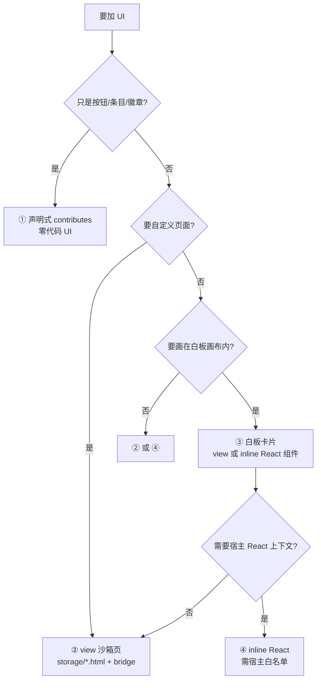

# UI 扩展指南（四条通道）

**结论先行**：UI 只有四条合法出口。选错通道的代价不是「效果差」，是**插件激活失败**或**页面白屏**。
判定顺序固定：**声明式 → `view` → 白板卡片 → inline React（最后手段）**。

---

## 1. 通道决策树



| 通道 | 执行模式要求 | 是否需白名单 | 能否写 React | 典型槽位 |
| --- | --- | --- | --- | --- |
| ① 声明式 | 任意（`process` 即可） | 否 | 否 | `classroom.seating.toolbar`、`command_palette.item`、`teacher.tab`（仅数据） |
| ② `view` | 任意 | 否 | 否（HTML + 原生 JS） | `teacher.tab`、`teacher.panel`、`student.view`、浮层 |
| ③ 白板卡片 | `view` 形态任意；React 形态需 inline | `view` 否 / React 是 | 视形态 | `teacher.dashboard.widget`、`student.view`、`whiteboard.canvas.widget` |
| ④ inline React | **必须 `inline`** | **是** | 是（React 来自 `HostSharedDeps`） | 任意 |

---

## 2. 通道 ①：声明式（首选）

### 2.1 manifest

```json
{
  "contributes": {
    "classroom.seating.toolbar": [
      { "id": "assign", "label": "一键排座", "icon": "Armchair", "commandType": "lab_seat.assign_seats" }
    ],
    "classroom.seating.summary": [
      { "id": "stat", "title": "已排座 42/45", "icon": "Users" }
    ]
  }
}
```

宿主负责渲染按钮/卡片，点击派发 `<manifest.id>.lab_seat.assign_seats`。

**代价**：样式与布局由宿主决定，只能控制 `label` / `icon` / `position` / `badge`。

### 2.2 纯数据扩展（无 UI，只有平台读取）

`command_palette.item`、`quick_insert.item`、`ai.prompt.template`、`ai.skill.provider`、
`classroom.seating.legend`、`peer_review.rubric.dimension` 等，宿主按字段消费，插件不需要任何前端代码。

---

## 3. 通道 ②：`view` 沙箱页面（自定义界面的推荐方案）

### 3.1 声明（两种写法）

```json
// A. manifest 声明（安装后即可见）
"contributes": {
  "teacher.tab": [{ "id": "seat", "label": "机房座位", "view": "storage/seat.html" }]
}
```

```ts
// B. 运行时注册（可带 rolesAllowed / position）
await ctx.ui.registerExtensionPoint('teacher.tab', {
  id: 'seat', label: '机房座位', view: 'storage/seat.html',
  pluginId: ctx.pluginId, rolesAllowed: ['teacher'], position: 60,
});
```

**`view` 值必须以 `storage/` 开头**：安装器只解压该前缀（`install.ts` L359/L756）。
`views/index.html` 这类写法对 ZIP 插件是错的 —— 文件根本不会落地。

### 3.2 页面内的桥接

```html
<!doctype html>
<html lang="zh">
<head>
  <meta charset="utf-8" />
  <script src="/plugin-sandbox/view-bridge.js"></script>
  <style>
    /* 中文正文 ≥ 13px：投影与白板上 11/12px 不可读 */
    body { font: 14px/1.6 system-ui, sans-serif; margin: 0; padding: 12px; }
    button { font-size: 14px; padding: 8px 14px; }
  </style>
</head>
<body>
  <button id="assign">一键排座</button>
  <pre id="out"></pre>

  <script>
    const B = window.OpenLearnPluginBridge;

    B.onInit(async (ctx) => {
      // ctx: { lessonId, classId, pluginId, ... }
      document.getElementById('out').textContent =
        `lesson=${ctx.lessonId} class=${ctx.classId}`;
      B.ui.resize(420);                      // 浮层必须调，否则高度按保底 180px
    });

    document.getElementById('assign').addEventListener('click', async () => {
      try {
        // 全限定名在三种规则下都安全
        const r = await B.invokeCommand('@aymwoo/plugin-lab-seat.lab_seat.assign_seats', {});
        document.getElementById('out').textContent = JSON.stringify(r, null, 2);
      } catch (e) {
        B.ui.toast('排座失败：' + e.message, 'error');
      }
    });
  </script>
</body>
</html>
```

`OpenLearnPluginBridge` 成员：

| 成员 | 落到哪个 op | 说明 |
| --- | --- | --- |
| `onInit(cb)` | — | 宿主 `init` 消息；上下文就绪会立即触发 |
| `onContextUpdate(cb)` | — | 宿主 `context-update` |
| `getContext()` | — | 返回缓存的 `{lessonId, classId}` |
| `ui.toast(msg, type)` / `ui.showToast` | `ui.toast` | 宿主代发提示 |
| `ui.resize(px)` | **独立 `resize` 消息** | 不是 op，仅调节 iframe 高度 |
| `invokeCommand(type, payload)` | `command.invoke` | 走 `/api/plugins/<id>/sandbox-command` |
| `api.get/post/del(path[, body])` | `api.*` | 走宿主 HTTP 代理 |

### 3.3 打包（必须自写）

官方 CLI 只打三件套，`storage/**` 要自己补：

```js
// scripts/pack.mjs —— 在 dist 目录里把 storage/ 塞进 zip
import JSZip from 'jszip';
import { readFileSync, readdirSync, statSync, writeFileSync } from 'node:fs';
import { join, relative } from 'node:path';

const cwd = process.cwd();
const zip = await JSZip.loadAsync(readFileSync(join(cwd, 'dist', 'index.js') /* 占位 */));
// 实际做法：读 dist/<name>.zip，重新 add storage/**
```

> 更简单可靠的做法：`npx @openlearn/plugin-sdk build` 之后，用 `jszip` 打开 `dist/<name>.zip`，
> 遍历 `storage/` 逐文件 `zip.file(relPath, content)`，再 `generateAsync({type:'nodebuffer'})` 覆盖原 zip。

### 3.4 `view` 页面的网络与事件边界

| 项 | 事实 | 证据 |
| --- | --- | --- |
| CSP `connect-src` | `'self' blob: data: https:` | `server/utils/plugin-view-bridge.ts`（L11） |
| 同源 `fetch` | **技术可行**（CSP 允许）；但拿不到宿主上下文，也不触发 `req.actor` 的插件身份 | 同上 |
| 事件推送 | 宿主**不向** iframe 推 socket 事件；实时同步需**轮询** `invokeCommand` / `api.get` | 推断（iframe 消息只有 `init` / `context-update` / `resize` 三类） |
| 推荐 | 所有数据访问走 `B.invokeCommand` / `B.api.*` | — |

### 3.5 尺寸铁律（按槽位容器）

| 容器 | 规则 |
| --- | --- |
| Panel（`teacher.tab` 等） | `html, body { height: 100% }`，内部 `flex flex-col min-h-0` 自管滚动 |
| FloatingOverlay | **`position: fixed`**，禁 `w-full` / `h-full` / `flex-1`（会挤掉白板） |
| WhiteboardWidget | 适配卡片尺寸与缩放，别假设视口 |
| ActionItem | 紧凑内联，高度对齐工具栏 |

---

## 4. 通道 ③：白板卡片

### 4.1 `view` 形态（`process` 即可）

成对声明两个槽位，whiteboard 会用 `PluginCardRenderer` 渲染：

```json
"contributes": {
  "teacher.dashboard.widget": [{ "id": "card", "label": "座位图", "view": "storage/card.html" }],
  "student.view":            [{ "id": "card", "label": "我的座位", "view": "storage/card.html" }]
}
```

学生端与教师端的卡片 id 需成对，宿主按 id 关联两侧。

### 4.2 React 形态（需 inline）

```tsx
// 仅在 inline 且已进白名单时可用
const React = (globalThis as any).HostSharedDeps?.React;
export function SeatCard({ lessonId }: { lessonId: string }) {
  return React.createElement('div', { className: 'p-3' }, `Lesson ${lessonId}`);
}
await ctx.ui.registerExtensionPoint('teacher.dashboard.widget', {
  id: 'card', label: '座位图', component: SeatCard, pluginId: ctx.pluginId,
});
```

**不要** `import React from 'react'` —— CLI 裸说明符守卫会直接让构建失败。

---

## 5. 通道 ④：inline React（受信插件专用）

| 前提 | 说明 |
| --- | --- |
| 执行模式 = `inline` | 文件在 `packages/plugins/`，或 id 在 `OPENLEARN_TRUSTED_INLINE_PLUGINS` |
| React 来源 | `globalThis.HostSharedDeps`（宿主注入），不是 npm 包 |
| 可用组件库 | `react` / `react-dom` / `recharts` / `lucide-react` |

```tsx
const React = (globalThis as any).HostSharedDeps.React;
const { useState } = React;

export function Panel({ dispatcher }: any) {
  const [n, setN] = React.useState(0);
  return React.createElement('button', {
    onClick: () => { setN(n + 1); dispatcher?.dispatch({ type: 'host:toast',
      payload: { title: '提示', message: `点了 ${n + 1} 次` } }); },
  }, `点击 ${n}`);
}
```

**反例**：自带一份 React bundle 去渲染宿主组件 → `Invalid hook call`。

---

## 6. 四条通道的失败模式对照

| 通道 | 典型失败 | 现象 | 排查入口 |
| --- | --- | --- | --- |
| ① 声明式 | `commandType` 无 handler | 按钮在，点了 403 | `COMMAND_NOT_REGISTERED` |
| ① 声明式 | 槽位名拼错 | 什么都不显示，无日志 | 对照 `slots.json` |
| ② `view` | `view` 被 zod strip | 面板空白 | DB 里查 `contributes.*.view` |
| ② `view` | `storage/` 未进包 | iframe 404 空白 | `unzip -l` |
| ② `view` | 浮层写 `w-full` | 白板消失 | 改 `fixed` |
| ③ 白板卡片 | 只声明了教师侧 | 学生端空白 | 补 `student.view` |
| ④ inline React | 无白名单 | 被强制 `process` → 组件不可传 | 改 `view` |
| ④ inline React | `import React` | 构建失败（裸说明符） | 用 `HostSharedDeps` |

---

## 7. 中文可读性（硬要求）

| 项 | 要求 |
| --- | --- |
| 正文 / 标签 / 按钮字号 | **≥ 13px** |
| 覆盖范围 | `view` 页面的 `<style>`、行内 `style`、`el.style.fontSize`；inline React 的 `fontSize` 数值/字符串 |
| 豁免 | 纯图标/装饰，需在同一行注明 `font-size-ok` |
| 原因 | 教室投影与白板缩放后 11/12px 不可读 |

这条是**可自动化检查**的：静态检查脚本可用 `FONT_TOO_SMALL` 规则拦截。
