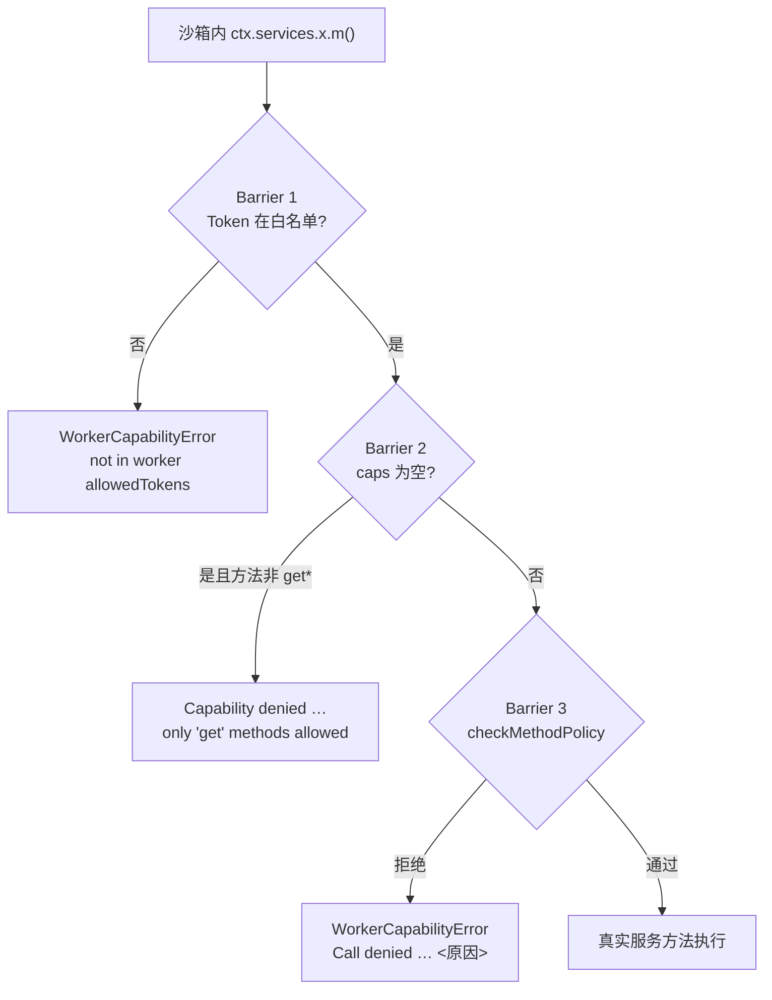

# 能力与安全边界

**结论先行**：系统里有**三套互不相干的「能力」**，名字都像权限但不是一回事；
插件侧真正会让你失败的是「**少声明**」而不是「乱声明」；
隔离侧有三道 Barrier，真正的访问控制在服务端每个 REST 端点，Barrier 只是收窄爆炸半径。

---

## 1. 三套能力登记（混用即错）

| # | 登记 | 字段 / 常量 | 管什么 | 取值数量 | 真源 |
| --- | --- | --- | --- | --- | --- |
| ① | 命令闸门 | `ActionDescriptor.capabilityRequired` | 谁能执行这条命令 | **19** | `docs/agent/contracts/capabilities.json → command_required` |
| ② | 方法级闸门 | `method-policy.ts` 的 `CAP_*` | 某个 `ctx` 方法能否调 | **8** | 同上 `method_policy` |
| ③ | 运行时权限 | `RuntimePermission`（classroom-runtime） | 课堂活动生态的权限 | **7** | 同上 `runtime_permission` |

### 1.1 命令能力全集（19 条，逐字）

```text
assignment:manage   assignment:read     assignment:review   assignment:submit
assignment:write    lesson:delete       lesson:read         lesson:write
management:read     management:write    plugin:read         plugin:write
process:read        process:write       student:write       vfs:read
vfs:write           whiteboard:read     whiteboard:write
```

**不在这 19 条里的都是错**。三个高频错误写法：

| 写了 | 实际归属 | 正确做法 |
| --- | --- | --- |
| `user:read` | 不存在 | `management:read` |
| `ai:invoke` | ②方法级（`CAP_AI_INVOKE`），不是命令能力 | `ai.generateText` 的授权走 `capabilitiesProposed` 声明 `ai:invoke` |
| `quiz:write` | ③运行时权限 | 不属于 `capabilityRequired` |
| `segment:gate_eval` | 真实存在但**不是** `capabilityRequired` | 仅作为 `capabilityRequired` 的**建议值**写在 JSDoc 里，`await` 校验时不算 |

### 1.2 方法级 8 个（`CAP_*`）

| 常量 | 字符串 | 拦截的行为 |
| --- | --- | --- |
| `CAP_API_WRITE` | `api:write` | 前端 `frontendApi.post/del` 的普通写入 |
| `CAP_API_ADMIN` | `api:admin` | 高危路径 / 不可逆操作 / 实体级删除 |
| `CAP_GRADES_WRITE` | `grades:write` | `saveSemesterGrade` 等写成绩 |
| `CAP_AGENT_TOOL` | `agent:tool` | 注册 `exposeToAgent !== false` 的 action |
| `CAP_AI_INVOKE` | `ai:invoke` | `ai.generateText` / `chat` / `complete` |
| `CAP_TASK_REGISTER` | `task:register` | `processManager.registerHandler/registerInterval/restore` |
| `CAP_STUDENT_DATA_READ` | `student-data:read` | 读学生积分/敏感数据 |
| `CAP_STUDENT_DATA_WRITE` | `student-data:write` | 写学生积分/敏感数据 |

证据：`packages/core/plugin-host/method-policy.ts`（L28-49）。

### 1.3 运行时权限 7 个

```text
ai:invoke   lesson:control   plugin:execute   quiz:submit
session:manage   stage:navigate   whiteboard:draw
```

它们由 classroom-runtime 消费，**与插件 manifest 无关**。插件作者不需要声明它们。

---

## 2. 「没有全局白名单」——这意味着什么

```ts
// packages/core/esm-loader/manifest-schema.ts
capabilitiesProposed: z.array(z.string()).optional()   // 自由字符串数组（L804）
```

推论（逐条可验证）：

| 结论 | 后果 |
| --- | --- |
| 声明杜撰的能力名**不会报错**，会被安静地授予 | 浪费时间但不会挂 |
| 声明**通配符**会**被拒**：仅 `*`、`*:*`、`*:*:*` 三种形态被硬拒 | 用具体串 |
| 真正致命的是**少声明**：目标命令的 `capabilityRequired` 必须与已授予集合**逐字相等** | 否则 403 `COMMAND_CAPABILITY_DENIED` |
| 授予集合 = `capsProposed ∩ 管理员审批` | 安装了但没勾选 = 没授予 |

证据：`docs/agent/contracts/capabilities.json → _no_global_whitelist`、`blocked_wildcard`。

---

## 3. 三道 Barrier（隔离侧）



| Barrier | 判定 | 实现 | 错误 |
| --- | --- | --- | --- |
| 1 | Token 是否在 `allowedTokens`（按 manifest 计算） | `src/plugin-host/service-host.ts`（L237-243） | `WorkerCapabilityError: Access to service token 'x' denied` |
| 2 | `manifestCapabilities.length === 0` 且方法不以 `get` 开头 | 同文件（L245-252） | `Capability denied for actor …: empty manifestCapabilities, only 'get' methods allowed` |
| 3 | 方法 / 路径级策略 | `method-policy.ts → checkMethodPolicy`（L197） | `Call denied for actor …: <token>.<method>() — <原因>` |

**Barrier 2 的实操含义**：`process` 插件如果 `capabilitiesProposed` 是空数组，
`activate()` 里连 `ctx.db.ensureTable()` 都会 500。最小声明一条（如 `lesson:read`）即可解除只读锁。

### 3.1 Barrier 3 的具体判定表

| Token | 方法 | 条件 | 拒绝文案要点 |
| --- | --- | --- | --- |
| `IFrontendAPI` | `get*` | 直接放行 | — |
| `IFrontendAPI` | `post` / `del` | 需要 `api:write` | 「写操作（post）需要 manifest 声明 'api:write'」 |
| `IFrontendAPI` | 路径命中高危前缀 | 需要 `api:admin` | 「写入高危路径 '/api/plugins'」 |
| `IFrontendAPI` | 路径以 `/gdpr-delete` 结尾 | 需要 `api:admin` | 「不可逆操作」 |
| `IFrontendAPI` | `del` 且路径恰为 `/api/<ns>/<id>` | 需要 `api:admin` | 「实体级删除」 |
| `ISocketService` | `disconnect` / `destroy` | **永远拒绝** | 「断开课堂实时通道会中断正在进行的教学」 |
| `ISemesterGradeService` | `save*` / `write*` / `set*` | 需要 `grades:write` | 「'grades:read' 不足以解锁写入」 |
| `IProcessService` | `registerHandler` / `registerInterval` / `restore` | 需要 `task:register` | — |
| `IAIService` | `generateText` / `chat` / `complete` | 需要 `ai:invoke` | — |
| `IActionRegistryService` | `register`（且 `exposeToAgent !== false`） | 需要 `agent:tool`，否则**降级** | 见 §3.2 |
| `IStorageService` / `IUIService` | 任意 | 放行 | — |

高危路径前缀（`HIGH_RISK_PATH_PREFIXES`，L60-69）：

```text
/api/plugins   /api/users   /api/auth   /api/ai-providers
/api/agent     /api/grade-sync   /api/site-settings   /api/approvals
```

### 3.2 `exposeToAgent` 的能力降级（不是拒绝）

未声明 `agent:tool` 时，注册的 descriptor 被**强制改写**为 `exposeToAgent: false` 后放行：

```text
action "<type>" 的 exposeToAgent=true 需要 'agent:tool' 能力；
插件未声明该能力，已降级为 exposeToAgent=false（不进入 AI Agent 工具列表，其余功能不受影响）。
```

证据：`method-policy.ts → sanitizeActionRegisterArgs`（L134-155）。
设计动机写在 L112-132：直接拒绝会让旧插件整个 `activate()` 失败，把「不进 AI 工具列表」放大成「插件启动不了」。

---

## 4. SQL 守卫

| 规则 | 内容 |
| --- | --- |
| 禁写表 | **40 张**核心表，命中即拒（`FORBIDDEN_CORE_TABLES`，`sql-guard.ts` L13-54） |
| 禁写语句 | `ATTACH` / `DETACH` / `PRAGMA` / `VACUUM` / `CREATE|DROP TRIGGER` / `CREATE|DROP VIEW`（L58-66） |
| 表名解析 | 先 `sanitizeSql` 剥注释与字符串字面量，再 `extractReferencedTables` 覆盖 `FROM`/`JOIN`/`INTO`/`UPDATE`/`TABLE` |
| 元数据表 | `sqlite_master` / `sqlite_schema` 仅放行**精确前缀**查询 |

40 张禁写表（全列，务必逐字比对）：

```text
users  client_sessions  plugins  plugin_storage  ai_providers  processes
pending_commands  classes  students  class_students  lessons  assignments
assignment_submissions  attendance  schedules  class_grade_weights  exams
exam_scores  student_semester_reports  student_rollcalls  student_seats
student_read_notifications  student_lesson_progress  courseware  courseware_attempt
system_resources  events  _migrations  site_settings  agent_conversations
classroom_sessions  lesson_quiz_submissions  courseware_score_config  demo_data_registry
whiteboard_elements  student_point_logs  lianyun_research_activities
lianyun_research_groups  lianyun_research_submissions  lianyun_research_reviews
```

> ⚠️ **这是黑名单，不是白名单**。不在 40 张之内的表理论上可写。
> 反例：示例插件 `lab-seat` 直接 `rawDb.exec('CREATE TABLE IF NOT EXISTS computer_labs …')`（`[P] src/index.ts` L175-186）。
> **不要据此认为「写平台表是安全的」** —— 一旦该表将来被加入黑名单，插件会在升级后突然失败。

**作用面（关键，容易误判）**：`assertPluginSqlAllowed` 全仓只有一个调用方 ——
`packages/core/worker-runtime/service-host.ts` L81 导入、L1216 调用。因此：

| 执行模式 | SQL 守卫是否生效 |
| --- | --- |
| `process`（未受信插件的强制模式） | ✅ 生效（走 `child-isolate` → `service-host`） |
| `worker`（`worker_threads`） | ✅ 生效（同一 `service-host`） |
| `inline`（受信内置插件，如 `lab-seat`） | ❌ **不生效** —— 直接拿到主进程 `better-sqlite3` 实例 |

`lab-seat` 之所以能对 `computer_labs` 建表，**根本原因是它在 `inline` 模式跑**，
而不是「`computer_labs` 恰好不在黑名单」。第二道防线是表名前缀：
`service-host` 传给守卫的 `ownPrefix = plugin_<插件>_`，DDL/DML 目标表必须命中自身前缀、
`plugin_migrations`、或授权后的 `plugin_research_*`（`sql-guard.ts` L276-290），
`computer_labs` 三条都不满足 —— 同一份代码改成非受信插件会立刻被拒。

**结论**：在 `inline` 模式下你「能」写平台表，但那只是没被拦住，不是被允许。

---

## 5. 出站网络

| 事实 | 值 |
| --- | --- |
| 声明方式 | `manifest.network.outbound: string[]`（域名） |
| 生效条件 | 管理员批准后，由**宿主代为发起** |
| 插件内直接 `fetch` | `process` 沙箱下被 CSP / Node 权限裁剪阻断 |
| 代理服务 | `INetworkProxyService`（`0.7.2+`），但 `INetworkProxyServiceToken` **不可 resolve** |

`INetworkProxyServiceToken` 导出与可解析状态矛盾是已知坑，`docs/agent/contracts/tokens.json` 的
`_count_trap` 明确记录。插件需要联网时优先走 `ctx.http` 由宿主代发，或声明 outbound 后由管理员放行。

---

## 6. 信任与隔离的判定表

| 条件 | 结果 |
| --- | --- |
| 源码在 `packages/plugins/**` | 可用请求的模式（含 `inline`） |
| `manifest.id` 命中 `OPENLEARN_TRUSTED_INLINE_PLUGINS`（支持 `*` / `前缀*`） | 同上 |
| `VITEST` 且未设 `OPENLEARN_ENFORCE_PLUGIN_ISOLATION=1` | 同上（仅测试） |
| 其他一切情况 | **强制 `process`**，`coerced: true` |

**不构成信任**：`@openlearn/` 前缀、`manifest.author`、ZIP 文件名、`manifest.executionMode` 字段、安装者角色。

---

## 7. 前端侧的安全差异（必须知道）

| 项 | 后端（隔离） | 前端 |
| --- | --- | --- |
| `caps` 来源 | 声明 ∩ 审批 | **仅声明**（无 CapabilityGuard） |
| 声明 `api:admin` 的效果 | 需管理员批准 | 浏览器侧**真的拿到了** |
| `socket.disconnect` | — | 被 Barrier 3 拒绝 |
| 事件推送 | 有 | 沙箱 iframe **收不到**，只能轮询 |
| `fetch` | 被裁剪 | iframe CSP `connect-src 'none'` |

证据：`method-policy.ts` 残留风险第 3 条（L317-320）。

---

## 8. 残余风险（官方承认的 5 条）

1. Barrier 3 只看方法名与路径形状，无法理解业务语义（`post('/api/lessons')` 按普通写入放行）；
2. 路径前缀表是静态表，新增高危端点未登记即成为漏网；
3. 前端 caps 无审批环节；
4. 只读路径可被用于信息聚合后外传；
5. 真正的兜底是每个 REST 端点自己的 `requireAuth` / `requireRole`。

证据：`method-policy.ts`（L309-331）。

---

## 9. 安全自检清单（提交前逐项确认）

- [ ] `capabilitiesProposed` 覆盖了 `activate()` 里每一个非 `get*` RPC；
- [ ] 每个 `commandType` 的 `capabilityRequired` 都在 19 条真值内；
- [ ] 需要进 AI 工具箱的 action 才设 `exposeToAgent: true`，并已声明 `agent:tool`；
- [ ] 需要人工审批的高风险操作设 `isHighRisk: true`；
- [ ] SQL 只碰 `ctx.db.table()` 派生的表，或确定不在 40 张黑名单内的自有表；
- [ ] 没有 `import ... from 'crypto' | 'fs' | 'path'`（用 `crypto.randomUUID()` / VFS）；
- [ ] 没有 `child_process` / `worker_threads` / `eval`；
- [ ] 前端没有 `fetch` / `document` / `window`（`view` 页面除外，且只能走 bridge）；
- [ ] 联网走 `ctx.http` 或已声明 `network.outbound`。
