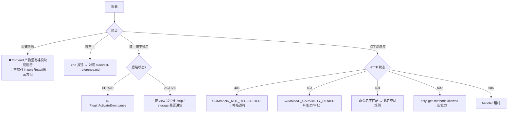

# 错误处理与资源清理

**结论先行**：错误分三层 —— **宿主错误类**（17 个，带 `[PluginHost]` 前缀）、**机器可读错误码**（`code` 字段，仅 4xx 透传）、
**插件自定义错误**（约定 `[<plugin>:<CODE>]` 前缀）。清理责任在宿主编排，插件只需管四类自建资源。

---

## 1. 宿主错误类层次

```text
Error
└── PluginHostError                        [PluginHost] 前缀
    ├── PluginCapabilityDeniedError        pluginId / requiredCapability / operation / method
    ├── PluginActivateError                pluginId (+ cause)
    ├── PluginDeactivateTimeoutError       pluginId / timeoutMs
    ├── IllegalStateTransitionError        pluginId / from / to
    ├── SemverMismatchError                pluginId / pluginName / tokenName / requiredRange / actualVersion
    ├── PluginDispatchTimeoutError         pluginId / timeoutMs（inline HTTP 派发超时）
    ├── MiddlewareError                    pluginId / phase
    ├── HotReloadError                     pluginId / filePath
    │   └── HotReloadActivationError       (+ cause)
    ├── PluginSignatureError               pluginId / code
    │   ├── PluginIntegrityRequiredError   COMMUNITY_INTEGRITY_REQUIRED
    │   ├── PluginAttestationRequiredError COMMUNITY_ATTESTATION_REQUIRED
    │   ├── PluginIntegrityMismatchError   COMMUNITY_INTEGRITY_MISMATCH
    │   └── PluginSignatureInvalidError    COMMUNITY_SIGNATURE_INVALID
    └── PluginMigrationError               pluginId
        ├── PluginMigrationExecutionError  migrationName (+ cause)
        └── PluginMigrationDowngradeError  currentDbVersion / packageVersion
```

全部定义在 `packages/core/plugin-host/errors.ts`。构造函数统一：`super('[PluginHost] …')` + `this.name = 'ClassName'` + `readonly` 上下文字段。

| 错误类                          | 触发时机                          | 捕获方                          |
| ------------------------------- | --------------------------------- | ------------------------------- |
| `PluginActivateError`           | `activate()` 抛错                 | 生命周期调度层 → 状态置 `ERROR` |
| `PluginDeactivateTimeoutError`  | `deactivate()` > 5000ms           | 同上                            |
| `IllegalStateTransitionError`   | 非法状态迁移                      | API 层返回 4xx                  |
| `SemverMismatchError`           | `requires` 版本不满足             | 安装/激活 API                   |
| `PluginCapabilityDeniedError`   | 学生数据读写缺能力                | 数据访问包装层                  |
| `PluginDispatchTimeoutError`    | inline HTTP handler 不 resolve    | 网关 → 504                      |
| `PluginMigrationDowngradeError` | 目标版本 < 当前 DB 版本           | 安装/更新                       |
| `PluginSignatureError` 家族     | 社区插件包缺 integrity / 签名无效 | 安装                            |

---

## 2. 机器可读错误码

### 2.1 透传规则（决定前端能拿到什么）

| 状态码 | `message` 是否透传                                    | `code` 是否透传              |
| ------ | ----------------------------------------------------- | ---------------------------- |
| 4xx    | **是**（业务语义，如「班级不存在」）                  | **是**（`err.code`）         |
| 5xx    | 生产环境替换为 `Internal server error`；开发/测试保留 | **否**（避免泄露内部错误码） |

证据：`server/utils/error-handler.ts → sendSafeError`（L34-90）。响应体固定形状：

```json
{ "success": false, "code": "COMMAND_NOT_REGISTERED", "error": "…" }
```

### 2.2 插件相关错误码全集

| code                                                                                             | HTTP          | 抛出点                                               | 含义 / 修法                                                          |
| ------------------------------------------------------------------------------------------------ | ------------- | ---------------------------------------------------- | -------------------------------------------------------------------- |
| `COMMAND_NOT_REGISTERED`                                                                         | 403           | 内核 default-deny（`packages/core/kernel/index.ts`） | 该 `commandType` 无 ActionDescriptor。补 `actionRegistry.register()` |
| `COMMAND_HANDLER_NOT_REGISTERED`                                                                 | 403           | 同上                                                 | 有描述符但无 handler。补 `commandBus.registerHandler()`              |
| `COMMAND_CAPABILITY_DENIED`                                                                      | 403           | `packages/core/kernel/index.ts`（L339）              | 能力不匹配。`capabilityRequired` 必须与授予集合逐字相等              |
| `TOKEN_NOT_FOUND`                                                                                | 4xx           | DI 容器                                              | `manifest.requires` 漏声明，或 Token 名不在 31 条白名单              |
| `HANDLER_ALREADY_EXISTS`                                                                         | 4xx           | CommandBus                                           | 同 `commandType` 重复注册；检查是否 `activate` 内注册两次            |
| `Unsupported sandbox bridge op "x"`                                                              | —             | `src/plugin-host/plugin-host.ts`（L649）             | 前端用了 10 个 op 之外的调用                                         |
| `Access to service token 'x' denied`                                                             | —             | `service-host.ts`（L238-241）                        | Barrier 1：Token 不在该插件白名单                                    |
| `Capability denied … only 'get' methods allowed`                                                 | 500（激活期） | `service-host.ts`（L248-251）                        | Barrier 2：`capabilitiesProposed` 为空                               |
| `Call denied for actor …`                                                                        | —             | `service-host.ts`（L266-270）                        | Barrier 3：方法/路径策略拒绝                                         |
| `Plugin "x" activation failed: …`                                                                | 500           | `PluginActivateError`                                | `activate()` 抛错；看 `cause`                                        |
| `Plugin "x" deactivate timed out after 5000ms`                                                   | —             | `PluginDeactivateTimeoutError`                       | `deactivate()` 里有同步阻塞或未 resolve                              |
| `Plugin "x" requires Foo@^1.0.0, but host provides 2.0.0`                                        | 4xx           | `SemverMismatchError`                                | 改 `requires` 范围或升级宿主                                         |
| `Plugin "x" attempted to register command "y" which belongs to another plugin's UUID namespace.` | —             | `context-builder.ts`                                 | 别用别人的 UUID 前缀注册命令                                         |
| `Signature verification failed for "x" [CODE]: …`                                                | 4xx           | `PluginSignatureError`                               | 按 CODE 分支处理                                                     |

### 2.3 HTTP 状态码（网关侧，非插件代码可控）

| 状态 | 触发                                           | 证据                                |
| ---- | ---------------------------------------------- | ----------------------------------- |
| 401  | `api.routes` 声明需鉴权但无 session            | `plugin-api-gateway.ts`（L350）     |
| 403  | `roles` 不匹配                                 | 同文件（L355-361）                  |
| 404  | `sandbox-command` 找不到 handler               | `server/routes/plugins.ts`          |
| 413  | 请求体 > 1MB                                   | `plugin-api-gateway.ts`（L310-312） |
| 429  | 超过 120/min（键含 `clientIp`）或 SSE 并发 > 5 | 同文件（L373-375 / L418-421）       |
| 504  | 插件未在超时内响应                             | 同文件（L560）                      |

---

## 3. 插件自定义错误（推荐范式）

真实样本 `[P] src/index.ts`（L60-83）：

```ts
export type LabSeatErrorCode =
  | 'LESSON_NO_STUDENTS'
  | 'ROOM_NOT_FOUND'
  | 'TEMPLATE_NOT_FOUND'
  | 'SEATS_INSUFFICIENT'
  | 'NO_LAB_SELECTED'
  | 'CHECKIN_NOT_OPEN'
  | 'NO_ASSIGNMENT'
  | 'LESSON_NO_ASSIGN'
  | 'SMART_NO_INSTRUCTION'
  | 'AI_UNAVAILABLE'
  | 'AI_CALL_FAILED';

export class LabSeatError extends Error {
  constructor(
    public code: LabSeatErrorCode,
    message: string,
  ) {
    super(`[lab_seat:${code}] ${message}`); // 前缀 = 可 grep 的稳定锚点
    this.name = 'LabSeatError';
    this.code = code;
  }
}
```

**为什么值得抄**：

1. 消息前缀 `[<plugin>:<CODE>]` 让日志、AI、前端都能按 code 分支，而不是嗅探中文字符串；
2. `code` 字段可挂到 `err.code` 上（`sendSafeError` 只在 4xx 透传，业务校验错误应 `err.status = 400`）；
3. 业务错误与 `TypeError` 可区分 —— 前者是预期分支，后者是真 bug。

---

## 4. 前端熔断（扩展点级）

| 参数 | 值                                 | 证据                                                   |
| ---- | ---------------------------------- | ------------------------------------------------------ |
| 阈值 | 3 次                               | `extension-breaker.ts`（L14）`CRASH_BREAKER_THRESHOLD` |
| 窗口 | 5 分钟滑窗                         | 同文件（L15）`CRASH_BREAKER_WINDOW_MS`                 |
| 触发 | 扩展点渲染抛错                     | ErrorBoundary                                          |
| 后果 | 该扩展点被摘除，其它扩展点不受影响 | —                                                      |
| 恢复 | 窗口过期后重新计数；或重新激活插件 | 推断                                                   |

**`origin` 决定是否被摘**：

- `origin:'manifest'`（`contributes`）—— **保留**，只显示错误态，避免「Tab 闪现后消失」；
- `origin:'runtime'`（`registerExtensionPoint`）—— 随前端健康度摘除。

---

## 5. 资源清理责任表

### 5.1 宿主自动处理（插件不要重复做）

| 资源                            | 清理点                                               |
| ------------------------------- | ---------------------------------------------------- |
| `eventBus.subscribe` 的 handler | 停用时退订                                           |
| `commandBus.registerHandler`    | 停用时注销                                           |
| `actionRegistry.register`       | 停用时注销                                           |
| 扩展点（两种 origin）           | 停用时摘除                                           |
| worker / 子进程                 | 停用时 terminate（`requiresIsolatedExecution` 分支） |
| 前端 iframe 与消息监听          | `destroySandboxFrame`（`plugin-host.ts` L457）       |
| 插件表                          | **仅 uninstall** 时 `dropAllTables()`                |
| `pointsDimension` 注册的维度    | 停用时自动 `unregisterDimension`                     |

### 5.2 插件必须自己处理

```ts
let timer: ReturnType<typeof setInterval> | null = null;
let mqtt: MqttClient | null = null;

export default {
  async activate(ctx) {
    timer = setInterval(() => {
      /* 轮询 */
    }, 30_000);
    mqtt = await connect(/* … */);
  },
  async deactivate() {
    if (timer) {
      clearInterval(timer);
      timer = null;
    }
    if (mqtt) {
      await mqtt.end();
      mqtt = null;
    }
  },
};
```

| 资源                     | 不清理的后果                                         |
| ------------------------ | ---------------------------------------------------- |
| `setInterval`            | 停用后仍在跑，回调里 `ctx` 已失效 → 未捕获异常刷日志 |
| 第三方连接               | 连接泄漏，重装插件后双连接                           |
| 模块级缓存               | 重复激活后数据陈旧 / 内存增长                        |
| 自建 `EventEmitter` 监听 | 监听器叠加，一次事件触发 N 次                        |

### 5.3 卸载（不可逆）

| 步骤 | 行为                     | 证据                                                     |
| ---- | ------------------------ | -------------------------------------------------------- |
| 1    | 停用（若 ACTIVE）        | `uninstall.ts`                                           |
| 2    | `ctx.db.dropAllTables()` | `types.ts → PluginDatabaseAPI.dropAllTables`（L104-105） |
| 3    | 删 `plugins/<uuid>/`     | `install.ts` 目录约定                                    |
| 4    | DB 行置 `UNINSTALLED`    | `PluginState`                                            |
| 5    | 孤儿数据导出（可配）     | `orphan-data.ts`，`待确认` 触发条件                      |

---

## 6. 排错决策树



逐条现象的完整对照见 [troubleshooting.md](../development/troubleshooting.md)。
