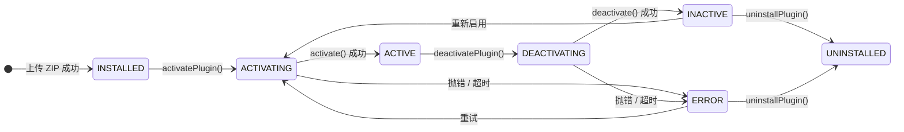

# 插件生命周期

**结论先行**：插件只有 7 个状态、4 个可由插件代码介入的时机（`activate` / `deactivate` / `onStudentExport` / `onStudentDelete`），
两个硬超时都是 **5000ms**。除这四点外的一切（注册、退订、清理扩展点）都由宿主代办。

---

## 1. 七态状态机



| 状态 | 取值字符串 | 是否瞬态 | 含义 |
| --- | --- | --- | --- |
| `INSTALLED` | `installed` | 否 | 文件已落盘，从未激活 |
| `ACTIVATING` | `activating` | **是** | 正在跑 `activate()`，不应停留 |
| `ACTIVE` | `active` | 否 | 命令可派发、扩展点可渲染 |
| `DEACTIVATING` | `deactivating` | **是** | 正在跑 `deactivate()` |
| `INACTIVE` | `inactive` | 否 | 正常停用，可再启用 |
| `ERROR` | `error` | 否 | 激活/停用失败，可重试或卸载 |
| `UNINSTALLED` | `uninstalled` | 否 | 数据与目录已删 |

**证据**：`packages/core/plugin-host/types.ts → PluginState（L54-62）`，注释里含完整迁移图（L45-52）。

### 非法迁移

`IllegalStateTransitionError(pluginId, from, to)`（`errors.ts` L87）。触发条件：目标状态不在允许集合内，
例如在 `INSTALLED` 上调 `deactivatePlugin()`。

### 卡死自愈（宿主内置，无需插件配合）

| 残留状态 | 自愈动作 | 证据 |
| --- | --- | --- |
| `ACTIVATING` | 重试前先置 `ERROR`，日志 `Recovering stuck ACTIVATING state` | `lifecycle.ts`（L89-91） |
| `DEACTIVATING` | 重试前先置 `INACTIVE`，日志 `Recovering stuck DEACTIVATING state` | `lifecycle.ts`（L665-666） |
| 停用撞上正在激活 | 等激活完成（`waitForLifecycleIdle`，默认 10s） | `lifecycle.ts`（L651-683） |

---

## 2. 超时

| 阶段 | 阈值 | 常量 / 错误 | 超时后果 |
| --- | --- | --- | --- |
| ESM 载入 | 5000ms | `ACTIVATION_TIMEOUT_MS`（`base.ts` L124）→ `EsmLoadTimeoutError` | `ACTIVATING → ERROR` |
| `activate()` 整体 | 5000ms | 同上 | `ACTIVATING → ERROR` |
| `deactivate()` | 5000ms | `DEACTIVATION_TIMEOUT_MS`（`base.ts` L126）→ `PluginDeactivateTimeoutError`（`errors.ts` L72） | `DEACTIVATING → ERROR` |
| 停用等待激活完成 | 10000ms | `waitForLifecycleIdle(pluginId, 10_000)` | 继续按停用流程走 |
| 前端 `activate()`（浏览器侧） | 5000ms | `plugin-host.ts`（L546-550）`Activation timeout (5000ms)` | 前端插件置 `ERROR` |
| 插件 REST 请求 | 由网关决定，超时返回 **504** | `plugin-api-gateway.ts`（L560） | 连接释放，插件侧无感知 |
| SSE 单 IP 并发流 | 默认 5 | `plugin-api-gateway.ts`（L418-421） | 429 |

> **推论（可据此设计）**：`activate()` 里**不能**做超过 5 秒的事。
> 长耗时初始化必须挪到首个命令里做，或用 `processManager.registerInterval` 异步推进。

---

## 3. 四个插件可介入的时机

### 3.1 后端模块导出形状

```ts
// 唯一合法形状：default 导出对象
export default {
  manifest: { /* ... */ },
  async activate(ctx: PluginContext): Promise<void> { /* 注册命令/订阅/建表 */ },
  async deactivate(): Promise<void> { /* 清理自建资源 */ },   // 可选
  async onStudentExport(studentId: string): Promise<unknown> { /* 可选：GDPR 导出 */ },
  async onStudentDelete(studentId: string): Promise<void> { /* 可选：GDPR 删除 */ },
};
```

证据：`packages/plugin-sdk/openlearn.d.ts → PluginHost.registerPreloadedPlugin`（L750-759）给出了这四个钩子的类型；
`src/plugin-host/plugin-host.ts → PluginModule`（L272 起）给出前端侧的对应形状。

| 钩子 | 调用者 | 同步/异步 | 返回值用途 |
| --- | --- | --- | --- |
| `activate(ctx)` | 内核 `lifecycle.ts` | 必须 async | 无 |
| `deactivate()` | 内核 `lifecycle.ts` | 可 sync/async | 无 |
| `onStudentExport(studentId)` | `PluginHost.exportStudentDataFromPlugins` | async | 该学生在本插件内的数据（JSON 可序列化） |
| `onStudentDelete(studentId)` | `PluginHost.deleteStudentDataFromPlugins` | async | 无 |

### 3.2 前端模块导出形状

```ts
export default {
  manifest: FrontendPluginManifest,
  async activate(ctx: FrontendPluginContext) { /* 注册扩展点 */ },
  async deactivate() { /* 可选 */ },
};
// 也接受具名导出：{ manifest, activate, deactivate }
```

证据：`src/plugin-host/plugin-host.ts → PluginModule`（L272-282）。

> 前端 `activate` 抛错 ⇒ 该插件置 `ERROR`，但其 `origin:'manifest'` 的声明式贡献**仍保留**。

---

## 4. 生命周期中「谁做了什么」责任表

| 动作 | 宿主 | 插件 |
| --- | --- | --- |
| 读 `manifest.json` 并校验 | ✅ | — |
| 计算执行模式（是否强制 process） | ✅ | 不能自选 |
| 构造并包装 `ctx` | ✅ | — |
| 给 `registerHandler` 补命名空间前缀 | ✅ | 写短名即可 |
| 拒绝无 ActionDescriptor 的命令 | ✅ | 必须登记描述符 |
| 停用时退订事件 | ✅ | — |
| 停用时注销 handler / action | ✅ | — |
| 停用时摘除扩展点 | ✅（前端） | — |
| 卸载时删表 | ✅（`dropAllTables`） | — |
| 清理自建定时器 | ❌ | ✅ |
| 清理第三方连接 | ❌ | ✅ |
| 重复激活的状态幂等 | 部分（状态机） | ✅（模块级变量自行重置） |
| 建表 / 迁移 | 提供 API | ✅ 调 `ensureTable` / `migrate` |

---

## 5. 重复激活（`activate → deactivate → activate`）

**这是测试必测项**（见 [testing-guide.md](../development/testing-guide.md) L2 用例 5）。三个真实故障模式：

| 故障 | 根因 | 修法 |
| --- | --- | --- |
| 事件回调被调用 N 次 | handler 是模块级函数，第二次 `subscribe` 又加一份 | 模块级 `Set` 记录或每次 `activate` 重新绑定箭头函数 |
| `HANDLER_ALREADY_EXISTS` | 上次 `registerHandler` 未注销就再注册同名 | 宿主已自动注销；若仍报，说明插件在 `activate` 里注册了两次 |
| 内存/连接泄漏 | 自建 `setInterval` 未清 | `deactivate()` 里 `clearInterval` |

---

## 6. 热重载

| 事实 | 值 | 证据 |
| --- | --- | --- |
| 支持范围 | 开发期，文件变更触发 | `packages/core/plugin-host/hot-reload.ts` |
| 失败错误 | `HotReloadError`（L144）、`HotReloadActivationError`（L158） | `errors.ts` |
| 语义 | 新版本激活失败 ⇒ 保留旧版本运行 | `HotReloadActivationError` 注释「Activation of new version failed」 |
| 生产建议 | 不在生产开启 | 无配置项暴露，`待确认` |

**注意**：`process` 模式下热重载必须走子进程重建；若实现退回主进程 `esmLoader.load()`，
隔离会静默降级为 inline。`types.ts → requiresIsolatedExecution`（L413）的注释记录了这个历史缺陷。

---

## 7. 前端沙箱的「停用」不是关闭 iframe

`destroySandboxFrame(pluginId)`（`plugin-host.ts` L457）的执行顺序：

1. 调 `sandboxCleanups` 里的清理函数（移除 `message`/`load` 监听）；
2. `postMessage({type:'deactivate', id})` 通知 iframe 内插件；
3. `frame.remove()`。

插件前端若在 `deactivate()` 里做异步清理，**不能假设一定有时间完成** —— 消息发出后立即移除节点。

---

## 8. 生命周期与能力门禁的交叉点（最容易踩）

```text
process / worker 模式下：
  activate() 中调用非 get* RPC（例：ctx.db.ensureTable、actionRegistry.register、eventBus.publish）
    ├─ capabilitiesProposed 为空        → 500：Capability denied … only 'get' methods allowed
    ├─ 声明了但管理员未勾选授予         → 同上
    └─ 声明了且已授予                   → 放行
```

证据：`src/plugin-host/service-host.ts → handleInvoke`（L245-252）的 Barrier 2 分支。
完整机制见 [capabilities-and-security.md](capabilities-and-security.md) §3。
