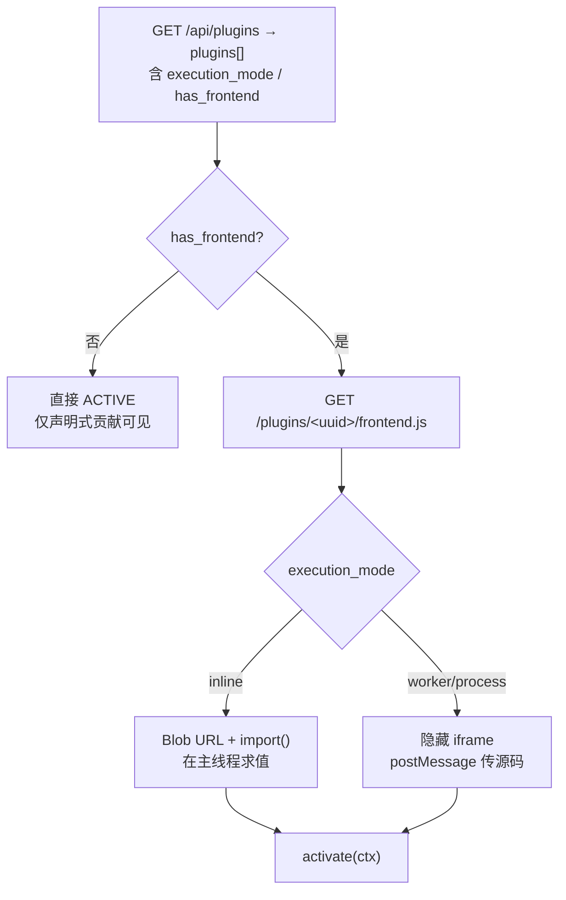

# 注册与加载

**结论先行**：加载分两段 —— **服务端**（ZIP → 磁盘 → ESM → `PluginContext`）与 **前端**（`frontend.js` → 隐藏 iframe / inline 求值）。
两段互不阻塞：前端产物缺失时，声明式贡献照常显示，插件仍可 `ACTIVE`。

---

## 1. 发现机制：没有「扫描目录自动注册」

| 事实 | 结论 | 证据 |
| --- | --- | --- |
| 是否有插件市场热扫描 | **没有**。只能通过上传 ZIP 或内置 `packages/plugins/` 预加载 | `PluginHost.installPlugin(sourceCode)`、`registerPreloadedPlugin`（`openlearn.d.ts` L750/L762） |
| ZIP 安装来源 | 管理后台「插件中心」上传，或 `installFromZip(zipPath, mode?)` | `IPluginDistributionManager.installFromZip`（`openlearn.d.ts` L941） |
| 更新来源 | `manifest.updateSource`（`github-release` / `gitee-release`）+ 仓库适配器 | `parseManifest`、`IPluginRepositoryAdapter`（L905） |
| 目录即真相 | 否。DB `plugins` 行是真相，目录缺失 ⇒ 载入失败 | `install.ts` 先落盘后写 DB |

> 这条排除了一个高频误解：**改 `plugins/<uuid>/index.js` 不会触发生效**，除非重启或触发热重载。

---

## 2. 安装期校验（按执行顺序）

```text
① ZIP 可读（jszip）
② manifest.json 存在且能 JSON.parse
③ manifestSchema.parse()           ← zod，严格
④ manifest.id 唯一（DB 唯一约束）
⑤ 写 plugins/<uuid>/{index.js, manifest.json, frontend.js?}
⑥ 解压 storage/**（其余路径丢弃）
⑦ 写 DB 行：id=uuid, manifest=原文, execution_mode=求值结果
```

### 2.1 zod 会拦什么、会放过什么

| 情况 | 结果 | 证据 |
| --- | --- | --- |
| `id` 含 `:` | **拒绝**（actor 命名空间保护） | `manifest-schema.ts`（L792-795） |
| `id`/`name`/`version`/`main` 为空串 | **拒绝** | 同文件（L792-798） |
| `requires` 条目格式不符正则 | **拒绝** | `requiresItemSchema`（L776） |
| `contributes` 顶层出现未知槽位名 | **放行**（`contributesSchema` 末尾 `.passthrough()`，L719） | 同文件 |
| `contributes` 中**已声明槽位**的条目内出现未知字段 | **被 strip**（条目是 `z.object`，未 passthrough） | 例：`teacherPanelSchema`（L493-502）显式补 `view` 就是为此 |
| `classroomTools` 内容非法 | **放行**（`z.array(z.unknown())`，L837） | 同文件 |
| `executionMode` 字段 | **放行但不参与判定**（顶层 passthrough） | `execution-policy.ts` |

> **这是最高危的一条**：`view` 字段若没在对应槽位的 zod 里声明，`parse()` 后被静默删除，
> 表现为「面板空白、无日志」。排查用 `bash scripts/post-install-check.sh <id> --zip <zip>`。

### 2.2 `requires` / `optional` 的正则（逐字）

```regex
^@[\w-]+\/[\w-]+:I\w+(?:@[\^~]?\d+\.\d+\.\d+(?:-[\w.]+)?)?$
```

可接受：`@openlearn/core:ICommandBusService`、`@openlearn/core:IDatabase@^1.0.0`、`@a/b:IFoo@1.2.3-pre.1`
不可接受：`IDatabase`（缺 scope）、`@openlearn:IDatabase`（缺 `/domain`）、`@openlearn/core:Database`（`I` 前缀必需）。

证据：`manifest-schema.ts → requiresItemSchema`（L776-778）。

### 2.3 依赖解析

| 概念 | 字段 | 语义 |
| --- | --- | --- |
| 硬依赖 | `requires` | 缺失或版本不满足 ⇒ 激活失败（`SemverMismatchError`） |
| 软依赖 | `optional` | 版本不满足 ⇒ 对应 `ctx.services.*` 置 `null`（D-12 降级） |
| 插件间依赖 | `pluginDependencies` | 依赖插件须先 `ACTIVE` |
| 对外提供服务 | `provides` | 与 `ctx.provide(token)` 配对，缺声明则 `provide()` 抛错 |

**证据**：`errors.ts → SemverMismatchError`（L105，携带 `tokenName`/`requiredRange`/`actualVersion`）；
`types.ts → PluginContext.services` 注释（L228-238）明确 `T | null` 来自 `manifest.optional` 的降级。

---

## 3. 执行模式求值（加载前必做）

```ts
// packages/core/plugin-host/execution-policy.ts
resolvePluginExecutionMode(manifestId, requested, env, sourcePath)
  → { mode, coerced, reason? }
```

判定顺序（**逐条短路**）：

1. `isInsideBuiltinPluginsDir(sourcePath)` → 用请求模式；
2. `isInTrustedInlineAllowlist(manifestId, env)` → 用请求模式；
3. `env.VITEST && env.OPENLEARN_ENFORCE_PLUGIN_ISOLATION !== '1'` → 用请求模式（仅测试）；
4. 其余 → **强制 `process`**，`coerced: true`。

通配符语义（`matchesTrustedInlinePattern`，L45）：

| 名单条目 | 匹配 |
| --- | --- |
| `*` | 任意 id |
| `@ext/*`、`openlearn-plugin-*` | 前缀匹配 |
| `com.acme.plugin` | 精确相等 |

**不构成信任的东西**（逐条实测语义）：`manifest.id` 以 `@openlearn/` 开头、`manifest.executionMode` 字段、`manifest.author`、ZIP 文件名。

---

## 4. 服务端载入

| 步骤 | 实现 | 说明 |
| --- | --- | --- |
| 读文件 | `plugins/<uuid>/index.js` | 由 `manifest.main` 指定，缺省 `index.js` |
| 载入 | `packages/core/esm-loader/node-loader.ts` → `import()` | CJS/ESM 均可（esbuild 产物为 CJS 风格 bundle） |
| 取导出 | `default.manifest` + `default.activate` | 具名导出不被识别（`待确认`：`node-loader` 是否兜底 named export） |
| 建上下文 | `context-builder.ts → buildContext` | 9 服务包装 + `db`/`log`/`config`/`http`/`i18n`/`require` |
| 激活 | `plugin.activate(ctx)` | 5s 超时 |
| 命令注册 | `context-builder` 内 `createSafeFunction` 包装 `registerHandler` | 自动补前缀 + 拒绝他人 UUID 命名空间 |

**命名空间拒绝逻辑**（`context-builder.ts` 内联 `UUID_V7_PREFIX` 判断）：

```text
若 commandType 以「其他插件的 UUID v7 + .」开头
   → 抛 Plugin "X" attempted to register command "Y" which belongs to another plugin's UUID namespace.
短语义名（quiz.create / vote.create）一律放行，注册时补本插件前缀。
```

---

## 5. 前端载入（三条分支）



| 分支 | 代码 | 关键约束 |
| --- | --- | --- |
| 无前端产物 | `activateRemotePlugin`（L687-699）：`hasFrontend === false` ⇒ 直接置 `ACTIVE` | 纯声明式 / 纯 `view` 插件合法 |
| inline | Blob + 动态 `import()` | 可用 `globalThis.HostSharedDeps` 取 React |
| 沙箱 | `mountSandboxFrame`（L474）→ `postMessage('load')` → 等 `activated` | 源码整体跨 `postMessage`，**函数不可传** |

**声明式贡献先于前端产物注册**（L683-685 注释 + 代码）：即使 `frontend.js` 404，
`contributes` / `classroomTools` 仍会被注册，并在失败分支被 `preserveManifestContributions` 保留。

### 5.1 裸模块说明符守卫（构建期就拦）

SDK CLI 3.7.2+ 在打包后扫描 `dist/frontend.js`：

```text
命中 from 'x' / import 'x' / require('x') / import('x')（x 非 ./ 非 /）
→ 输出 ✖ frontend 产物里有裸模块说明符
→ 构建失败
```

证据：`packages/plugin-sdk/cli.mjs → frontendBareSpecifierGuard`（L272 注释起，报错在 L324）。
原因：远程前端跑在不透明源 iframe，加载方式是 `Blob` + 动态 `import()`，无 importmap 可解析裸说明符。

---

## 6. 贡献点注册：两套机制，别混

| 机制 | 入口 | 是否渲染 UI | 存储位置 |
| --- | --- | --- | --- |
| A. 声明式 `manifest.contributes` | 安装期即可见 | **否**（组件是 `NullExtensionComponent`，仅数据） | 前端 zustand 注册表 + 服务端 `ContributionRegistry` |
| B. 命令式 `ctx.ui.registerExtensionPoint()` | `activate()` 期间 | 是（可带 `component` / `view`） | 前端 zustand 注册表 |

**A 的处理细节**（`registerManifestContributions`，L185-259）：

1. `manifest.classroomTools` → 逐个注册到槽位 `classroom.tool`，`slotProps` 只带 `commandType`；
2. `contributes.locales` → `registerPluginLocales(pluginId, locales)`；
3. 其余**数组型** `contributes` 键逐个注册：`id` 取 `entry.id ?? entry.type`，`label` 取 `title ?? label ?? name ?? id`；
4. `entry.commandType` 经 `resolvePluginCommandType(commandType, manifestId)` 前缀化后放进 `slotProps`；
5. `entry.view` 透传；
6. `editor.palette_item` / `editor.timeline_segment` 额外桥接到对应运行时 Registry。

> **注意 A 与 B 的 id 冲突**：同 `(slot, id)` 后者覆盖前者。manifest 与运行时都注册同一个 id，赢的是运行时那次。

---

## 7. 前端 `view` 路径规则（安装侧决定）

| 规则 | 值 | 证据 |
| --- | --- | --- |
| 允许的前缀 | `storage/` | `install.ts` 解压谓词（L359/L756） |
| 官方 CLI 是否打包 `storage/` | **否**（只打 `index.js` / `manifest.json` / `frontend.js` / `signature.json`） | `cli.mjs`（L546-553） |
| 后果 | 写了 `view` 但没自写打包脚本 ⇒ 文件 404，面板空白 | 推断（由上述两条直接推出） |
| 桥接脚本 | 页面内需引 `/plugin-sandbox/view-bridge.js` | `docs/agent/contracts/bridge-ops.json` 的 view 通道 |

---

## 8. 加载失败的处置矩阵

| 失败点 | 抛出的错误 | 插件状态 | 用户可见现象 |
| --- | --- | --- | --- |
| manifest zod 失败 | zod `ZodError` | 不落库 | 安装弹窗报字段错误 |
| ZIP 结构错（缺 `index.js`） | 载入期 `import()` 失败 | `ERROR` | 插件列表红标 |
| `main` 指向不存在的文件 | `EsmLoadTimeoutError` / 模块解析错误 | `ERROR` | 同上 |
| `activate()` 抛错 | `PluginActivateError` | `ERROR` | 同上 |
| `requires` 版本不满足 | `SemverMismatchError` | `ERROR` | 同上，消息含期望/实际版本 |
| `frontend.js` 404 | 前端 `Error: Failed to fetch frontend.js … HTTP 404` | 前端 `ERROR`，后端仍 `ACTIVE` | 声明式 Tab 在，运行时 UI 无 |
| iframe 二次 `load`（导航外逃） | 无错误，日志 `attempted unauthorized navigation` | 前端 `ERROR` | 插件被销毁 |
| 前端 `activate` 超时 | `Activation timeout (5000ms)` | 前端 `ERROR` | 同上 |
