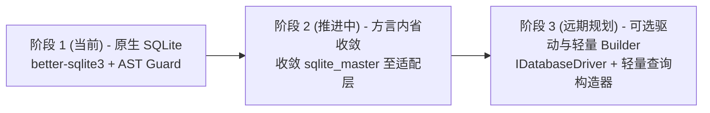

# ADR-001: 多租户架构决策（明确单校部署与容器化编排）与数据库抽象层评估

- **状态**: Accepted (已采纳)
- **决策者**: 核心架构组
- **日期**: 2026-10-18
- **关联 Issue**: [#149 [P2][架构] 多租户/多校区决策（设计或明确单校部署）+ 数据库抽象层评估](https://github.com/aymwoo/OpenLearn-Next-V2/issues/149)
- **关联文档**:
  - [database-and-migrations.md](file:///home/wuxf/Develop/openlearnv2/docs/architecture/database-and-migrations.md)
  - [operations.md](file:///home/wuxf/Develop/openlearnv2/docs/beta/operations.md)

---

## 1. 背景与上下文 (Context)

OpenLearn V2 定位为“教育操作系统 (Educational OS)”，核心场景聚焦中小学及高中信息科技、技术与工程等学科的数字化教学互动、课堂测评与插件生态。

在平台演进过程中，随着插件生态和部署场景拓展，出现了一个根本性的架构分水岭：**平台是否需要在核心数据模型中引入跨校租户字段（如 `school_id`），做成单库多租户 SaaS 架构？**

当前系统的技术现状如下：
1. **单实例模型**: 在 `server/`、`packages/` 与 `migrations/` 中无任何 `tenant`、`school_id` 或 `campus` 字段，全局默认为单实例单校模型。
2. **底层存储技术**: 采用高性能嵌入式数据库 `better-sqlite3`（WAL 模式 + 外键约束），数据存储在本地文件（如 `$OPENLEARN_DATA_DIR/educational_os.db`）。
3. **插件数据访问**: 插件通过 `ctx.db` 直接执行参数化 SQL，自建表机制由 `packages/core/plugin-host/plugin-tables.ts` 与 `sql-guard.ts` 通过 AST 语法检查保证表名前缀隔离（`ext_{pluginId}_*`），并使用 `sqlite_master` 等 SQLite 特有系统表进行结构探测。

如果在没有明确架构决策的情况下盲目演进，未来无论是强行切分多租户，还是更换数据库引擎，都会给平台核心与第三方插件生态带来毁灭性的破坏。

---

## 2. 方案对比与评估 (Options Evaluated)

针对多租户与多校区需求，架构团队深入评估了两种截然不同的路线：

### 方案 A：一校一实例（物理隔离 + 容器化编排）

- **定义**: 保持 OpenLearn 核心代码的单校模型不变。一所学校部署一个独立的 OpenLearn 进程容器与专属 SQLite 数据库卷；多校区/区域集约化部署通过现代容器编排（Docker Compose / Kubernetes）配合轻量反向代理（Nginx / Caddy）实现。

### 方案 B：单库多租户（行级逻辑隔离）

- **定义**: 核心数据表全部增加 `school_id` 列；所有查询、唯一索引（如用户名、班级名）重构为复合键；要求所有插件自建表必须携带租户列，数据范围中间件在所有 SQL 语句中动态改写注入 `WHERE school_id = ?`。

---

### 详细权衡矩阵

| 评估维度 | 方案 A：一校一实例（物理隔离） | 方案 B：单库多租户（逻辑隔离） | 裁决与权重说明 |
| :--- | :--- | :--- | :--- |
| **数据安全与隐私合规** | **极优 (Physical Isolation)** 各校数据在独立的 SQLite 文件与磁盘目录中，从介质层彻底阻断跨校越权。 | **极高风险 (Logical Isolation)** 依赖代码与中间件的每行 SQL 改写。插件编写复杂 SQL 时极易产生注入漏水，导致全区学生数据泄露。 | **致命红线**。未成年人学生隐私（《个人信息保护法》）要求极高，物理隔离具备天然法律合规优势。 |
| **边缘与断网可用性** | **完美契合** 中小学机房断网、内网穿透或局域网局域互联时，单校单机即可完整离线运行白板与测验。 | **无法满足** 强依赖中心化多租户数据库与公网连通性，机房网络抖动即导致全校教学中断。 | **核心场景**。OpenLearn 核心战场正是机房与校内局域网边缘计算。 |
| **并发与写锁瓶颈** | **完全隔离** 单校几百至上千人并发，SQLite WAL 读写分离性能充沛；各校并发互不争抢写锁。 | **写锁雪崩** 多校万名学生同时期末交卷，SQLite 单写锁将引发严重阻塞与超时，被迫重构成外部重型集群数据库。 | **架构倒挂**。单库多租户会迫使平台放弃轻量极简优势，引入庞大中心化运维负担。 |
| **备份与容灾恢复** | **细粒度极简** 单校备份仅需热备单文件；单校误删或故障恢复可在分钟级完成，对其他学校 0 影响。 | **复杂沉重** 单库灾难波及全区；无法单独将某校数据迁回该校机房进行本地分析。 | **运维摩擦**。一校一档是教育信息化最基础的运维诉求。 |
| **代码与插件兼容性** | **0 破坏性** 现有 37+ 迁移、业务代码及全部插件 API 100% 保持有效，零研发负担与技术债务。 | **剧烈破坏** 需重写所有索引与查询，现有已安装插件自建表全挂，生态迁移阻力极大。 | **生态生命线**。保护第三方插件生态开发者的投资。 |

---

## 3. 决策结论 (Decision)

我们**明确且权威地采纳方案 A：一校一实例 (Instance-per-School)，并在文档与架构基线中确定 OpenLearn V2 为纯单校部署模型**。

### 核心决议要点：

1. **核心模型纯粹性**:
   - 核心数据表与插件数据表**绝不**引入 `school_id` / `tenant_id`。
   - 所有业务逻辑（用户、班级、权限、课件、测评、插件）默认作用域为当前单校实例。
2. **多校区标准实现路径**:
   - 多校区或区域多校统一部署**必须且仅通过容器化编排实现**。
   - 单台 8 核 16G 服务器可通过 Docker Compose 轻松承载数十所学校的独立实例（每容器内存占用仅 ~100MB），通过轻量反代按子域名（如 `school-a.edu.local`）分发。
3. **数据主权归属**:
   - 每所学校的数据目录（`/data`）完全独立挂载，支持随时单校打包迁移、本地冷备与合规归档。

---

## 4. 数据库抽象层评估结论 (Database Abstraction Evaluation)

### 4.1 现状分析
- 平台当前紧密耦合 `better-sqlite3` 同步执行机制（`db.prepare(...).run() / all() / get()`）。
- 插件系统在隔离运行时（Worker 线程 / 子进程）下，通过底层自定义 RPC 桥接 `PluginDatabaseAPI`，为插件提供安全的自建表执行环境。
- 部分核心逻辑依赖 SQLite 方言特性：
  - 系统内省：直接执行 `SELECT name FROM sqlite_master WHERE type='table'`。
  - 动态列判定：依靠 `PRAGMA table_info(...)`。
  - 冲突处理：依靠 `ON CONFLICT (...) DO UPDATE`。

### 4.2 为什么目前不应引入大型 ORM（如 Prisma / TypeORM）？
1. **包体积与冷启动**: 大型 ORM 引擎体积巨大（数 MB 至数十 MB 原生二进制），会导致轻量级容器镜像与插件 Worker 进程启动变慢数倍。
2. **插件上下文摩擦**: 插件开发者需要自由建表与高灵活度查询，大型 ORM 的静态模型生成与编译体系与动态插件加载天然相悖。
3. **性能损耗**: 在 SQLite 内存与本地文件极速访问场景下，原生参数化预编译语句性能远高于通用 ORM 的抽象层封装。

### 4.3 数据库抽象演进路线（渐进式解耦）

平台采取**三步走**渐进式抽象策略：

1. **第一阶段（当前保持）**:
   - 保持现有 `PluginDatabaseAPI` 的原始 SQL 参数化调用契约 100% 向后兼容。
   - 依靠 `sql-guard.ts` 实施严格的表名前缀隔离与 AST 校验。
2. **第二阶段（宿主内省收敛）**:
   - 将分散在业务代码中的直接 `sqlite_master` 与 `PRAGMA` 查询统一收敛至 `packages/core/db/introspection.ts` 专用适配器。
   - 消除业务层对底层系统表结构的硬编码依赖。
3. **第三阶段（轻量 QueryBuilder 与驱动抽象）**:
   - 在 `@openlearn/plugin-sdk` 中增量引入可选的轻量、无外部依赖链式 QueryBuilder（如 `ctx.db.table('items').where(...).select(...)`）。
   - 宿主内核定义 `IDatabaseDriver` 接口，将底层连接与事务管理抽象化，为未来个别需要接入 PostgreSQL 的大型定制场景留出底层驱动可替换性，同时保持上层业务与插件 API 完全无感。

---

## 5. 后续影响与影响范围 (Consequences)

### 正向影响 (Positive)
1. **研发专注度**: 研发团队彻底卸下“多租户漏水”、“复杂租户中间件重构”的思想包袱，专注于教育教学核心功能与插件生态深度扩展。
2. **系统健壮性**: 单校单库彻底杜绝跨租户数据串扰与越权缺陷（CVE 级隐患），系统极其健壮稳定。
3. **部署经济性**: 学校机房可用最低配硬件（甚至千元级小主机或单板机）本地运行，断网不影响正常教学。
4. **规范指引**: 部署手册提供现成的多容器与反向代理模版，区域教育局运维有章可循。

### 负向与限制 (Trade-offs)
- **无全局跨校联合报表**: 若需要跨全区所有学校汇总统考数据，不能通过单条 SQL `GROUP BY school_id` 查出，需通过标准的边缘数据上报协议（例如未来基于开放标准的定时数据同步或 xAPI 导出）在上层汇总系统进行汇聚。这恰恰符合现代分布式系统“边缘处理 + 中心汇总”的最佳实践。
