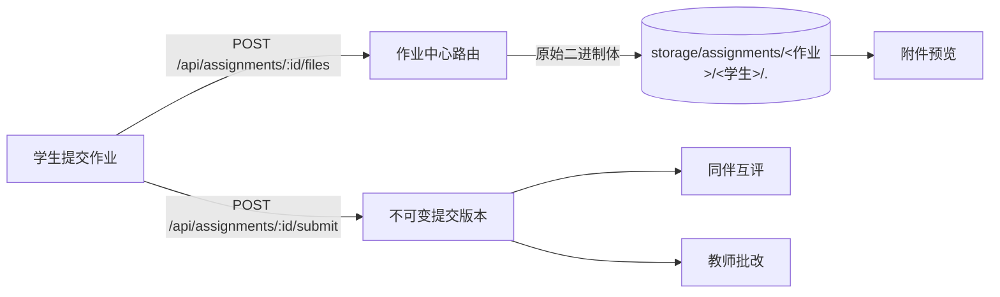

# Assignment（作业中心）架构说明

OpenLearn V2 的 **作业中心（Assignment Hub）** 是一节课里「学生交作业 → 老师批 → 同伴互评 → 归档」这条链路的落地面。相关实现分布在三处：

- 前端：`src/features/whiteboard/components/AssignmentSubmitDialog.tsx`（学生提交）、`AssignmentPeerReviewPanel.tsx`（同伴互评）、`src/components/StudentAssignmentEvalPanel.tsx`（评估面板）、`src/components/AssignmentFilePreview.tsx`（附件预览）
- 服务端：`server/routes/assignment-hub.ts`（路由与鉴权）、`server/services/assignment-service.ts`（领域服务）
- 内核侧共享规则：`packages/core/assignment/`（前后端共用的纯函数）

---

## 整体定位

「测评（Assessment）」与「作业（Assignment）」是**两件事**：测评是题库与判分（见
[Assessment 模型](assessment-model.md)），作业是**学生交付的产物**——文件、文本、链接，
以及围绕它发生的提交、互评与评分。本文档只讲后者。



---

## 核心数据结构

### `plugin_assignment_files` —— 附件本体

| 字段                           | 含义                                              |
| ------------------------------ | ------------------------------------------------- |
| `id`                           | 附件 id                                           |
| `assignment_id`                | 所属作业                                          |
| `submission_id` / `version_id` | 归档后指向提交版本（未归档为 null）               |
| `student_id`                   | 归属学生                                          |
| `original_name`                | 原始文件名（含扩展名，展示用）                    |
| `stored_path`                  | 落盘相对路径                                      |
| `size`                         | 字节数                                            |
| `mime`                         | **上传时客户端自报**的 Content-Type（**不可信**） |
| `sha256`                       | 内容摘要                                          |

### `plugin_submission_versions` —— 不可变提交版本

提交那一刻的附件快照写在 `files_json`（`[{ fileId, name, size, mime }]`）里。文件本体
仍在 `plugin_assignment_files`，按 `fileId` 取回 —— 版本不可变，但附件不复制。

---

## 上传与读取的口径

- **上传**：原始二进制体（`Content-Type: application/octet-stream`），文件名走
  `X-File-Name` 头。扩展名白名单 + magic bytes 校验 + 单文件/单学生配额，
  见 `server/utils/assignment-upload-policy.ts`。
- **归属由服务端按会话确定**：普通学生一律写到自己名下，教师代交需显式指定学生。
- **读取**：所有附件都走带鉴权的
  `GET /api/assignments/:assignmentId/files/:fileId`。`storage/` 从未被
  `express.static` 暴露 —— 附件只能经这条路由读，且服务端会校验
  「本人 / 同学 / 教师」的可见性（IDOR 防护）。

---

## 附件预览：判定规则单点化

预览能力的判定规则集中在 **`packages/core/assignment/file-preview-policy.ts`** ——
前后端共用同一份纯函数，避免「前端认为是图片、后端按 text/plain 返回」这类漂移。

| 形态          | 覆盖类型                                            | 渲染方式                           |
| ------------- | --------------------------------------------------- | ---------------------------------- |
| `image`       | png / jpg / gif / webp / bmp / svg / heic           | ``                            |
| `pdf`         | pdf                                                 | `<iframe>`（服务端 `inline` 返回） |
| `text`        | txt / md / csv / json / xml / html / css / 各类源码 | `<pre>`，**按文本渲染**            |
| `unsupported` | docx / pptx / xlsx / zip / rtf …                    | 提示 + 下载 + 扩展插槽             |

### 三条安全铁律

1. **Content-Type 由服务端按扩展名推导**，绝不采信 `plugin_assignment_files.mime`
   （客户端自报，客户端说了算）。
2. **可执行文档一律不 inline**：`text/html` / `image/svg+xml` /
   `application/xhtml+xml` 强制 `attachment`。inline 回去等于把学生上传的文件
   变成同源页面 —— 能读 cookie、能调本平台 API。SVG 仍可预览，但只走 ``
   （图片上下文不执行 SVG 脚本）。
3. **`nosniff` 兜底**，文本一律按 `text/plain` 返回。

下载端点支持 `?disposition=inline`：只有落在内联白名单里的类型才会真的内联，
其余自动回落到下载。

---

## 扩展插槽：`assignment.file.preview`

宿主**故意不内置解析** docx / pptx / xlsx —— 那要么引入重依赖，要么自己写 OOXML
解析器（既是安全面也是维护面）。平台不猜，插件声明自己能处理什么类型：

```tsx
ctx.ui.registerExtensionPoint('assignment.file.preview', {
  id: 'docx-preview',
  label: 'Word 预览器',
  component: () => null, // 数据型贡献：远程插件不提供 React 组件
  slotProps: {
    extensions: ['.docx'],
    commandType: 'ext-docx.preview',
  },
});
```

宿主按当前附件的扩展名比对 `extensions` / `mimeTypes`，命中才渲染入口；
点击后派发 `commandType`，payload 带 `fileId` / `assignmentId` / `downloadUrl` /
`inlineUrl`。

与 `assignment.submission.preview`（提交级多模态预览：沙盒回放 / 音视频 / 3D）
是两个不同粒度的插槽：前者针对**整个提交**，后者针对**单个附件**。

详见[插件 UI 扩展槽位参考](../reference/plugin-ui-extension-slots.md#101-作业附件预览扩展-assignmentfilepreview)。
