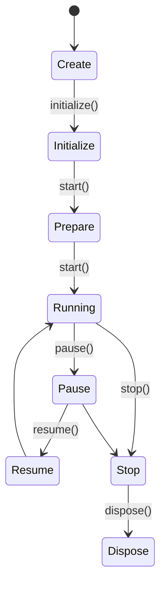
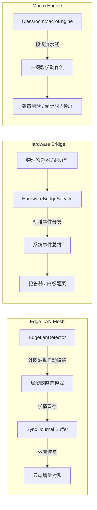

# Classroom Runtime 架构说明

> **2026-10-26 复核（v0.7.4）**：本页此前描述的「9 阶段状态机 + 前端 `src/features/classroom-runtime/`（343 行 / 7 文件）」实现**在代码中并不存在** —— 该前端目录不存在，`ClassroomSession` / `ClassroomService` / `ClassroomRegistry` / `ClassroomContextFacade` / `ClassroomEventBus` / `IClassroomContext` 等符号全仓无一命中。真实情况是**同一名词指代两套互不相干的系统**。本页已按代码重写。

---

## 0. 先分清两个同名系统

| 维度     | 内核版（`packages/core/classroom-runtime/`）                                                                               | 服务版（`server/services/classroom-runtime-service.ts`）    |
| -------- | -------------------------------------------------------------------------------------------------------------------------- | ----------------------------------------------------------- |
| 定位     | 通用「课堂运行时内核」：状态树 + 事件总线 + 服务/模块注册 + 调度器 + 权限 + 资源 + 快照 + 钩子 + 监控                      | 真实的课堂生命周期：阶段流转、环节门禁、互动组件注册        |
| 主类     | `ClassroomRuntimeKernel`                                                                                                   | `ClassroomRuntimeService`                                   |
| 接口     | 无（直接 `new`）                                                                                                           | `IClassroomLifecycleService` / `IInteractionRuntimeService` |
| 状态模型 | `RuntimeLifecycleState`（**8 态**）                                                                                        | `ClassroomLifecycleStage`（**4 阶段**）                     |
| 持久化   | 无，纯内存                                                                                                                 | 落库（`classroom_sessions`、课节进度等）                    |
| 接线     | `packages/core/kernel/index.ts` 实例化为 `classroomRuntime` 并注册 `IClassroomRuntimeServiceToken`，但**全仓零 `resolve`** | `server/routes/classroom.ts` 直接使用                       |

⚠️ **内核版目前是「已实例化、无人消费」**：它被 `packages/core/kernel/index.ts` 建好后注册进容器，却没有任何模块 `resolve` 这个 Token；唯一构造它的外部代码是 `src/features/student-workspace/student-workspace-context.ts`，而那里是**另起的独立实例**，与容器中的对象不是同一个。这一现状记录在 [`audit-2026-10-15.md`](https://github.com/aymwoo/OpenLearn-Next-V2/blob/main/audit-2026-10-15.md)。**要判断「课堂」的真实行为，看服务版。**

---

## 1. 内核版：`ClassroomRuntimeKernel`

一个把十余个基础设施协调起来的编排器（`kernel.ts`，224 行），本身不承载业务规则。

### 1.1 生命周期：8 态

`RuntimeLifecycleState`（`types.ts`）定义了 **8 个**状态，不是 9 个：

```text
Create → Initialize → Prepare → Running ⇄ Pause / Resume → Stop → Dispose
```

- 构造时置 `Create`；`initialize()` 推进到 `Initialize` 并启动调度器、初始化全部已注册服务；
- 状态转换统一走 `transitionState()` 校验，非法转换抛错；
- 对外方法：`initialize()` / `start()` / `pause()` / `resume()` / `stop()` / `dispose()`。



### 1.2 十一个协作者

`ClassroomRuntimeKernel` 在构造时装配下列 11 个子系统，全部以只读属性暴露：

| 属性                | 实现类                     | 职责                                                      |
| ------------------- | -------------------------- | --------------------------------------------------------- |
| `eventBus`          | `RuntimeEventBus`          | 类型化事件通道，支持 `'*'` 通配订阅                       |
| `stateManager`      | `RuntimeStateManager`      | 唯一的不可变状态树 + 监听器                               |
| `serviceRegistry`   | `RuntimeServiceRegistry`   | `IRuntimeService` 的注册与生命周期                        |
| `moduleRegistry`    | `RuntimeModuleRegistry`    | `IRuntimeModule` 的注册与生命周期                         |
| `scheduler`         | `RuntimeScheduler`         | 带 `TaskPriority` 的任务调度                              |
| `permissionManager` | `RuntimePermissionManager` | 角色 → 权限集合的映射                                     |
| `resourceManager`   | `RuntimeResourceManager`   | `RuntimeResource`（图片/视频/音频/PDF/插件/AI）的装载状态 |
| `snapshotManager`   | `RuntimeSnapshotManager`   | 状态快照与最近快照恢复                                    |
| `hooksManager`      | `RuntimeHooksManager`      | 8 个具名钩子的注册与触发                                  |
| `sessionManager`    | `ClassroomSessionManager`  | 课堂会话的创建/查询/归档（`ClassroomSessionData`）        |
| `monitor`           | `RuntimeMonitor`           | 运行时诊断（`getDiagnostics()`）                          |

### 1.3 统一上下文

`getContext(): RuntimeContextData` 汇总当前会话与用户身份：

```text
runtimeId / sessionId / courseId / lessonId / teacher / currentUser
role / permissions / lifecycleState
```

角色枚举 `RuntimeRole` 有 **6 个**值：`Teacher` / `Assistant` / `Student` / `Observer` / `Plugin` / `AI`。
权限枚举 `RuntimePermission` 有 **7 个**值：`lesson:control` / `stage:navigate` / `whiteboard:draw` / `quiz:submit` / `plugin:execute` / `ai:invoke` / `session:manage`。

### 1.4 状态树

`RuntimeStateTree` 是内核的唯一真相源，顶层分区：

| 分区              | 内容                                                        |
| ----------------- | ----------------------------------------------------------- |
| `runtime`         | `id` / `lifecycle` / `startTime` / `elapsedTime`            |
| `lesson`          | 当前课节信息                                                |
| `stage`           | `index`（环节序号）                                         |
| `activity`        | 当前活动                                                    |
| `whiteboard`      | `objectCount` / `isLocked`                                  |
| `teachingObjects` | 教学对象列表                                                |
| `students`        | 参与者列表（`UserParticipant`）                             |
| `plugin`          | 已加载插件                                                  |
| `ai`              | `isGenerating`                                              |
| `analytics`       | `totalInteractions` / `activeStudentCount` / `averageScore` |

### 1.5 事件、钩子

`RuntimeEventMap` 定义了 **12 个**事件通道，**键名是 PascalCase，不是 `classroom.*` 命名空间**：

```text
SessionCreated, StudentJoined, StudentLeft, LessonStarted, StageChanged,
ObjectUpdated, QuizSubmitted, PluginLoaded, AIFinished, NetworkDisconnected,
RuntimePaused, LifecycleChanged
```

`RuntimeEventBus` 是**内核自带的独立总线**（`Map<string, Set<subscriber>>`），不复用平台的全局 EventBus。`publish()` 产出带 `id` / `type` / `payload` / `source` / `timestamp` 的 `RuntimeEventEnvelope`，并同时投递给通配订阅者。

`RuntimeHookName` 有 **8 个**：`beforeLessonStart` / `afterLessonStart` / `beforeStageChange` / `afterStageChange` / `beforePluginLoad` / `afterPluginLoad` / `beforeStudentJoin` / `afterStudentJoin`。

### 1.6 其余能力

`registerModule()`、`setUser()`、`hasPermission()`、`takeSnapshot()`、`restoreLatestSnapshot()`、`getDiagnostics()`。

---

## 2. 服务版：`ClassroomRuntimeService`（真实课堂生命周期）

`server/services/classroom-runtime-service.ts`，`implements IClassroomLifecycleService, IInteractionRuntimeService`。这才是路由层实际调用、且会落库的课堂实现。

### 2.1 四阶段（不是 9 阶段）

`ClassroomLifecycleStage`（`packages/core/di/interfaces.ts`）只有 **4 个**值：

```text
PRE_CLASS_READY → IN_CLASS_TEACHING → WRAP_UP_EXIT_TICKET → ARCHIVED_REPORT
```

`ARCHIVED_REPORT_STAGE = 'ARCHIVED_REPORT'` 是导出常量；`getOrCreateSession` 及动态流查询「活动会话」时会排除该阶段。

### 2.2 生命周期接口

| 方法                                                               | 说明                                         |
| ------------------------------------------------------------------ | -------------------------------------------- |
| `getStage(lessonId)`                                               | 读取课节当前阶段                             |
| `transitionStage(lessonId, toStage, actorId, classId?)`            | 流转阶段，返回 `{ success, stage, reason? }` |
| `registerStageGuard(owner, guard)` / `unregisterStageGuard(owner)` | 注册/注销 `ClassroomStageGuard`              |

**门禁执行策略是 fail-close**：每个 guard 有独立超时（默认 **1500ms**，可用 `OPENLEARN_CLASSROOM_GUARD_TIMEOUT_MS` 覆盖），异常或超时一律**拒绝流转**，不会静默放行。这条策略是有意与 `StageGuardPipeline` 对齐的 —— 环节流转是教师侧单次请求，挂起的插件 guard 不能让接口无限等待。

### 2.3 互动运行时

`registerActivityProvider(owner, descriptor)` / `unregisterActivityProvider(owner, id)` / `listActivityProviders()`，`QuickActivityDescriptor` 带 `id` / `name` / `category` / `icon?` / `description?` / `supportedRoles?`。第三方插件通过它注册自定义互动组件（极速投票、抢答、结课通票等）。

---

## 3. 在 Layer-2 中的位置

参考 [`platform-kernel.md`](./platform-kernel.md) Layer 2_6 节点（`classroomRuntime`）：

| Kernel 属性        | 实际类型                                           |
| ------------------ | -------------------------------------------------- |
| `classroomRuntime` | `ClassroomRuntimeKernel`（内核版，当前零 resolve） |

内核版是 Layer 2 中唯一的「协调型」runtime —— 其他 runtime（lesson-runtime、whiteboard-runtime 等）都是单一职责型。但**它是编排骨架，不是业务实现**：真正的课堂阶段、门禁、互动注册都在 §2 的服务版里。

---

## 4. 约束与不变量

1. **状态机是封闭的**：内核版 8 态转换必须走 `transitionState()` 校验；服务版 4 阶段转换必须过全部已注册 `ClassroomStageGuard`。
2. **状态树只读**：`RuntimeStateTree` 的每个字段都是 `readonly`，变更只能经由 `RuntimeStateManager` 产生新树。
3. **事件通道名固定**：新增事件必须加进 `RuntimeEventMap`，`RuntimeEventType = keyof RuntimeEventMap`，写错名字在编译期就红。
4. **门禁 fail-close**：超时或抛异常的 guard 等于「不允许」，不是「跳过」。
5. **内核版与容器实例不同源**：`student-workspace-context.ts` 自建的 `ClassroomRuntimeKernel` 与 `kernel/index.ts` 里的那个互不相通，跨实例共享状态不会生效。

---

## 5. 相关源码

### 内核版（`packages/core/classroom-runtime/`，14 文件 / 约 1391 行）

| 文件                    | 职责                                                               |
| ----------------------- | ------------------------------------------------------------------ |
| `kernel.ts`             | `ClassroomRuntimeKernel`，装配 11 个协作者                         |
| `types.ts`              | 全部类型契约（8 态 / 6 角色 / 7 权限 / 12 事件 / 8 钩子 / 状态树） |
| `state-manager.ts`      | `RuntimeStateManager`                                              |
| `event-bus.ts`          | `RuntimeEventBus`                                                  |
| `service-registry.ts`   | `RuntimeServiceRegistry`                                           |
| `module-registry.ts`    | `RuntimeModuleRegistry`                                            |
| `scheduler.ts`          | `RuntimeScheduler` + `TaskPriority`                                |
| `permission-manager.ts` | `RuntimePermissionManager`                                         |
| `resource-manager.ts`   | `RuntimeResourceManager`                                           |
| `snapshot-recovery.ts`  | `RuntimeSnapshotManager`                                           |
| `hooks-system.ts`       | `RuntimeHooksManager`                                              |
| `session-manager.ts`    | `ClassroomSessionManager`                                          |
| `monitor.ts`            | `RuntimeMonitor` / `RuntimeDiagnostics`                            |
| `index.ts`              | 桶导出                                                             |

### 服务版

- `server/services/classroom-runtime-service.ts` —— `ClassroomRuntimeService`、`ARCHIVED_REPORT_STAGE`、门禁执行策略
- `packages/core/di/interfaces.ts` —— `ClassroomLifecycleStage` / `ClassroomStageGuard` / `IClassroomLifecycleService` / `IInteractionRuntimeService`

---

## 教学全生命周期四阶段架构实现 (Classroom Lifecycle Models)

在实际教学落地（`src/features/classroom/` 与 `LiveClassroomView.tsx`）中，系统将课堂抽象为**四阶段主生命周期**，贯穿课前、课中、课尾与课后：

### 1. 课前准备阶段（Pre-Class Ready）

- **预习学情穿透看板 (`PreClassDiagnosticHub.tsx`)**：
  - 课前穿透展示学生微课视频完播率与前置导学测验错误率最高 Top 3 知识点卡点，实现“以学定教”。
- **环境一键飞检预检 (`PreflightHealthModal.tsx`)**：
  - 自动巡检音视频加载速度、插件沙箱安全合规、学生终端 WebSocket 局域网连通率与本地服务响应延迟。
- **无感动态签到与破冰题**：
  - 5 秒滚动动态 OTP 二维码防代签，配合全班心态基线破冰题调研。

### 2. 课中授课与深度互动阶段（In-Class Teaching）

- **智能随机抽问与分层轮盘 (`services/fair-picker-engine.ts` / `widgets/RollCallWrapper.tsx`，均在 `src/features/whiteboard/`)**：
  - 结合历史发言频次进行公平降采样惩罚，支持基础/进阶/拔高难度自适应分层匹配，回答后触发即时成长金币声光特效。
- **随堂小组协作与画廊互评展台 (`GroupCollabWhiteboardModal.tsx` / `breakout-engine.ts`)**：
  - 支持同质分层与异质互助动态分组，提供组内协作子白板与组间成果画廊互评（Gallery Walk），支持全班点赞送花与思辨标签。
- **优秀作业多屏对比投屏批注 (`ShowcaseDiffModal.tsx` / `DiffAnnotationCanvas.tsx`)**：
  - 支持 2~4 屏多端作答并排比对，搭载激光笔光晕拖尾与荧光笔半透明覆盖批注图层。

### 3. 课尾反馈与结课阶段（Wrap-up Exit Ticket）

- **自适应梯级 Exit Ticket (`AdaptiveExitTicketModal.tsx`)**：
  - 核心概念通关必做题 ➔ 答对动态解锁进阶探究挑战题，答错动态解锁支架概念解析卡分支。
- **疑难词云与卡点聚类 (`ConceptWordcloudPanel.tsx` / `concept-clustering-engine.ts`)**：
  - 运用自然语言分词将全班反馈的疑惑概念聚类为动态词云，并生成 2 分钟收口总结建议。
- **课堂知识树即时点亮 (`KnowledgeTreeLightingModal.tsx`)**：
  - 全班核心知识图谱节点由灰暗转为亮起，直观呈现当堂达成度。

### 4. 课后复盘与学情沉淀阶段（Archived Report & Follow-up）

- **AI 教学副驾反思建议 (`copilot-reflection-engine.ts`)**：
  - 结合讲授时长占比（高讲授预警）、提问覆盖率、晴雨表时序波峰定位，输出量化归因反思报告与下一课时针对性温故策略。
- **差异化课后巩固派发中枢 (`DifferentiatedFollowupHub.tsx`)**：
  - 依据测评表现自动将全班分流为 A 梯队（通关拔高型）、B 梯队（稳健巩固型）、C 梯队（支架补强型），支持教师微调并一键下发专属任务包。
- **学生个人课节报告卡与家校互联 (`StudentLearningDigestModal.tsx`)**：
  - 自动核算单生得分、互动人次、成就勋章，并生成家校同步成长卡片。

---

## 底层架构与插件生态优化 (Architecture & Ecosystem)

系统于 `src/features/classroom/ecosystem/` 建立了三位一体的平台级支撑基座：



1. **本地局域网离线高可用降级 (Edge LAN Mesh Fallback)**：
   - 三态网络健康机：`CLOUD_ONLINE`（云端在线）、`EDGE_LAN_ONLY`（局域网直连高可用）、`OFFLINE_DISCONNECTED`（离线断开）；
   - 在校园外网抖动中断时，课堂白板、抢答、投票全量交互基于本地 Express + Socket.IO 零中断运行，待外网恢复后由对账机制自动回传。
2. **硬件教具生态标准化 (Hardware Bridge)**：
   - 统一抽象 RF 433MHz 物理答题器、数位板、无线翻页笔按键为系统事件（`CLICKER_SUBMIT_OPTION`、`CLICKER_BUZZER_PRESS`、`PRESENTER_NEXT_PAGE` 等），打通实体教具与虚拟软件的交互隔阂。
3. **课堂宏动作编排 (Classroom Action Macros)**：
   - 调度执行器支持一键自动化编排串联多步原子教学动作（倒计时总线、学生端防切屏全屏锁定、实时动态榜切换与自动收卷）。
