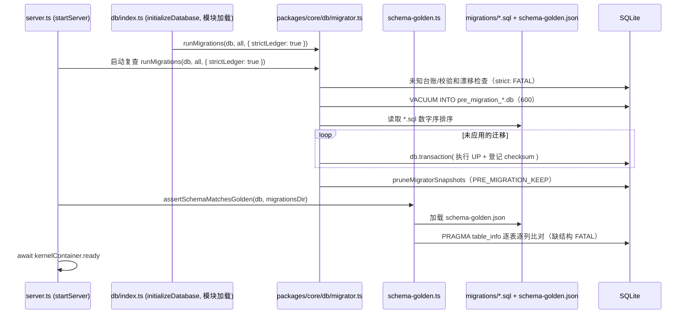

# 数据库与版本化迁移架构 (Database & Migrations)

OpenLearn V2 采用 SQLite 作为嵌入式持久化存储，结合 WAL 模式提供高吞吐并发读写能力，并通过版本化迁移体系保障 Schema 演进的可靠性与幂等性。

> **选型边界**：平台采用「一校一实例」，不为多租户引入 `school_id`，也**不承诺** PostgreSQL 兼容、不引入 ORM / 查询构建器。决策依据、代价与重新评估条件见 [ADR-001：多租户 / 多校区与数据库抽象层](adr-001-tenant-and-db-abstraction.md)；多校部署方式见 [多校部署（一校一实例）](../deployment/multi-school.md)。

---

## 1. 数据库持久化基础 (Storage Foundation)

- **引擎与模式**: 采用 `better-sqlite3`，全生命周期开启 `WAL (Write-Ahead Logging)` 读写分离模式与外键约束：
  ```sql
  PRAGMA journal_mode = WAL;
  PRAGMA synchronous = NORMAL;
  PRAGMA foreign_keys = ON;
  ```
- **多环境路径解析**:
  - **生产与标准开发**: 默认存放于 `packages/core/db/educational_os.db`，支持通过环境变量 `OPENLEARN_DB_PATH` 自定义重定向（容器内固定 `/data/educational_os.db`）。
  - **Vitest 测试并发隔离**: 当检测到 `process.env.VITEST` 激活时，按 Worker 进程 Pool ID / PID 在临时目录分配独立数据库（`/tmp/openlearn_test_dbs/openlearn_test_${poolId}.db`），彻底消除并发测试时的文件写锁争用，支持数百套测试高速并行回归。
- **读连接池**: 内核另维护只读连接池（`getReadDb` / `queryRead` 等），报表类查询走读库，不与主写连接争锁。

---

## 2. 版本化迁移引擎（SSOT：`packages/core/db/migrator.ts`）

迁移运行器的单一真实来源在 **`packages/core/db/migrator.ts`**；`server/utils/migrate.ts` 只是向后兼容的 `@deprecated` 转发出口。内核侧入口是 `packages/core/db/index.ts` 的 `initializeDatabase()`（模块加载即执行），`server.ts` 启动时再做一次复查（幂等）。

### 迁移约定与文件规范

迁移脚本位于根目录 `migrations/`，遵循统一规范：

1. **命名格式**: `NNN_description.sql`（`NNN` 为三位序号升序执行）；
2. **段落切分**: 使用 `-- UP` 声明正向迁移操作，使用 `-- DOWN` 声明回滚逆操作。`parseMigrationSql` 对二者均为可选：未匹配到 `-- UP` 时**整份文件内容**即视为 UP，未匹配到 `-- DOWN` 时 `down` 为空串。
   - 因此「缺少 DOWN 段」不会阻塞**正向**应用，但 `rollbackMigration` 会在该迁移上直接 `throw new Error('Migration ... does not provide a DOWN rollback script.')`。**若希望某个迁移可回滚，`-- DOWN` 段是硬性要求。**
   - 携带敏感数据的迁移（如 `023` 班级口令加密）的 DOWN 只回退结构，不会把密文还原成明文。
3. **元表追踪**: 引擎自动维护 `_migrations` 状态表：
   ```sql
   CREATE TABLE IF NOT EXISTS _migrations (
     name TEXT PRIMARY KEY,
     applied_at INTEGER NOT NULL,
     checksum TEXT NOT NULL
   );
   ```
4. **结构金样**: `migrations/schema-golden.json` 记录「空库跑完全部迁移后的表 → 列快照」（`pnpm db:gen-golden` 再生成，自动产物勿手改）。**改迁移后必须重新生成金样**，`server/__tests__/schema-golden.test.ts` 会对账。

### 关键容错与安全机制（按启动时序）

- **增量比对**: 启动时查询 `_migrations` 已有记录，仅应用增量脚本（按 `name` 精确匹配）。
- **未知台账守卫（strictLedger）**: 台账条目在迁移目录中不存在（库比代码新：误用未来版本的备份恢复了旧代码；或已应用迁移被改名/删除）时，启动链路直接 FATAL 拒绝启动，报错同时指出两种成因。`MIGRATION_ALLOW_UNKNOWN_LEDGER=true` 可显式放行有意的降级运维。`runMigrations` 作为库函数默认非严格（迁移子集调用是升级演练测试的合法用法），`server.ts` 与 `initializeDatabase()` 两个启动入口均以 `{ strictLedger: true }` 调用。
- **校验和实际校验**: `runMigrations` 读出 `_migrations.checksum` 并与磁盘上 UP 段的 `simpleChecksum` 比对，检出「已执行迁移被修改」漂移时返回 `ChecksumDrift[]` 并打印醒目告警；`MIGRATION_CHECKSUM_STRICT=true`（升级回归 CI 即此模式）直接抛错阻断启动。**已执行迁移的 UP 脚本不可修改**，修正永远走新增迁移。
- **迁移前安全快照**: 应用 pending 迁移前先 `VACUUM INTO` 一致性快照到 `backups/pre_migration_*.db`（落盘即 `chmod 600`；快照是未加密的学生数据副本）；正式进程快照失败即中止、不应用任何 SQL。历史快照按 `PRE_MIGRATION_KEEP`（默认 5，下限 1）保留修剪；`pre_restore_` 人工恢复快照不自动删。
- **逐条事务**: 「执行 + 登记 checksum」在同一个 `db.transaction` 内，单条迁移中途失败整体回滚，不留半应用状态。
- **启动终检（金样）**: 两个启动入口在迁移后调用 `assertSchemaMatchesGolden`——实际库必须包含 `schema-golden.json` 声明的每张表与每个列（子集校验：插件自建表、expand-contract 过渡列等多出的结构不报错），缺结构即 FATAL 并列出缺在哪。这层把「手动改库 / 外部工具 / 旧备份部分恢复」造成的漂移从运行时 SQL 报错提前到启动期明确报错。
- **历史库平滑升级 (Duplicate Column Tolerate)**: 执行 DDL 时，若遇到旧版本已手工添加的列报错（`duplicate column name`），`executeSqlStatements` 打印 `console.warn` 并 `continue`，保障存量老库无痛过渡至版本化管理。
- **DOWN 烟雾测试**: `server/__tests__/migration-down-smoke.test.ts` 对迁移链尾部做「回滚 → 重放 → 金样对账」闭环；无 DOWN 的迁移清单被钉住（新增无 DOWN 迁移需扩名单或补 DOWN）。

---

## 3. 当前标准迁移序列

`migrations/` 现有 **`000`–`043` 共 44 个 `.sql` 脚本**（按文件名数字序升序执行）。完整清单以 **`migrations/README.md` 的迁移表**为权威（随每个迁移同步更新）；结构真源是 **`migrations/schema-golden.json`**（82 张表的表 → 列快照）。

早期序列（`000`–`014`）摘要：

| 序号        | 迁移文件                 | 职责摘要                                                                                                                                        |
| ----------- | ------------------------ | ----------------------------------------------------------------------------------------------------------------------------------------------- |
| `000`       | `000_initial_schema.sql` | 核心基础数据表（30+ 表）与性能索引全量建表                                                                                                      |
| `001`–`002` |                          | `plugins.execution_mode`、`client_sessions.expires_at`                                                                                          |
| `003`–`014` |                          | 课堂运行时 / 课件成绩策略 / 作业中心 / 事件审计补课堂维度 / 互动课堂 / 教学模式 / 课中互评 / 小组 / 课堂动态流 / 自动录入 / 成绩来源 / 性能索引 |

`015` 之后的关键节点：`016` 预设投票、`021` 班级归属、`023` 班级口令加密、`024` 环节门控、`027/030` 学年与回填、`031` 测评核心（assessments 全家）、`037` 插件配置 scope、`039` 题库共享、`041` 课程包幂等、`043` SHA-256 口令标记强制改密。

> `012` / `013` 的 DOWN 段采用「建 `*__rollback` 临时表 → 重命名覆盖」的方式回滚 `ADD COLUMN`，因为旧版 SQLite 内核不支持 `ALTER TABLE ... DROP COLUMN`，且迁移执行器只对 `duplicate column` 做容错。

---

## 4. 架构时序

启动时 `startServer()`（`server.ts`）在 `assertStartupEnv()` / 敏感文件权限自检之后、`await kernelContainer.ready` 之前执行版本化迁移复查（内核 `initializeDatabase()` 在模块加载时已先跑过一遍，二者幂等）。**迁移失败、快照失败、金样终检失败都会 FATAL 并 `throw`，进程退出，不在未完成迁移的库上提供服务。**

紧随其后的 `await runStartupMigrations(db)`（`server/bootstrap-db.ts`，表征测试 `server/__tests__/bootstrap-db.test.ts`）是**独立的**启动期修补逻辑：旧内置插件升级（删除过时 Quiz / 随机点名插件行）与 SEC-AUTH-03 过期会话清理，与 `_migrations` 版本化体系无关、先后串行、互不感知。


