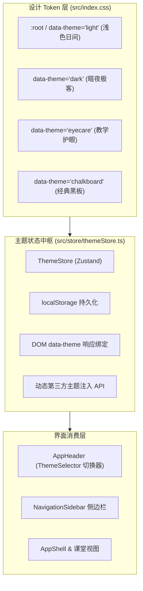

# 现代教育 OS 主题系统 (Theming System Engine)

OpenLearn V2 采用基于 **Tailwind CSS v4 CSS 变量第一公民** 的设计 Token 体系，为平台提供具备零运行时性能开销、针对课堂教学场景定制的多主题换肤引擎。

---

## 1. 架构总览 (Architecture Overview)



---

## 2. 内置四大教学主题预设

| 主题 ID      | 主题名称                  | 设计意图与采光场景                                 | 主色与背景规范                                  |
| ------------ | ------------------------- | -------------------------------------------------- | ----------------------------------------------- |
| `light`      | **浅色日间 (Light)**      | 明亮通透，适合白天自然采光充足的标准教室           | 极简灰白底 (`#f8fafc`) + 教学蓝调 (`#4f46e5`)   |
| `dark`       | **暗夜极客 (Dark)**       | 深邃抗暗光，适合计算机房、编程教学与夜间专注备课   | 深曜黑底 (`#0b0f19`) + 极客靛蓝 (`#6366f1`)     |
| `eyecare`    | **教学护眼 (EyeCare)**    | 柔和微暖绿，针对中小学电子白板与交互大屏防眩光设计 | 舒缓柔绿底 (`#f2f7f4`) + 森林墨绿 (`#2d6a4f`)   |
| `chalkboard` | **经典黑板 (Chalkboard)** | 沉浸式粉笔黑板质感，为教师提供熟悉的传统板书氛围   | 传统墨绿底 (`#0e1713`) + 清晰粉笔绿 (`#4caf50`) |

---

## 3. 设计 Token 与实用工具类

在 `src/index.css` 中暴露核心语义实用类，组件无需硬编码色值：

- **背景层级**: `bg-app`（应用底色）、`bg-surface`（主卡片/面板）、`bg-surface-secondary`（次级容器）、`bg-surface-elevated`（悬浮浮层）
- **文字层级**: `text-main`（主文本）、`text-muted`（次要文字）、`text-subtle`（弱化提示文字）
- **边框层级**: `border-theme`（标准边框）、`border-theme-subtle`（细弱分割线）
- **品牌交互**: `bg-primary-theme`（主色）、`bg-primary-theme-light`（浅色高亮背景）、`text-primary-theme`（主色文字）

---

## 4. 插件自定义主题扩展机制

平台支持插件或第三方学校机构动态注册专属主题：

```typescript
import { useThemeStore } from './store/themeStore';

useThemeStore.getState().registerTheme(
  {
    id: 'school-custom',
    label: '名校专属·墨蓝金',
    description: '校企定制主题',
    previewBg: '#0f172a',
    previewPrimary: '#f59e0b',
    category: 'plugin',
    pluginId: '@ext/custom-theme',
  },
  {
    '--bg-app': '#0f172a',
    '--bg-surface': '#1e293b',
    '--color-primary': '#f59e0b',
  },
);
```

当插件卸载时，调用 `unregisterTheme(id)`，系统自动清理动态注入的样式标签并安全回滚至默认主题。

---

## 5. 白板渲染引擎与教学工作区深度联动 (Whiteboard & Workspace Synergy)

在 Phase 2 中，主题系统深入连接交互白板渲染管线与教学工作流：

### 5.1 白板主题渲染令牌 (`theme-manager.ts`)

白板渲染引擎原生支持 `light`, `dark`, `eyecare`, `chalkboard` 四组专属 Tokens：

- **`background`**: 画布底色与容器背景联动（例如黑板模式呈现经典深墨绿 `#0e1713`）。
- **`gridDot`**: 极坐标与微网格参考点自适应变色（例如黑板模式下点阵呈现淡绿微光 `#2d5242`）。
- **`pen` / `text`**: 笔触与文本高对比度智能判断。针对暗黑模式与黑板模式，自动反转历史黑色墨迹为粉笔白（`#f8fafc`），杜绝黑底黑字视障问题。
- **自定义令牌订阅**: `themeManager.registerCustomTokens()` 与 `themeManager.subscribe()` 支持第三方白板插件自定义图形与笔迹高对比度滤镜。

### 5.2 白板控件与视图容器全面语义化

- **悬浮工具栏 (`WhiteboardToolbar`)**: 选取、画笔、几何图形、荧光笔色盘与网格开关接入 `--color-primary` 与 `--bg-surface`。
- **分页导航胶囊 (`WhiteboardPageBar`)**: 底部分页器、缩略图大纲抽屉与右键菜单统一遵循主题语义类名。
- **课堂主视图**:
  - `LiveClassroomView`: 步骤时间轴、互动反馈流、学生专注力监控环与课件轨迹分析模态框全面支持 4 套教学主题。
  - `LessonEditorView`: 课程编辑器、工具调色板 (`LessonPalette`) 与空状态均无缝换肤。
  - `StudentView`: 学生端工作台、白板交互面板与大纲面板完全统一视觉语言。

---

## 6. 第三方声明式主题包系统 (Third-Party Theme Packages)

在内置主题与 Token 体系之上，平台现已提供完整的第三方 `.zip` 主题包架构，涵盖清单与包体校验 (`packages/core/themes/theme-spec.ts`、`packages/core/themes/theme-package.ts`)、服务端共享目录与每账号隔离持久化 (`migrations/047_third_party_theme_system.sql`、`server/services/theme-service.ts`、`server/routes/themes.ts`) 以及前端主题中心与安全恢复栏 (`src/components/ThemeCenterModal.tsx`、`src/components/ThemeFailsafeRecoveryButton.tsx`)。

### 6.1 主题包目录结构与安全边界

标准示例见 `examples/themes/campus-atelier/`：

```text
campus-atelier/
├── theme.json          # 声明式主题清单（必填）
├── styles.css          # 可选作用域样式文件（仅允许 scoped CSS）
└── assets/
    ├── emblem.svg      # 预览缩略图
    └── backdrop.svg    # 本地图片 / SVG / WOFF2 字体等静态资源
```

安装入口 (`POST /api/themes/install`) 与浏览器导入均执行严格沙盒校验：

- **禁止执行脚本**：拒绝一切 `.js` / `.mjs` / `.html` / `.wasm` / `.sh` 文件，仅允许清单 JSON、CSS、常见图片及字体格式；
- **防路径穿越与体积限制**：单个 ZIP 上限 `10 MB`、解压后总量上限 `25 MB`、最多 `64` 个文件，禁止 `..` 与符号链接；
- **零外部网络请求**：禁止 CSS `@import`、`expression()`、`javascript:` 及任何 `http://` / `https://` 外链资源；所有字体、壁纸与徽标必须随 `.zip` 包本地携带；
- **SVG 安全扫描**：拦截 `<script>`、`<foreignObject>`、`on*=` 事件处理器及外链 URL，静态资源服务同时附带 `X-Content-Type-Options: nosniff` 与 SVG `Content-Security-Policy: sandbox`；
- **声明式布局安全白名单**：通过 `resolveSafeLayouts` 对登录页 (`LoginPage.tsx`)、教师端 (`TeacherView.tsx`)、学生端 (`StudentView.tsx`) 与管理后台 (`AdminPanel.tsx`) 进行区域重排与列数定制，并强制保留登录表单、导航项、管理权限等必选控件。

### 6.2 清单示例 (`theme.json`)

```json
{
  "schemaVersion": 1,
  "id": "campus-atelier",
  "name": "Campus Atelier",
  "version": "1.0.0",
  "author": "OpenLearn Community",
  "defaultMode": "auto",
  "compatibility": { "minPlatformVersion": "0.7.0", "maxPlatformVersion": "1.99.0" },
  "tokens": { "--color-primary": "#0f766e" },
  "modes": {
    "light": { "tokens": { "--bg-app": "#f7f4ed", "--bg-surface": "#ffffff", "--text-main": "#1c1917" } },
    "dark": { "tokens": { "--bg-app": "#161917", "--bg-surface": "#1f2421", "--text-main": "#f5f5f4" } }
  },
  "layouts": {
    "login": { "arrangement": "split-left", "order": ["brand", "auth-form", "seed-hint"] },
    "teacher": { "navPosition": "right", "contentMaxWidth": "wide" },
    "student": { "headerPosition": "top", "cardColumns": 3 },
    "admin": { "navStyle": "sidebar-left" }
  }
}
```

### 6.3 多账号隔离、版本更新与管理员治理

- **共享安装，账号隔离生效**：所有已登录账号（学生、教师、管理员）均可上传 `.zip` 主题包至平台共享目录 (`themes`)，用户个人选择的主题、锁定版本、`light/dark/auto` 模式与基础外观覆盖（强调色、圆角、密度、字号比例）按 `principal_key` 严格隔离存储在 `user_theme_preferences`；
- **作者版本发布与非静默升级**：仅原上传者可向同一主题 ID 发布更高 SemVer 版本。新版进入共享目录后，**不会静默替换** 其他账号当前正在使用的旧版本，而是在主题中心提示「确认升级」并展示变更日志；
- **匿名登录前隐私保护**：未登录接口 `GET /api/themes/public` 仅返回平台默认主题与公开摘要，不包含任何账号 ID 或个人偏好；浏览器本地仅保存纯视觉快照键 `openlearn_browser_appearance`；
- **管理员治理与故障回退**：仅管理员可通过 `/api/themes/:id/disable`、`/api/themes/:id/enable`、`DELETE /api/themes/:id` 停用或删除主题，并在站点设置配置全站默认主题 (`default_theme_id`)。当主题被停用、删除、不兼容或样式异常时，系统自动回退至安全默认主题，并在全端左下角常驻独立内联样式的 **「一键恢复默认主题」** 按钮 (`ThemeFailsafeRecoveryButton.tsx`)，确保样式损坏时仍可一键自救。

### 6.4 第三方插件与沙箱课件适配 (`window.LMS` / Bridge SDK)

所有微前端插件（`PluginSandboxIframeView.tsx`）与教学课件 iframe 均可通过统一接口同步宿主主题、深浅模式、Token、圆角密度与字体栈：

```javascript
// 方式一：使用 Bridge SDK（window.LMS）
function applyHostTheme(themeMeta) {
  if (!themeMeta) return;
  document.documentElement.dataset.theme = themeMeta.theme;
  document.documentElement.dataset.colorScheme = themeMeta.colorScheme;
  Object.entries(themeMeta.tokens || {}).forEach(([k, v]) => {
    document.documentElement.style.setProperty(k, v);
  });
}

applyHostTheme(window.LMS?.getTheme?.());
window.LMS?.on?.('theme:changed', applyHostTheme);

// 方式二：直接监听浏览器原生事件
window.addEventListener('openlearn:themechange', (ev) => applyHostTheme(ev.detail));
```
