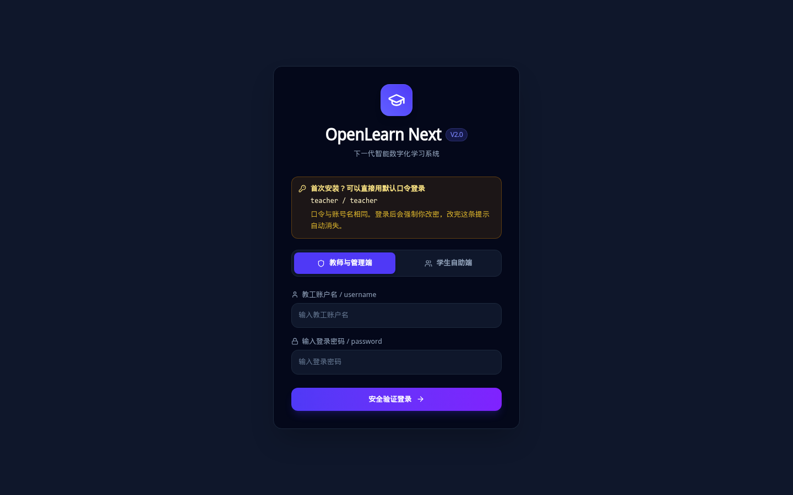
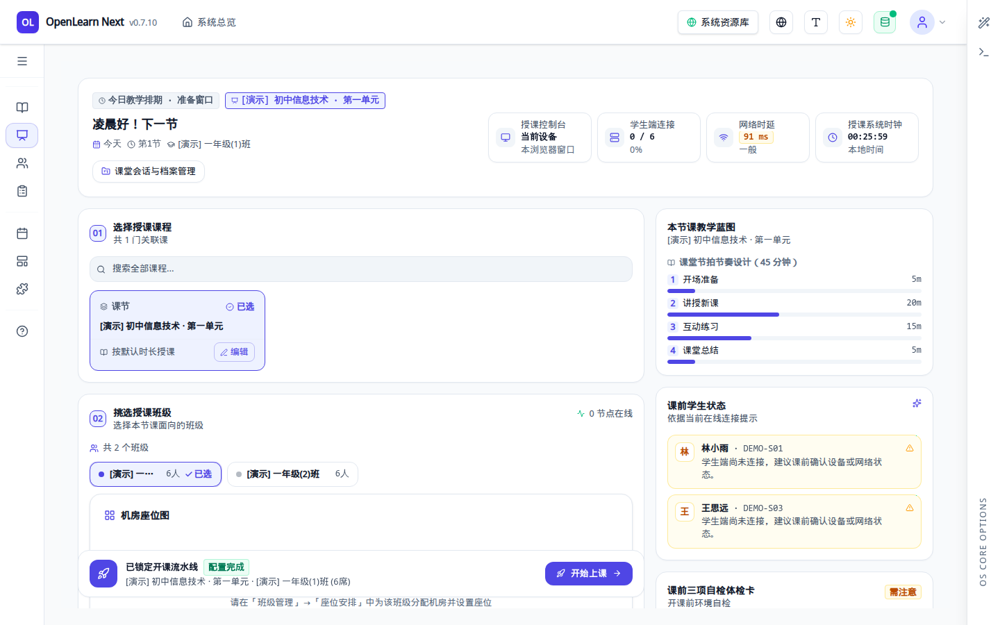
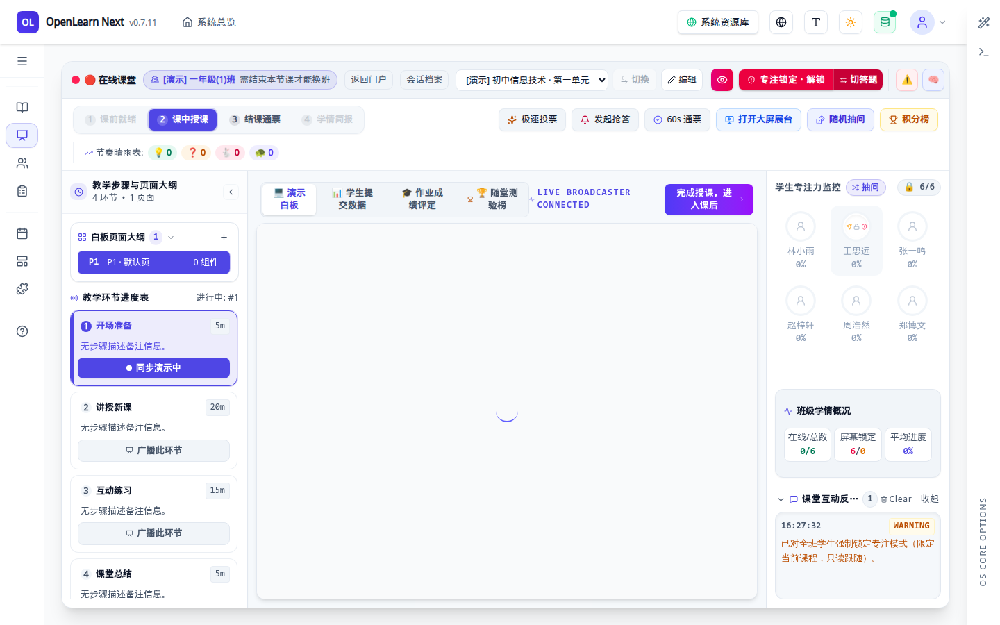
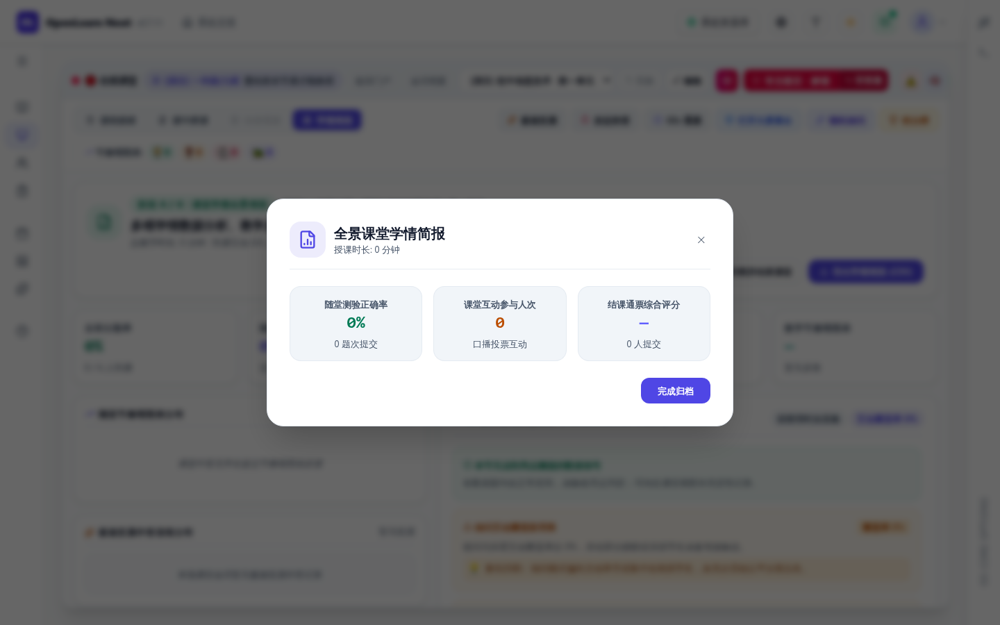
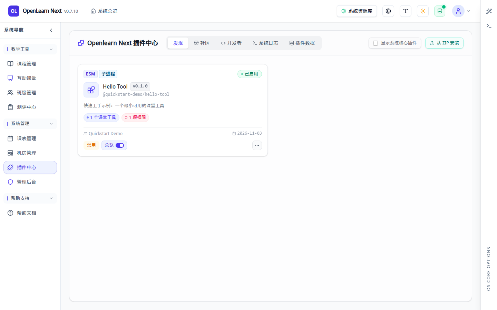
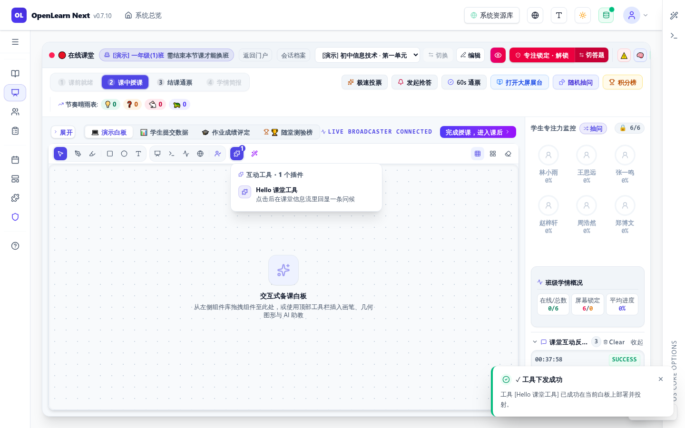

# 快速上手手册

> 面向**第一次接触 OpenLearnV2** 的老师与插件开发者：只用一页，把「装起来 → 跑通 → 上一节课 → 装一个自己写的插件」走完。
>
> 本页只讲最短路径，不展开契约与原理；每一步都指向对应的深度文档，需要细节时再跳过去。

| 你的目标                 | 建议从哪一节开始                                 | 预计耗时 |
| ------------------------ | ------------------------------------------------ | -------- |
| 只想看看这个系统长什么样 | [1.1 npx 一键试用](#11-npx-一键试用)             | 1 分钟   |
| 要长期部署 / 二次开发    | [1.2 源码本地开发](#12-源码本地开发)             | 5 分钟   |
| 想写一个插件             | 先跑通 1.2，再读 [第 4 节](#4-写第一个插件hello) | 15 分钟  |

---

## 1. 安装

### 1.1 npx 一键试用

不用克隆代码、不用装依赖，只要有 Node 就能起一个完整实例：

```bash
npx openlearn-next@latest          # 默认 http://localhost:9000
npx openlearn-next@latest -p 3000 -o   # 指定端口并自动打开浏览器
npx openlearn-next@latest --demo -o    # 一次性演示数据，退出即销毁
```

`--demo` 的数据放在系统临时目录，**不会**污染你已有的数据库，适合快速体验或录屏。

> 运维命令（体检、冷备、查插件）见 [安装指南 · npx 一键启动与 CLI 工具链](installation-guide.md#方式一npx-一键启动与-cli-工具链推荐)。

### 1.2 源码本地开发

写插件、改前端、调试内核都走这条路。环境要求：

| 依赖 | 版本要求           | 说明                                                            |
| ---- | ------------------ | --------------------------------------------------------------- |
| Node | 20.x / 22.x / 24.x | **推荐 22**（仓库 `.nvmrc`、Dockerfile、CI 都钉它）             |
| pnpm | 10.33.4            | 仓库是 pnpm workspace，`npm i` 会装出第二棵依赖树并漏编原生模块 |

```bash
git clone https://github.com/aymwoo/OpenLearn-Next-V2.git OpenLearn-Next-V2
# 国内网络访问 GitHub 受限时改用 Gitee 镜像（内容一致，GitHub → Gitee 单向同步）：
# git clone https://gitee.com/aymwoo/openlearn-next.git OpenLearn-Next-V2
cd OpenLearn-Next-V2

corepack enable && corepack prepare pnpm@10.33.4 --activate
pnpm install
cp .env.example .env
pnpm dev
```

`pnpm dev` 会同时起 Express 与 Vite（HMR），默认端口 **9000**。

> 🔁 **源在哪里拉？** 主仓是 [github.com/aymwoo/OpenLearn-Next-V2](https://github.com/aymwoo/OpenLearn-Next-V2)（Issue / PR / CI / Release 主入口）；国内网络访问 GitHub 受限时用镜像 [gitee.com/aymwoo/openlearn-next](https://gitee.com/aymwoo/openlearn-next)，内容与 `main` 一致，但 CI、Release 与 npm 发布仍只在 GitHub 侧跑。克隆后可保留两个远端（`origin`=GitHub、`gitee`=镜像），换源时 `git push gitee main` 手动快进，**不要**在 Gitee 侧开自动双向镜像。

> 版本不一致时，`preinstall` 守卫会在安装阶段直接拦住，并告诉你该换 Node 还是该 `pnpm rebuild better-sqlite3` —— 不用等启动时才撞上 `ERR_DLOPEN_FAILED`。

### 1.3 Docker Compose

```bash
# 直连模式（容器自带 9000 端口）
docker compose up -d --build

# 前面有 Nginx 反代时
TRUST_PROXY=1 docker compose --profile proxy up -d --build
```

数据落在一个数据卷里（`openlearn_data`）：SQLite、课件 `storage/`、插件目录、上传文件都在 `/data`。升级镜像前先做一次 `node scripts/site-backup.mjs` 备份。

> 生产部署、Nginx、PM2、备份恢复的完整清单见 [生产部署指南](../deployment/production-guide.md)。

### 1.4 首次初始化的四个注意点

1. **初始口令 = 用户名**：种子账号是 `admin`（管理员）和 `teacher`（教师），口令同样是 `admin` / `teacher`。首次登录会强制改密（≥8 位、含字母和数字、不能等于用户名），**改密前除改密/登出外的接口一律 403**。登录页顶部会直接给出这条提示：

   

   - 想换初始口令：设置 `OPENLEARN_ADMIN_PASSWORD` / `OPENLEARN_TEACHER_PASSWORD`；
   - 想恢复旧版随机口令：`OPENLEARN_SEED_PASSWORD_MODE=random`（只对首次建库生效，口令写入 `storage/bootstrap-credentials.txt`）。

2. **AI 不是启动前置条件**：不配任何 API Key 也能登录、建班、上课。AI 能力在管理后台「AI 提供商管理」里按 OpenAI 兼容接口添加（DeepSeek / Qwen / Ollama / OpenAI 均可）。

3. **保管好加密密钥**：`storage/encryption-key`（或环境变量 `ENCRYPTION_KEY`）用于加密 AI 密钥与班级口令。**换掉它，旧数据就解不开了**；备份时请单独离线保存。

4. **数据放在一个目录里**：默认库是 `packages/core/db/educational_os.db`，课件与插件在 `storage/`。用 `OPENLEARN_DATA_DIR` 可以把它们整体搬到卷上；容器里 `OPENLEARN_DB_PATH` 与 `OPENLEARN_DATA_DIR` 要在同一个卷，否则课件和库对不上。

---

## 2. 运行起来并确认跑通

### 2.1 启动与自检

`pnpm dev` 输出 `OpenLearn Next vX.Y.Z ready` 后，浏览器打开 `http://localhost:9000`。三个快速自检：

```bash
curl http://localhost:9000/health          # {"status":"ok","uptime":...,"version":"..."}
curl http://localhost:9000/health/ready     # {"status":"ready"}；未就绪时 503 且只有这一个字段
curl http://localhost:9000/api/auth/seed-status   # 种子账号是否还在用默认口令（不返回口令本身）
```

### 2.2 想直接有数据可玩？用演示模式

```bash
pnpm dev:demo             # 隔离的 storage/demo.db，不影响你的开发库
pnpm dev:demo -- --reset  # 丢弃旧演示数据重来
```

演示库会自动铺好：1 门课程、2 个班级、12 名学生、1 条课表，以及演示教师账号 **`demo_teacher` / `Demo@2026`**。下面的上课流程截图就是用这个账号拍的。

### 2.3 起不来时先看这三条

| 现象                                                | 原因                                                | 处理                                                      |
| --------------------------------------------------- | --------------------------------------------------- | --------------------------------------------------------- |
| `ERR_DLOPEN_FAILED` / `NODE_MODULE_VERSION ...`     | Node 主版本变了，`better-sqlite3` 二进制 ABI 不匹配 | 切回 Node 22，或执行 `pnpm rebuild better-sqlite3`        |
| `EADDRINUSE :9000`                                  | 端口被占用                                          | `PORT=3999 pnpm dev`（dev 下 CLI 参数无效，要用环境变量） |
| 登录后几乎所有请求 403 `FORBIDDEN_DEFAULT_PASSWORD` | 还在用默认口令                                      | 先完成强制改密                                            |

---

## 3. 教师视角：从登录到下课（最短路径）

### 3.1 登录

打开 `http://localhost:9000`，选择「教师与管理端」入口，用教师账号登录（演示库用 `demo_teacher` / `Demo@2026`）。学生走「学生自助端」。

### 3.2 主界面就是「授课控制台」

教师登录后落在 **互动课堂 · 授课控制台**，这也是最常用的主界面。左侧是功能导航，中间自上而下是三件事：今日排期 → 选课程 → 选班级 → 开始上课；右侧是本节课的教学蓝图、学生状态与开课自检。



### 3.3 开始上课

1. 在「选择授课课程」里点选本节课（默认已选中排期里的课节）；
2. 在「挑选授课班级」里点选班级，班级卡片会变成「已选」；
3. 底部流水线由「待配置」变「配置完成」后，点 **开始上课**。

进入课堂后先看到「课前就绪」阶段：学生到课情况、班级上课临时密码、备课预检都在这里。把临时密码（例如 `1001`）发给学生，他们用「学生自助端」+ 该密码即可进入本班课堂。

点 **一键开启课中授课（进入白板）** 进入正式授课。

### 3.4 课中常用操作



| 想做的事             | 位置                                                        | 说明                                                                  |
| -------------------- | ----------------------------------------------------------- | --------------------------------------------------------------------- |
| 讲 PPT / 写板书      | 中间白板 + 顶部工具栏（画笔、几何、文字、图片、页面）       | 白板页面与「教学环节」联动，可把某个环节广播给全班                    |
| 控制课堂节奏         | 左侧「教学环节进度表」                                      | 显示当前环节与剩余时长，可「广播此环节」                              |
| 快速互动             | 右上「极速投票 / 发起抢答 / 60s 通票 / 随机抽问 / 积分榜」  | 点一下即下发，学生端实时参与                                          |
| 投屏                 | 「打开大屏展台」                                            | 用另一块屏/投影展示白板内容                                           |
| 看学生状态           | 右侧「学生专注力监控 / 班级学情概况」                       | 在线数、专注度、屏幕锁定与平均进度                                    |
| 管理课堂纪律         | 顶部「专注锁定 · 解锁」                                     | 锁定后学生无法切出课堂（限当前课堂，只读跟随）                        |
| 上课件 / 收作业      | 中间「演示白板 / 学生提交数据 / 作业成绩评定 / 随堂测验榜」 | 课件投放、提交查看与成绩评定的入口                                    |
| 用插件提供的课堂工具 | 白板工具栏右侧的拼图图标「互动工具 (插件扩展)」             | 每个插件贡献的课堂工具都会出现在这个下拉里（第 4 节会用到一个 Hello） |

### 3.5 下课与归档

1. 点右上 **完成授课，进入课后**；
2. 在「结课通票」阶段可做随堂作业评定、60s 通票反馈、课后任务下发；
3. 切到「学情简报」，会弹出全景概要，点 **完成归档** 结束本次课堂（会话进入已归档战报，才能开始下一节课）。



> 从其它路径进入「学情简报」时，页头也常驻「归档并结束课堂」入口，效果相同。

---

## 4. 写第一个插件（Hello）

目标：15 分钟内做出一个能在课堂工具里看到的插件，而不是只停留在「能构建」。

### 4.1 前置条件

- 已按 [1.2 源码本地开发](#12-源码本地开发) 跑起服务（Node 22）；
- 用管理员账号进「插件中心」安装插件（第三方插件需要管理员勾选授权）。

### 4.2 脚手架

在仓库根目录执行（直接用仓库自带的 SDK CLI，不需要联网）：

```bash
node packages/plugin-sdk/cli.mjs init \
  --name hello-tool \
  --template server-only \
  --author "Quickstart Demo"
cd hello-tool
```

> 安装了发布版 CLI 时，等价命令是 `npx @openlearn/plugin-sdk init --name hello-tool --template server-only --author "Quickstart Demo"`，再在插件目录里 `npm install`。

生成的结构很小：

```
hello-tool/
├── package.json        # build 脚本、SDK 版本
├── tsconfig.json
└── src/index.ts        # manifest + activate —— 只改这一个文件
```

`--author` 决定插件 id 的 scope：这里会生成 `manifest.id = @quickstart-demo/hello-tool`。**不要**为了「拿权限」把 id 写成 `@openlearn/…`：`@openlearn/` 前缀不带来任何信任，`id` 也不改变执行模式（上传的第三方包一律以子进程运行，由服务端锁定）。

### 4.3 改成「课堂里看得见」的最小插件

把 `src/index.ts` 换成下面这份。相对模板只多了**课堂工具声明**，并把命令换成「能被点击触发、有返回值」的形态：

```ts
import type { PluginContext } from '@openlearn/plugin-sdk';

export default {
  manifest: {
    id: '@quickstart-demo/hello-tool',
    name: 'Hello Tool',
    version: '0.1.0',
    main: 'index.js', // 必填：缺失会导致插件装不上
    description: '快速上手示例：一个最小可用的课堂工具',
    author: 'Quickstart Demo',
    engines: { openlearn: '>=0.7.0' }, // 用到了 0.7.x 的课堂工具槽位
    capabilitiesProposed: ['lesson:read'], // 第三方插件的能力是「申请」，管理员勾选后才生效
    requires: ['@openlearn/core:ICommandBusService@^1.0.0', '@openlearn/core:IActionRegistryService@^1.0.0'],
    // 课堂工具入口：宿主渲染成白板工具栏的「互动工具」下拉项
    classroomTools: [
      {
        id: 'hello-tool',
        name: 'Hello 课堂工具',
        description: '点击后在课堂信息流里回显一条问候',
        icon: 'Sparkles',
        commandType: 'hello.greet',
        payload: { lessonId: '$lessonId' },
      },
    ],
  },

  async activate(ctx: PluginContext) {
    // 三件套之二：ActionDescriptor —— 内核 default-deny，缺它命令会被拒（HTTP 403）
    await ctx.services.actionRegistry.register({
      id: 'hello-tool-greet',
      commandType: 'hello.greet',
      description: '打招呼 —— Hello Tool 的示例课堂动作',
      capabilityRequired: 'lesson:read',
      inputSchema: {
        type: 'OBJECT',
        properties: { lessonId: { type: 'STRING', description: '当前课节 ID' } },
        required: [],
      },
    });

    // 三件套之三：handler —— 必须是 { execute } 对象，不能是裸函数
    await ctx.services.commandBus.registerHandler('hello.greet', {
      async execute(command) {
        const payload = (command.payload ?? {}) as { lessonId?: string };
        const message = `Hello from Hello Tool! lessonId=${payload.lessonId ?? '(none)'}`;
        ctx.log.info(message);
        return { message };
      },
    });

    ctx.log.info('Hello Tool activated successfully');
  },

  async deactivate() {
    // 宿主停用时会自动注销 handler / action，这里无需手工清理。
  },
};
```

两个容易踩的点，提前说清：

- **`commandType` 在两处写同一个短名**（`hello.greet`）：manifest 与 `registerHandler()` 都会被宿主自动补上 `manifest.id.` 前缀（实际派发的是 `@quickstart-demo/hello-tool.hello.greet`）。
- **三件套缺一不可**：manifest 声明入口、handler 处理命令、`actionRegistry.register()` 登记描述符。只做前两件时，点按钮会得到 403 `COMMAND_NOT_REGISTERED`。

### 4.4 构建出可分发的 ZIP

```bash
# 在 hello-tool/ 里；仓库内构建无需先 npm install
node ../packages/plugin-sdk/cli.mjs build
# 用发布版 CLI 时等价于：npx openlearn-plugin-sdk build
```

产物在 `dist/` 与项目根目录：`openlearn-plugin-hello-tool.zip`（约 10 KB）。ZIP 根目录固定是 `manifest.json` + `index.js`，**不要**手工 `zip -r` 出嵌套目录。

### 4.5 安装并启用（管理员）

1. 用管理员登录，左侧导航 **系统管理 → 插件中心**；
2. 点右上 **从 ZIP 安装**，选中刚构建的 ZIP；
3. 安装向导共 5 步，有两处必须勾选：
   - 第 2 步：`我已了解并信任此插件的提供商，愿意授予上述高级系统权限。`
   - 第 5 步：`确认授予清单申请的能力。不勾选则这些能力不会生效。`
4. 点 **确认安装并上传**。安装成功后会自动启用，卡片上显示 `已启用`、`1 个课堂工具`、`1 项权限`。



> 卡片右下角的按钮写的是「点它会做什么」：显示 **禁用** 表示当前已启用（显示「启用」则说明已停用，多半是激活失败）。

### 4.6 确认有可见效果

1. 进 **互动课堂**，选好课程与班级后 **开始上课**（或对进行中的课堂点 **继续上课**）；
2. 点 **一键开启课中授课（进入白板）** —— 白板只在「课中授课」阶段渲染；
3. 白板工具栏右侧的拼图图标（tooltip **互动工具 (插件扩展)**，右上角角标 `1`）；
4. 展开 **互动工具 · 1 个插件** → 点 **Hello 课堂工具**，右下角弹出 `✓ 工具下发成功`，左侧课堂互动反馈出现 `插件工具 [Hello 课堂工具] 执行完毕，数据成功下发。`



### 4.7 接着往下学

| 想做的事                       | 读什么                                                                                                                           |
| ------------------------------ | -------------------------------------------------------------------------------------------------------------------------------- |
| 系统学插件开发（命令/事件/表） | [插件开发完全指南](../tutorials/plugin-development-tutorial.md)                                                                  |
| manifest 每个字段的含义与限制  | [插件 Manifest 规范](../plugin/plugin-manifest-spec.md)                                                                          |
| 给插件加页面 / 侧栏 / 画板卡片 | [UI 扩展槽位](../reference/plugin-ui-extension-slots.md) + [前端沙箱能力边界](../plugin/frontend-sandbox-capability-boundary.md) |
| 写测试、在本地把问题炸出来     | [插件测试工具包](../sdk/plugin-test-kit.md) + [测试策略](../developer-guide/testing-strategy.md)                                 |

---

## 5. 常见问题

**Q：`pnpm install` 直接失败了？**
Node 版本不对。用 Node 22（`.nvmrc`），或按 `preinstall` 守卫的提示切版本 / `pnpm rebuild better-sqlite3`。

**Q：登录后什么都不能点，接口全是 403？**
还在默认口令状态。先改密；改密前除改密、登出、读会话外的接口都会被拒。

**Q：不配 AI Key 能用吗？**
能。建班、排课、上课、白板、作业都不依赖 AI；需要 AI 时再去「AI 提供商管理」添加。

**Q：插件装上了，但课堂工具里看不到 / 点了没反应？**
先按顺序查：① 插件卡片是否显示 `已启用`（按钮文案是反向的：显示「禁用」才是已启用）；② 是否进到了「课中授课」阶段（白板与工具栏只在课中授课渲染，课前就绪页没有）；③ manifest 里是否有 `classroomTools`（或 `contributes['classroom.tool']`）；④ 是否同时注册了 handler 和 ActionDescriptor。四条里缺任何一条都会表现为「静默没反应」。

**Q：点「启用」报 500，日志说 `no granted capability, only 'get' methods allowed`？**
安装时**漏勾了能力授予**。安装向导第 2 步的「我信任该提供商」不等于授权，真正生效的是第 5 步的 **`确认授予清单申请的能力`**；两处都勾上并重装/更新一次即可。机制：子进程隔离下，`activate()` 里只要有非 `get*` 调用（注册 handler / action 都算），就必须「manifest 声明了能力」且「管理员勾选授予」同时成立。

**Q：安装向导第 3 步显示「此插件没有提供任何额外的槽位注册项」，但我明明写了 `classroomTools`？**
正常现象。`classroomTools` 是旧字段，安装时由 `ContributionRegistry` 桥接成 `contributes['classroom.tool']`；第 3 步读的是 `contributes` 所以为空，第 4 步「静态分析预览」里能看到 `classroom.tool · hello-tool`。

**Q：想清掉演示数据重新来？**
`pnpm dev:demo -- --reset`，或直接删 `storage/demo.db*`；也可以走管理后台「系统设置 → 演示数据 → 一键清理」（只删播种过的行）。

---

## 6. 截图怎么重新生成

手册里的 01–04 是脚本产物，不是手工截图。界面改版后重跑即可：

```bash
# 终端 A：起一个干净的演示实例
pnpm dev:demo

# 终端 B：按脚本提示生成截图（需要 Playwright 的 Chromium）
node scripts/capture-quickstart-screenshots.mjs --base-url http://127.0.0.1:9000
```

脚本会对关键文案做断言：页面结构变了会直接失败，而不是悄悄生成一张过期截图。插件相关的 05 / 06 需要先按第 4 节构建并安装 Hello 插件，再单独补拍。

---

> 还想更深入？文档首页按「架构 / 插件 / 部署 / API」分了区：[文档中心](../index.md)。
