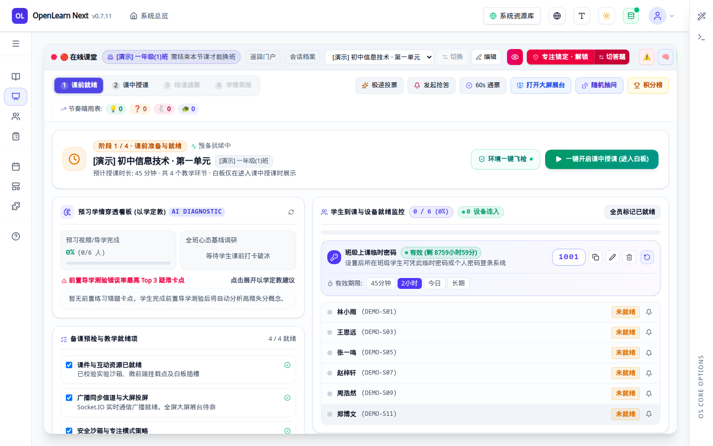
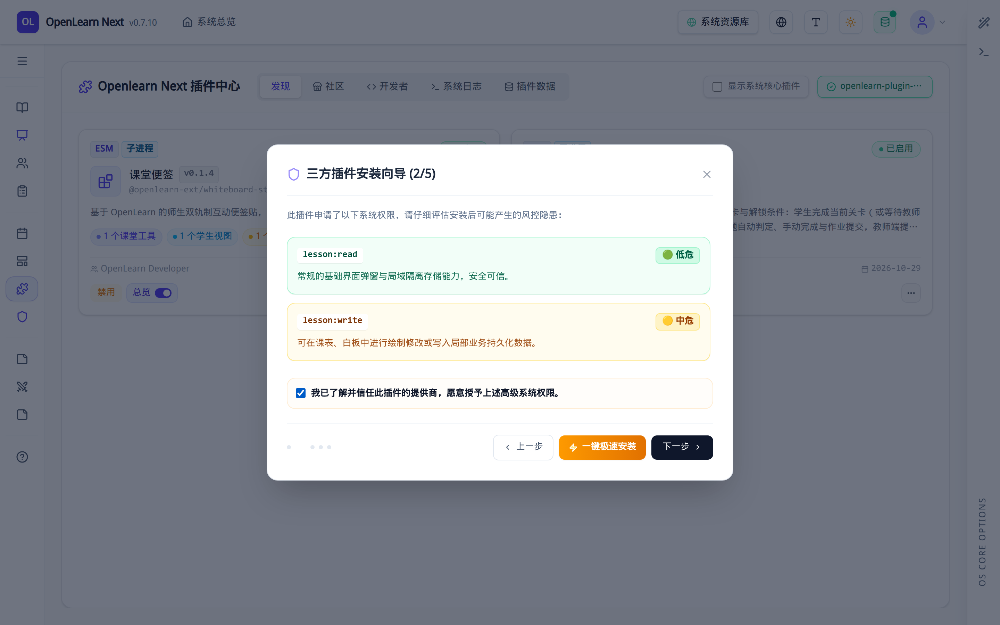

# 快速上手手册

> 面向**第一次接触 OpenLearnV2** 的老师与插件开发者：只用一页，把「装起来 → 跑通 → 上一节课 → 装一个自己写的插件」走完。
>
> 本页只讲最短路径，不展开契约与原理；每一步都指向对应的深度文档，需要细节时再跳过去。

| 你的目标                 | 建议从哪一节开始                                                     | 预计耗时 |
| ------------------------ | -------------------------------------------------------------------- | -------- |
| 只想看看这个系统长什么样 | [1.1 npx 一键试用](#11-npx-一键试用)                                 | 1 分钟   |
| 要长期部署 / 二次开发    | [1.2 源码本地开发](#12-源码本地开发)                                 | 5 分钟   |
| 想用 AI 开发一个课堂插件 | 先跑通 1.1 或 1.2，再读 [第 4 节](#4-用-ai-skill-开发第一个课堂插件) | 10 分钟  |

---

## 1. 安装

### 1.1 npx 一键试用

不用克隆代码、不用装依赖，只要有 Node 就能起一个完整实例：

```bash
npx openlearn-next@latest          # 默认 http://localhost:9000
npx openlearn-next@latest -p 3000 -o   # 指定端口并自动打开浏览器
npx openlearn-next@latest --demo -o    # 一次性演示数据，退出即销毁
```

`--demo` 的数据放在系统临时目录，**不会**污染你已有的数据库，适合快速体验或录屏。

> 运维命令（体检、冷备、查插件）见 [安装指南 · npx 一键启动与 CLI 工具链](installation-guide.md#方式一npx-一键启动与-cli-工具链推荐)。

### 1.2 源码本地开发

写插件、改前端、调试内核都走这条路。环境要求：

| 依赖 | 版本要求           | 说明                                                            |
| ---- | ------------------ | --------------------------------------------------------------- |
| Node | 20.x / 22.x / 24.x | **推荐 22**（仓库 `.nvmrc` 与 CI 门禁均对齐它）                 |
| pnpm | 10.33.4            | 仓库是 pnpm workspace，`npm i` 会装出第二棵依赖树并漏编原生模块 |

```bash
git clone https://github.com/aymwoo/OpenLearn-Next-V2.git OpenLearn-Next-V2
# 国内网络访问 GitHub 受限时改用 Gitee 镜像（内容一致，GitHub → Gitee 单向同步）：
# git clone https://gitee.com/aymwoo/openlearn-next.git OpenLearn-Next-V2
cd OpenLearn-Next-V2

corepack enable && corepack prepare pnpm@10.33.4 --activate
pnpm install
cp .env.example .env
pnpm dev
```

`pnpm dev` 会同时起 Express 与 Vite（HMR），默认端口 **9000**。

> 🔁 **源在哪里拉？** 主仓是 [github.com/aymwoo/OpenLearn-Next-V2](https://github.com/aymwoo/OpenLearn-Next-V2)（Issue / PR / CI / Release 主入口）；国内网络访问 GitHub 受限时用镜像 [gitee.com/aymwoo/openlearn-next](https://gitee.com/aymwoo/openlearn-next)，内容与 `main` 一致，但 CI、Release 与 npm 发布仍只在 GitHub 侧跑。**不要**在 Gitee 侧开自动双向镜像（会覆盖分支 / 标签 / 提交）。
>
> 想两边都留着（推荐，GitHub 不通时可切源）：
>
> ```bash
> git clone https://github.com/aymwoo/OpenLearn-Next-V2.git OpenLearn-Next-V2
> cd OpenLearn-Next-V2
> git remote add gitee https://gitee.com/aymwoo/openlearn-next.git   # 已有则跳过
> ```
>
> 日常 `git fetch origin`（GitHub 优先，不通就 `git fetch gitee`）。**把镜像快进到最新是维护者专属动作**（需 Gitee 写权限）：`git push gitee main --tags`，只快进、不 force-push。

> 版本不一致时，`preinstall` 守卫会在安装阶段直接拦住，并告诉你该换 Node 还是该 `pnpm rebuild better-sqlite3` —— 不用等启动时才撞上 `ERR_DLOPEN_FAILED`。

### 1.3 首次初始化的注意事项

1. **初始口令 = 用户名**：种子账号是 `admin`（管理员）和 `teacher`（教师），口令同样是 `admin` / `teacher`。首次登录会强制改密（≥8 位、含字母和数字、不能等于用户名），**改密前除改密/登出外的接口一律 403**。登录页顶部会直接给出这条提示：

   

   - 想换初始口令：设置 `OPENLEARN_ADMIN_PASSWORD` / `OPENLEARN_TEACHER_PASSWORD`；
   - 想恢复旧版随机口令：`OPENLEARN_SEED_PASSWORD_MODE=random`（只对首次建库生效，口令写入 `storage/bootstrap-credentials.txt`）。

2. **AI 不是启动前置条件**：不配任何 API Key 也能登录、建班、上课。AI 能力在管理后台「AI 提供商管理」里按 OpenAI 兼容接口添加（DeepSeek / Qwen / Ollama / OpenAI 均可）。

3. **保管好加密密钥**：`storage/encryption-key`（或环境变量 `ENCRYPTION_KEY`）用于加密 AI 密钥与班级口令。**换掉它，旧数据就解不开了**；备份时请单独离线保存。

4. **数据放在一个目录里**：默认库是 `packages/core/db/educational_os.db`，课件与插件在 `storage/`。支持通过环境变量 `OPENLEARN_DATA_DIR` 或 `OPENLEARN_DB_PATH` 自定义存储路径，备份或迁移时整体打包对应目录即可。

---

## 2. 运行起来并确认跑通

### 2.1 启动与自检

`pnpm dev` 输出 `OpenLearn Next vX.Y.Z ready` 后，浏览器打开 `http://localhost:9000`。三个快速自检：

```bash
curl http://localhost:9000/health          # {"status":"ok","uptime":...,"version":"..."}
curl http://localhost:9000/health/ready     # {"status":"ready"}；未就绪时 503 且只有这一个字段
curl http://localhost:9000/api/auth/seed-status   # 种子账号是否还在用默认口令（不返回口令本身）
```

### 2.2 想直接有数据可玩？用演示模式

```bash
pnpm dev:demo             # 隔离的 storage/demo.db，不影响你的开发库
pnpm dev:demo -- --reset  # 丢弃旧演示数据重来
```

演示库会自动铺好：1 门课程、2 个班级、12 名学生、1 条课表，以及演示教师账号 **`demo_teacher` / `Demo@2026`**。下面的上课流程截图就是用这个账号拍的。

### 2.3 起不来时先看这三条

| 现象                                                | 原因                                                | 处理                                                      |
| --------------------------------------------------- | --------------------------------------------------- | --------------------------------------------------------- |
| `ERR_DLOPEN_FAILED` / `NODE_MODULE_VERSION ...`     | Node 主版本变了，`better-sqlite3` 二进制 ABI 不匹配 | 切回 Node 22，或执行 `pnpm rebuild better-sqlite3`        |
| `EADDRINUSE :9000`                                  | 端口被占用                                          | `PORT=3999 pnpm dev`（dev 下 CLI 参数无效，要用环境变量） |
| 登录后几乎所有请求 403 `FORBIDDEN_DEFAULT_PASSWORD` | 还在用默认口令                                      | 先完成强制改密                                            |

---

## 3. 教师视角：从登录到下课（最短路径）

### 3.1 登录

打开 `http://localhost:9000`，选择「教师与管理端」入口，用教师账号登录（演示库用 `demo_teacher` / `Demo@2026`）。学生走「学生自助端」。

### 3.2 主界面就是「授课控制台」

教师登录后落在 **互动课堂 · 授课控制台**，这也是最常用的主界面。左侧是功能导航，中间自上而下是三件事：今日排期 → 选课程 → 选班级 → 开始上课；右侧是本节课的教学蓝图、学生状态与开课自检。


### 3.3 开始上课与课前就绪

1. 在「选择授课课程」里点选本节课（默认已选中排期里的课节）；
2. 在「挑选授课班级」里点选班级，班级卡片会变成高亮绿色的「已选」状态；
3. 底部授课流水线由「待配置」变为「配置完成」后，点击右下角 **开始上课**。

点击后系统会进入「课前就绪」准备页：



在这个阶段，教师可以完成开课前的关键准备：

- **上课临时密码**：页面显目展示本节课的 4 位随机入班口令（如 `1001`）。将口令公布在教室黑板或投影仪上，学生使用「学生自助端」输入学号与该口令即可签到加入当前课堂；
- **学生签到监控**：左侧「学生签到」面板实时展示已到人数与名单（如 `12/12` 绿标），掌握全班出勤状态；
- **蓝图与课件预检**：中央区域展示本次课堂关联的课件与教学环节蓝图，方便课前快速过目；
- **进入正式课中**：当全班签到就绪后，点击右上方醒目的 **一键开启课中授课（进入白板）** 按钮，系统立即切换至课中互动授课白板。

### 3.4 课中常用操作


| 想做的事             | 位置                                                        | 说明                                                                  |
| -------------------- | ----------------------------------------------------------- | --------------------------------------------------------------------- |
| 讲 PPT / 写板书      | 中间白板 + 顶部工具栏（画笔、几何、文字、图片、页面）       | 白板页面与「教学环节」联动，可把某个环节广播给全班                    |
| 控制课堂节奏         | 左侧「教学环节进度表」                                      | 显示当前环节与剩余时长，可「广播此环节」                              |
| 快速互动             | 右上「极速投票 / 发起抢答 / 60s 通票 / 随机抽问 / 积分榜」  | 点一下即下发，学生端实时参与                                          |
| 投屏                 | 「打开大屏展台」                                            | 用另一块屏/投影展示白板内容                                           |
| 看学生状态           | 右侧「学生专注力监控 / 班级学情概况」                       | 在线数、专注度、屏幕锁定与平均进度                                    |
| 管理课堂纪律         | 顶部「专注锁定 · 解锁」                                     | 锁定后学生无法切出课堂（限当前课堂，只读跟随）                        |
| 上课件 / 收作业      | 中间「演示白板 / 学生提交数据 / 作业成绩评定 / 随堂测验榜」 | 课件投放、提交查看与成绩评定的入口                                    |
| 用插件提供的课堂工具 | 白板工具栏右侧的拼图图标「互动工具 (插件扩展)」             | 每个插件贡献的课堂工具都会出现在这个下拉里（第 4 节会用到一个 Hello） |

### 3.5 下课与归档

1. 点右上 **完成授课，进入课后**；
2. 在「结课通票」阶段可做随堂作业评定、60s 通票反馈、课后任务下发；
3. 切到「学情简报」，会弹出全景概要，点 **完成归档** 结束本次课堂（会话进入已归档战报，才能开始下一节课）。


> 从其它路径进入「学情简报」时，页头也常驻「归档并结束课堂」入口，效果相同。

---

## 4. 用 AI Skill 开发第一个课堂插件

目标：**不需要手写一行代码、不需要背诵底层 API**，通过官方 `openlearn-next-plugin-dev` AI Skill，用自然语言对话在 10 分钟内生成一个能在课堂白板里使用的插件，并完成上传安装与课堂验证。

> 💡 **为什么不需要看底层代码？**
> OpenLearn V2 的插件契约（如 `manifest.json` 规范、内核三件套登记、子进程沙箱边界、桥接通信等）已全部封装在 `openlearn-next-plugin-dev` Skill 中，由 **AI Agent 自动阅读并执行**。你只需要负责：**装好 Skill → 告诉 AI 教学需求 → 回答几道单选题 → 把生成的 `.zip` 上传到插件中心**。

### 4.1 安装插件开发 Skill

在你的 AI 编程助手（Claude Code / Cursor / CodeBuddy / Codex 等）终端里，任选一种通道安装 Skill：

```bash
# 方式 A：GitHub 主源（海外或直连 GitHub 顺畅时推荐）
npx skills add aymwoo/openlearn-skills@openlearn-next-plugin-dev -g -y

# 方式 B：Gitee 国内镜像（国内网络访问 GitHub 受限时推荐，注意必须带完整 https:// 与 .git 后缀）
npx skills add https://gitee.com/aymwoo/openlearn-skills.git --skill openlearn-next-plugin-dev -g -y
```

> 若处于完全离线环境，也可以直接克隆仓库并拷贝 Skill 目录：
>
> ```bash
> git clone https://gitee.com/aymwoo/openlearn-skills.git
> mkdir -p ~/.claude/skills/ && cp -r openlearn-skills/openlearn-next-plugin-dev ~/.claude/skills/
> ```

### 4.2 对话唤醒 Skill 并回答单选题（Grilling）

1. **一句话唤醒 AI**：在新建的空目录中打开 AI 助手，直接发送自然语言需求：
   > 「用 `openlearn-next-plugin-dev` 帮我做一个课堂插件 **Hello 课堂工具**，在课中白板的互动工具栏里加一个按钮，点击后向课堂下发一条问候通知。」
2. **源码健康检查选 `1`**：若本地尚未缓存平台源码，Skill 会弹出 4 个选项询问如何获取契约参考，直接回复 **`1`**（后台异步克隆源码，当前立即使用内置快照继续）。
3. **回答交互式单选题（Q1–Q6）**：Skill 会每次只问一道单选题（标注了 `[A] (推荐)`），例如插件显示位置、是否需要持久化存储、所需最小权限等。你只需一路回复字母（如 `A`）或补充一句话，最后回复 **「确认」**。
4. **AI 自动交付 `.zip` 产物**：确认后，AI 会自动生成工程、运行双阶段单测与契约审计，并在项目根目录下打包出可直接安装的 **`openlearn-plugin-hello-tool.zip`**。

### 4.3 在插件中心上传并授权（管理员）

1. 用管理员账号登录系统，在左侧主导航中点击 **系统管理 → 插件中心**；
2. 点击右上角 **从 ZIP 安装** 按钮，选中 AI 刚刚为你打包好的 `.zip` 文件；
3. 安装向导共 5 步，其中**第 2 步与第 5 步的两处安全授权复选框必须全部勾选**，否则插件无法激活或运行：
   - **第 2 步（提供商信任）**：勾选 `我已了解并信任此插件的提供商，愿意授予上述高级系统权限。`（第三方插件强制在子进程沙箱中隔离运行，需管理员明示信任）；
   - **第 5 步（能力授予授权）**：勾选 `确认授予清单申请的能力。不勾选则这些能力不会生效。`（平台遵循 Default-Deny 最小权限原则，未勾选的能力在运行时会被直接拦截）。



4. 点击右下角 **确认安装并上传**。安装成功后系统会自动激活并启用该插件。返回插件中心列表后，卡片上将显示绿色的 `已启用` 徽标，并统计 `1 个课堂工具`、`1 项权限`：


> 💡 **按钮状态辨析**：插件卡片右下角的按钮文字代表「点击后将执行的动作」——显示红色 **禁用** 说明当前正处于**已启用运行状态**；若显示 **启用** 则说明当前处于停用状态。

### 4.4 在课中白板验证插件效果

1. 点击左侧导航 **互动课堂**，选择课程与班级后点击 **开始上课**（或对进行中的课堂点击 **继续上课**）；
2. 在课前就绪页点击右上角 **一键开启课中授课（进入白板）** —— 互动白板与插件工具栏仅在「课中授课」阶段渲染；
3. 找到白板顶部工具栏最右侧的**拼图图标**（悬停提示 **互动工具 (插件扩展)**，右上角带有数字角标 `1`）；
4. 点击展开 **互动工具 · 1 个插件** 下拉面板 → 点击 **Hello 课堂工具**，右下角即刻弹出绿色提示 `✓ 工具下发成功`，左侧课堂互动反馈流同步记录 `插件工具 [Hello 课堂工具] 执行完毕，数据成功下发。`


### 4.5 想改功能或遇到报错？继续跟 AI 说

- **改功能**：直接对 AI 说「帮我把问候语改成随机抽取一名已签到学生提问，并重新打包 ZIP」，然后在插件中心再次点击 **从 ZIP 安装** 上传新包即可原地升级。
- **排障修复**：如果上传或点击时遇到报错，直接把界面提示或插件中心「开发者工具」里的报错信息贴给 AI，Skill 会自动定位并修复后重新给你打包 `.zip`。
- **完整图文手册**：更详细的十步实操（含侧边栏独立页面插件、课中下发、卸载清理全流程截图）请查阅配套的 **《OpenLearn V2 插件开发手册（AI Skill 版）》**。
  PDF 制品**不进版本控制**（避免仓库被二进制胀大），统一挂在 GitHub Release 附件，链接指向最新版本：
  [OpenLearnV2-Plugin-Skill-Guide.pdf](https://github.com/aymwoo/OpenLearn-Next-V2/releases/latest/download/OpenLearnV2-Plugin-Skill-Guide.pdf) ·
  [OpenLearnV2-Plugin-Handbook.pdf](https://github.com/aymwoo/OpenLearn-Next-V2/releases/latest/download/OpenLearnV2-Plugin-Handbook.pdf) ·
  [OpenLearnV2-Quickstart-Handbook.pdf](https://github.com/aymwoo/OpenLearn-Next-V2/releases/latest/download/OpenLearnV2-Quickstart-Handbook.pdf)
  > 重新生成：`npm run docs:pdf`（需先 `bash scripts/build-docs.sh`）→ `npm run docs:pdf:upload` 上传覆盖。

---

## 5. 常见问题

**Q：`pnpm install` 直接失败了？**
Node 版本不对。用 Node 22（`.nvmrc`），或按 `preinstall` 守卫的提示切版本 / `pnpm rebuild better-sqlite3`。

**Q：登录后什么都不能点，接口全是 403？**
还在默认口令状态。先改密；改密前除改密、登出、读会话外的接口都会被拒。

**Q：不配 AI Key 能用吗？**
能。建班、排课、上课、白板、作业都不依赖 AI；需要 AI 时再去「AI 提供商管理」添加。

**Q：插件装上了，但课堂工具里看不到 / 点了没反应？**
先按顺序查：① 插件卡片是否显示 `已启用`（按钮文案是反向的：显示「禁用」才是已启用）；② 是否进到了「课中授课」阶段（白板与工具栏只在课中授课渲染，课前就绪页没有）；③ manifest 里是否有 `classroomTools`（或 `contributes['classroom.tool']`）；④ 是否同时注册了 handler 和 ActionDescriptor。四条里缺任何一条都会表现为「静默没反应」。

**Q：点「启用」报 500，日志说 `no granted capability, only 'get' methods allowed`？**
安装时**漏勾了能力授予**。安装向导第 2 步的「我信任该提供商」不等于授权，真正生效的是第 5 步的 **`确认授予清单申请的能力`**；两处都勾上并重装/更新一次即可。机制：子进程隔离下，`activate()` 里只要有非 `get*` 调用（注册 handler / action 都算），就必须「manifest 声明了能力」且「管理员勾选授予」同时成立。

**Q：安装向导第 3 步显示「此插件没有提供任何额外的槽位注册项」，但我明明写了 `classroomTools`？**
正常现象。`classroomTools` 是旧字段，安装时由 `ContributionRegistry` 桥接成 `contributes['classroom.tool']`；第 3 步读的是 `contributes` 所以为空，第 4 步「静态分析预览」里能看到 `classroom.tool · hello-tool`。

**Q：想清掉演示数据重新来？**
`pnpm dev:demo -- --reset`，或直接删 `storage/demo.db*`；也可以走管理后台「系统设置 → 演示数据 → 一键清理」（只删播种过的行）。

---

## 6. 截图怎么重新生成

手册里的 01–04 是脚本产物，不是手工截图。界面改版后重跑即可：

```bash
# 终端 A：起一个干净的演示实例
pnpm dev:demo

# 终端 B：按脚本提示生成截图（需要 Playwright 的 Chromium）
node scripts/capture-quickstart-screenshots.mjs --base-url http://127.0.0.1:9000
```

脚本会对关键文案做断言：页面结构变了会直接失败，而不是悄悄生成一张过期截图。插件相关的 05 / 06 需要先按第 4 节构建并安装 Hello 插件，再单独补拍。

---

> 还想更深入？文档首页按「架构 / 插件 / 部署 / API」分了区：[文档中心](../index.md)。
