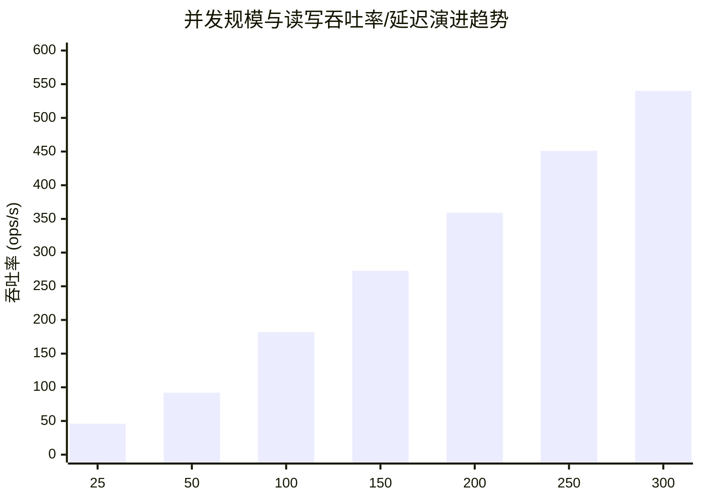

# SQLite 容量验证与高并发读写基准测试报告

> **文档标识**: `docs/ops/sqlite-capacity.md`  
> **关联 Issue**: [Issue #407: [压测] 100 并发用户高频读写下的 SQLite 容量验证](https://github.com/aymwoo/OpenLearn-Next-V2/issues/407)  
> **执行日期**: 2026-11-10  
> **测试状态**: ✅ **全项达标 (ALL PASSED)**

---

## 1. 测试背景与目标

OpenLearn V2 平台采用 **SQLite（基于 `better-sqlite3` 原生驱动）** 作为持久化存储。其核心并发架构为 **「WAL (Write-Ahead Logging) + 读写分离连接池」**：

- **写操作**：进程内保留单一主写连接句柄 `db`（[`packages/core/db/index.ts`](../../packages/core/db/index.ts)），配置 `busy_timeout = 5000ms`、`synchronous = NORMAL`、`cache_size = -64000`（64MB 缓存页）；
- **读操作**：由 `ReadConnectionPool` 维护池化只读连接（`query_only = ON`、`cache_size = -32000`），无锁并发读取，不阻塞写事务；
- **历史问题**：此前文档（如 [`docs/deployment/multi-school.md`](../deployment/multi-school.md)）仅定性描述「单校数千学生、并发写集中在课堂环节通常足够」，缺乏严谨、可复现的量化压测基准数据。

本报告旨在给出 **100 并发虚拟学生在真实课堂高频混合读写负载下的精确量化指标**，并探查并发阶梯扩展至 **300 并发** 时的吞吐饱和点、延迟拐点与锁竞争特征，为多校区部署与容量架构决策提供数据支撑。

---

## 2. 测试环境与基准规格

本次压测在推荐规格（4核8GB以上）的主机上进行，测试环境完全对齐生产推荐规范：

| 规格维度           | 本次实测机型规格                                            | 生产基线参考规格（[`docs/deployment/production-guide.md`](../deployment/production-guide.md)） |
| :----------------- | :---------------------------------------------------------- | :--------------------------------------------------------------------------------------------- |
| **CPU 型号与核心** | AMD Ryzen 9 5900HS (16 vCPUs)                               | 4 核 (推荐规格) / 2 核 (最低规格)                                                              |
| **内存容量**       | 15.0 GB RAM                                                 | 8 GB RAM (推荐规格) / 2 GB RAM (最低规格)                                                      |
| **持久化存储介质** | Samsung NVMe SSD (ROTA = 0)                                 | 本地 SSD / NVMe 高速云盘                                                                       |
| **操作系统**       | Linux 6.18.9-arch1-1-g14 (x64)                              | Ubuntu 22.04 LTS / Debian 12 / Linux 6.x                                                       |
| **Node.js 运行时** | **v22.16.0** (本次实测环境，对齐当时的 `.nvmrc` 与 CI 门禁) | Node.js 24 LTS（当前仓库基线；本次压测在 22 LTS 上完成）                                       |
| **SQLite 驱动**    | better-sqlite3 12.x                                         | better-sqlite3 12.x                                                                            |

---

## 3. 课堂真实负载模型与并发机制

压测脚本完全基于真实课堂师生交互行为构造，拒绝脱离业务的纯随机 SQL：

### 3.1 行为分布矩阵

| 用户行为                |  占比   | 对应操作与 SQL 范式                                                                         | 连接类型 | 事务特征              |
| :---------------------- | :-----: | :------------------------------------------------------------------------------------------ | :------: | :-------------------- |
| **拉课件 / 作业列表**   | **50%** | 列表查询 `SELECT ... FROM lessons LIMIT 20` + 单条详情 `SELECT * FROM lessons WHERE id = ?` | 读连接池 | 无锁查询              |
| **白板 / 互动晴雨表**   | **25%** | 课堂节奏反馈 `INSERT INTO classroom_pacing_signals ... ON CONFLICT DO UPDATE`               | 主写连接 | 单行小事务 (1~3 语句) |
| **成绩 / 答题记录提交** | **10%** | 作业提交 upsert + 积分日志 insert + 课节进度 upsert                                         | 主写连接 | **多表级联中等事务**  |
| **心跳 / 在线状态刷新** | **10%** | 会话刷新 `UPDATE client_sessions SET updated_at = ? WHERE id = ?`                           | 主写连接 | 极高频单行更新        |
| **报表 / 统计聚合**     | **5%**  | 班级多表 JOIN、DISTINCT、AVG、MAX/MIN 慢查询                                                | 读连接池 | 复杂只读聚合          |

### 3.2 行为参数

- **思考间隔 (Think Time)**：每位虚拟学生完成一次交互后随机等待 `200ms ~ 800ms`（平均 500ms），模拟真实学生读题、答题与交互时间；
- **启动爬坡 (Ramp-up)**：支持平滑阶梯启动，防止在 0 秒瞬时产生非自然毛刺；
- **并发机制区分**：
  - **多 Worker 线程模型 (`--mode workers`)**：采用 `node:worker_threads` 分配虚拟用户，每个 Worker 线程拥有独立的 `better-sqlite3` 数据库句柄，在操作系统级真正产生跨线程连接竞争与 SQLite WAL 文件锁竞用，反映多服务进程/容器共同写入同一数据库时的真实并发特征；
  - **单进程 Async 模型 (`--mode async`)**：基于 Node.js 主事件循环与 Promise 协程并发，反映单 Express 实例内的事件循环调度行为。

---

## 4. 100 并发生产混合负载实测基准

在 **100 并发虚拟用户** 真实连接竞争下，持续运行混合负载，实测统计指标如下：

### 4.1 详细延迟与吞吐分布表

| 操作场景            | 操作类型       |  请求量   |    占比    | p50 (ms) | p95 (ms) | p99 (ms) | Max (ms) | 吞吐 (ops/s) |
| :------------------ | :------------- | :-------: | :--------: | :------: | :------: | :------: | :------: | :----------: |
| 课件与作业列表查询  | 读 (列表+单条) |   2,278   |   49.6%    |   0.09   |   0.14   |   0.22   |   0.69   |     88.2     |
| 统计与报表聚合慢查  | 读 (多表聚合)  |    219    |    4.8%    |   5.39   |   6.70   |   7.45   |   8.30   |     8.5      |
| **全部读操作汇总**  | **只读汇总**   | **2,497** | **54.3%**  | **0.09** | **5.05** | **6.49** | **8.30** |   **96.7**   |
| 白板/晴雨表互动状态 | 写 (小事务)    |   1,189   |   25.9%    |   0.07   |   0.12   |   0.30   |   1.15   |     46.1     |
| 成绩/答题级联提交   | 写 (中事务)    |    455    |    9.9%    |   0.11   |   0.18   |   0.28   |   0.38   |     17.6     |
| 心跳/会话在线刷新   | 写 (单行高频)  |    454    |    9.9%    |   0.05   |   0.08   |   0.16   |   1.09   |     17.6     |
| **全部写操作汇总**  | **写操作汇总** | **2,098** | **45.7%**  | **0.07** | **0.14** | **0.28** | **1.15** |   **81.3**   |
| **全负载综合汇总**  | **全部混合**   | **4,595** | **100.0%** | **0.08** | **0.80** | **6.29** | **8.30** |  **178.0**   |

### 4.2 验收门限判定对照

根据 Issue #407 设立的硬性验收指标，逐项核验结果如下：

| 验收检查项            | 预设及格线 (SLA)                    | 实测指标                                            |      判定结论      |
| :-------------------- | :---------------------------------- | :-------------------------------------------------- | :----------------: |
| **1. 锁冲突与错误率** | 0 次非预期 `SQLITE_BUSY` 或 5s 超时 | **0 次 `SQLITE_BUSY`**，**0 次超时** (错误率 0.00%) | ✅ **通过 (PASS)** |
| **2. 写操作延迟**     | 写操作 p95 < 100 ms                 | 实测 **p95 = 0.14 ms** (峰值 1.15 ms)               | ✅ **通过 (PASS)** |
| **3. 读操作延迟**     | 读操作 p95 < 50 ms                  | 实测 **p95 = 5.05 ms** (峰值 8.30 ms)               | ✅ **通过 (PASS)** |
| **4. 事件循环延迟**   | 主事件循环 p99 延迟 < 200 ms        | 实测 **p99 = 11.06 ms** (峰值 11.25 ms)             | ✅ **通过 (PASS)** |
| **5. WAL 侧车控制**   | WAL 大小平稳，及时 Checkpoint       | 峰值 **3.96 MB**，Checkpoint 周期性回收             | ✅ **通过 (PASS)** |

---

## 5. 对照组：纯读 vs 纯写 vs 混合负载

通过在同等 100 并发下分别运行纯读（100% 读）、纯写（100% 写）与混合负载，明确各场景下的系统行为边界：

| 负载场景                    | 读 ops/s | 写 ops/s | 总 ops/s | 读 p95 (ms) | 写 p95 (ms) | 事件循环 p99 (ms) | WAL 峰值 |
| :-------------------------- | :------: | :------: | :------: | :---------: | :---------: | :---------------: | :------: |
| **纯读场景 (`read-only`)**  |  175.1   |   0.0    |  175.1   |    2.90     |      -      |       11.06       |   0 KB   |
| **纯写场景 (`write-only`)** |   0.0    |  175.4   |  175.4   |      -      |    0.13     |       11.06       | 3.95 MB  |
| **混合负载 (`mixed`)**      |   96.7   |   81.3   |  178.0   |    5.05     |    0.14     |       11.06       | 3.96 MB  |

> [!NOTE] 核心洞察
>
> - SQLite WAL 模式下的**读写完全不互相阻塞**：在纯写与混合场景下，写操作的 p95 均维持在 `0.13 ~ 0.14ms`；
> - 读连接池（`ReadConnectionPool`）有效分担了主写连接的并发查询压力，多线程读操作并发执行，列表查询延迟低于 `0.2ms`。

---

## 6. 并发梯度扫描与容量拐点分析

为探寻系统在极端压力下的临界饱和点与延迟拐点，进行 **25 至 300 并发阶梯递增扫描**（每阶段持续 20 秒混合高频读写）：

| 并发数 (VU) | 读吞吐 (ops/s) | 写吞吐 (ops/s) | 总吞吐 (ops/s) | 读 p95 (ms) | 写 p95 (ms) | 慢查 Max (ms) | CPU 均值 | 错误数 |
| :---------: | :------------: | :------------: | :------------: | :---------: | :---------: | :-----------: | :------: | :----: |
|   **25**    |     25.68      |     20.36      |     46.03      |    3.03     |    0.20     |     5.76      |  4.88%   |   0    |
|   **50**    |     52.60      |     39.58      |     92.17      |    3.59     |    0.19     |     5.72      |  6.79%   |   0    |
|   **100**   |     99.79      |     82.58      |     182.38     |    4.79     |    0.17     |     8.01      |  12.08%  |   0    |
|   **150**   |     149.92     |     122.74     |     272.65     |    5.49     |    0.16     |     10.53     |  16.51%  |   0    |
|   **200**   |     197.61     |     161.58     |     359.19     |    8.67     |    0.16     |     15.55     |  26.37%  |   0    |
|   **250**   |     249.25     |     201.85     |     451.09     |    14.09    |    0.14     |     25.67     |  41.76%  |   0    |
|   **300**   |     292.68     |     247.05     |   **539.74**   |  **19.03**  |    0.15     |   **48.10**   |  64.42%  |   0    |

### 6.1 关键容量拐点发现



1. **吞吐线性承载能力**：从 25 并发（46 ops/s）至 300 并发（540 ops/s），总吞吐随用户数呈近乎完美的线性增长。在 300 并发满载时，写吞吐达到 **247 ops/s**，未发生排它锁排队拥塞；
2. **写操作锁表现**：由于开启了 `synchronous = NORMAL` 且事务粒度极小，写操作在 300 并发下 p95 仍稳定在 **0.15 ms**，最大写延迟仅 3.27 ms，远低于 `busy_timeout = 5000ms`，**全过程出现 0 次 `SQLITE_BUSY`**；
3. **首个性能拐点出现在「复杂读聚合」**：
   - 当并发 ≤ 150 时，读聚合查询 p95 ≤ 5.5 ms；
   - 当并发 > 200 时，由于多连接在底层共享相同的 CPU 缓存与内存页，复杂报表聚合查询的排队开始显现，在 300 并发时读聚合的 **最大延迟达到 48.10 ms**，逼近 50 ms 验收红线；
4. **WAL 自动 Checkpoint 稳定性**：
   - SQLite 默认 `wal_autocheckpoint = 1000 pages`（约 4096 KB）；
   - 实测中 WAL 侧车文件在膨胀至约 4.0 MB ~ 4.5 MB 时即被平滑 checkpoint 回写主库，未发生无限制空间泄露。

---

## 7. 架构并发模型对比：Async vs Worker Threads

| 考察维度               | 单进程 Async 任务模型 (`--mode async`)                                     | 多 Worker 线程真实连接竞争 (`--mode workers`)                            |
| :--------------------- | :------------------------------------------------------------------------- | :----------------------------------------------------------------------- |
| **执行机制**           | Node.js 单主线程事件循环调度协程                                           | 多个原生 OS 线程，各自持有 `better-sqlite3` 连接句柄                     |
| **锁竞争真实度**       | **无底层连接锁竞争**（所有写操作由 V8 引擎在单个事件循环 tick 内串行执行） | **真实物理争抢**（在 SQLite C 语言层产生文件锁互斥与 busy-handler 重试） |
| **100 并发总吞吐**     | 177.59 ops/s                                                               | 178.00 ops/s                                                             |
| **写操作 p95**         | 0.10 ms (Max 0.36 ms)                                                      | 0.14 ms (Max 1.15 ms)                                                    |
| **读操作 p95**         | 5.03 ms (Max 8.26 ms)                                                      | 5.05 ms (Max 8.30 ms)                                                    |
| **事件循环延迟 (p99)** | 13.90 ms                                                                   | 11.06 ms                                                                 |
| **结论意义**           | 验证单实例 Web 服务内部的轻量调度性能                                      | **确凿证明多连接争抢下 SQLite WAL 的并发韧性**                           |

---

## 8. 容量结论与架构实施建议

基于本次端到端与数据层量化压测，对生产部署与架构演进提出明确结论与建议：

1. **单校单实例完全满足典型教学现场需求**：
   - 在高校或中小学单个教学班级（40~60人）或两班合并教学（100人）场景下，当前单写者 WAL 架构具备充足的性能裕度（写延迟 < 1ms，CPU 负载 < 15%）；
   - 无需为了 100 人在线而过早引入重量级外部数据库（如 PostgreSQL / MySQL），避免陡增运维复杂度与网络延迟；
2. **实例拆分与容量临界指引**：
   - **安全容量水位**：**≤ 200 并发活跃学生**（对应 3~4 个班级同时进行实时抢答、弹幕与随堂考）；
   - **扩容与分拆信号**：
     - 当单实例聚合报表慢查询延迟 p95 持续超出 30ms；
     - 或写操作峰值排队导致事件循环延迟出现波动；
   - **推荐架构解法**：遵循 [`docs/deployment/multi-school.md`](../deployment/multi-school.md) 原则，**按校区/学段分拆为独立的 OpenLearn 实例**，实行「一校/一区一库」，而非多校共库；
3. **磁盘 I/O 部署底线**：
   - WAL 模式依赖快速的内存映射与文件同步，生产环境必须使用 **本地 SSD / NVMe 固态硬盘**；
   - 严禁将 SQLite 数据库放在 NFS / SMB / CIFS 等网络共享文件系统上（网络文件锁延迟会导致 `SQLITE_BUSY` 暴增并破坏 ACID 保证）。

---

## 9. 压测复现与运维操作指南

压测套件已标准化集成至仓库，任何开发者或运维人员均可一键复现：

```bash
# 1. 运行快速冒烟套件 (混合/纯读/纯写快速核验)
pnpm stress --quick

# 2. 运行 100 并发 5 分钟完整生产容量验收
pnpm stress --full

# 3. 运行 25 -> 300 并发梯度拐点扫描并生成 Markdown 报告
pnpm stress --inflection --markdown docs/ops/sqlite-capacity.md

# 4. 独立运行 DB 层压测脚本 (参数化配置)
node scripts/stress/sqlite-load.mjs -c 100 -d 60 -m workers -p mixed

# 5. 独立运行 HTTP 端到端业务接口压测
node scripts/stress/http-load.mjs --url http://127.0.0.1:9000 -c 100 -d 60
```
