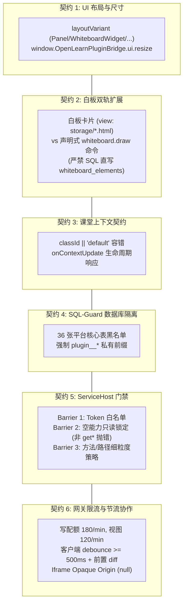

# AI Agent 与第三方插件开发架构契约与防护规范（Architecture Contracts & Guardrails RFC）

<!-- doc-version: sdk=3.7.5 -->

> **适用范围**：`@openlearn/plugin-sdk@3.7.5+` / 平台 `v0.7.7+`  
> **面向对象**：AI 编码智能体（AI Agent / CodeBuddy / Copilot）、第三方插件开发者、系统架构师。  
> **核心目标**：明确 OpenLearn V2 在前端视图注入、白板协作、课堂上下文、数据库隔离、RPC 权限门禁与网关流控等方面的 6 大架构契约，杜绝因对沙箱底层机制认知偏差导致的功能异常与安全违例。

---

## 1. 契约背景与核心设计哲学

OpenLearn V2 是一套基于分布式沙箱与强类型微内核架构的教育操作系统。为了保证课堂高频协作下的**多租户隔离、崩溃韧性与零信任安全**，平台在进程层（Process/Worker 沙箱）、DOM 层（Iframe Opaque Origin）、RPC 通信层（ServiceHost 三重守卫）和数据库层（SQL-Guard 静态 AST 审计）设立了纵深防御机制。

在课堂互动类插件（如互动随堂测验、随堂小组白板协作、互动投票等）的实战开发中，第三方开发者与 AI Agent 极易受到常规单体 Web 应用经验的误导，进而触发平台安全拦截。本文档将 6 大核心架构契约与硬性安全红线完整收敛成文。

---

## 2. 六大核心架构契约规范



---

### 契约 1：UI Extension Slots 布局形态与尺寸伸缩协议

在 `manifest.json` 中向 `contributions.views` 或 `contributions.slots` 声明 UI 扩展点时，必须遵循明确的布局形态矩阵与双向高度伸缩通信协议：

#### 1.1 四大布局形态（`layoutVariant`）

| 形态（layoutVariant）  | 典型槽位 / 宿主容器                       | 渲染行为与尺寸策略                                                       | 最佳实践场景                         |
| :--------------------- | :---------------------------------------- | :----------------------------------------------------------------------- | :----------------------------------- |
| **`Panel`**            | `classroom.right-drawer`, `admin.sidebar` | **宽度固定**（通常为 360px–480px），**高度根据内容纵向撑开或自适应滚动** | 随堂测验列表、互动答题榜单、设置面板 |
| **`WhiteboardWidget`** | `whiteboard.card-overlay`, 白板画布卡片   | **宽高完全受限在白板矩形卡片或浮动卡片盒内**；宿主提供可缩放的卡片容器   | 互动抽奖卡片、白板投票器、随堂草稿纸 |
| **`FloatingOverlay`**  | 全局右下角/白板悬浮工具条                 | 绝对定位悬浮层，默认收折为图标，展开时覆盖局部区域                       | 课堂即时反馈悬浮球、倒计时挂件       |
| **`ActionItem`**       | `classroom.toolbar`, `whiteboard.toolbar` | **无独立视图主体**，仅注册一个可点击的按钮/菜单项；点击后触发命令派遣    | 一键截屏、快速发起随机提问按钮       |

#### 1.2 高度双向同步协议（`ui.resize`）

由于视图运行在跨源沙箱 `<iframe>` 内，父窗口无法通过 DOM 直接感知 iframe 内部的实际高度。

- 视图加载完成后或 DOM 节点增删时，插件必须主动通过 Bridge 上报内容高度：
  ```javascript
  const reportHeight = () => {
    const height = Math.ceil(document.documentElement.scrollHeight || document.body.scrollHeight);
    window.OpenLearnPluginBridge?.ui?.resize?.({ height });
  };
  window.addEventListener('load', reportHeight);
  ```
- **死循环防护**：使用 `ResizeObserver` 监听时，必须设置变动阈值（如变化超过 4px 才派发更新），严禁在无节流情况下反复触发父子窗口 resize 事件。

---

### 契约 2：白板双轨扩展与安全落盘约束

在白板上实现业务功能存在两条物理上完全不同的技术路径，开发者必须根据交互深度严格选型：

#### 2.1 技术选型双轨对照

| 扩展维度     | 路径 A：声明式矢量命令（`whiteboard.draw`）            | 路径 B：自定义白板富应用卡片（Custom Sandbox HTML）                    |
| :----------- | :----------------------------------------------------- | :--------------------------------------------------------------------- |
| **适用场景** | 绘制原生矩形、文本、图片、几何图形、简易箭头           | 完整的交互式游戏、实时计分板、带复杂状态机的测验卡片                   |
| **前端实现** | 纯数据驱动，派遣 `whiteboard.draw` 总线命令            | 部署完整 HTML 文件，在 `manifest.json` 中声明 `view: "storage/*.html"` |
| **沙箱隔离** | 无 iframe 开销，直接进入 Fabric.js 渲染管线            | 运行在独立 Opaque Origin iframe 沙箱内，保障崩溃隔离                   |
| **所需权限** | 必须在 `capabilitiesProposed` 中声明 `whiteboard:draw` | 需要 `view:render` 与卡片关联的交互数据权限                            |

#### 2.2 ⚠️ 绝对红线：严禁原生 SQL 操作平台白板表

- 严禁通过 `ctx.db` 或任何 SQL 客户端尝试对 `whiteboard_elements` 表执行 `INSERT`、`UPDATE` 或 `DELETE`；
- 所有白板元素均绑定了版本号、协同会话 ID、Z-Index 层级和 Socket.IO 广播事务，绕过命令总线直接插库会导致白板引擎协同状态彻底混乱；
- **防护拦截**：平台在 `packages/core/plugin-host/sql-guard.ts` 中已将 `whiteboard_elements` 列入硬黑名单，直写 SQL 将被宿主即刻拦截并使调用崩溃。

---

### 契约 3：课堂运行时上下文生命周期与空值契约

插件视图或后端服务在获取课堂上下文（`classroomContext`）时，必须针对单机离线、调试预览与班级切换建立完备的防御逻辑：

#### 3.1 `classId` 空值安全回退范式

在独立单元测试、插件中心预览沙盒、或离线课件浏览模式下，`currentClassId` 极可能为 `null`、`undefined` 或空字符串。

- **强制防守代码**：
  ```typescript
  // 必须实施空值合并与安全回退
  const safeClassId = context?.classId || 'default';
  const safeSessionId = context?.sessionId || 'standalone_session';
  ```
- 严禁在未做非空校验的情况下直接将 `classId` 拼接入 SQL 查询条件或 HTTP 接口路径，否则将产生 `404 Not Found` 或 `plugin_storage` 命名空间击穿。

#### 3.2 动态班级切换时的主动订阅

在连堂课或合班课教学场景中，教师可能在不重载系统的情况下切换当前授课班级。

- 插件前端必须注册上下文变更监听：
  ```javascript
  window.OpenLearnPluginBridge?.classroom?.onContextUpdate?.((newContext) => {
    console.log('Classroom switched to:', newContext.classId);
    // 重置本地临时状态、重新拉取新班级专属数据
    reloadPluginDataForClass(newContext.classId || 'default');
  });
  ```

---

### 契约 4：SQL-Guard 核心数据表硬黑名单与隔离机制

对于隔离模式插件（`process` / `worker_threads`），平台数据库访问遵循**零信任与白名单命名空间原则**：

#### 4.1 36 张核心安全表静态黑名单（`FORBIDDEN_CORE_TABLES`）

无论任何 SQL 语法结构（包括简单查询、多层子查询、JOIN、视图展开），只要触及以下 36 张核心表中的任何一张，SQL-Guard 立即阻断并记录安全审计事件：

```text
users, client_sessions, agent_conversations,
plugins, plugin_storage, processes, pending_commands, system_resources, site_settings, _migrations, events, demo_data_registry,
ai_providers,
classes, students, class_students, schedules, class_grade_weights, student_point_logs,
lessons, classroom_sessions, whiteboard_elements, student_seats, student_rollcalls, attendance, student_read_notifications,
courseware, courseware_attempt, student_lesson_progress, lesson_quiz_submissions, courseware_score_config,
assignments, assignment_submissions, exams, exam_scores, student_semester_reports,
lianyun_research_activities, lianyun_research_groups, lianyun_research_submissions, lianyun_research_reviews
```

#### 4.2 语法与操作封禁

- **危险操作阻断**：`ATTACH`、`DETACH`、`PRAGMA`、`VACUUM`、`CREATE/DROP TRIGGER|VIEW` 全面拦截；
- **合规存储路径**：插件私有数据必须使用 `ctx.db` API（表名自动以 `plugin_<scopeId>_*` 为前缀）或键值存储 `ctx.services.storage`。

---

### 契约 5：ServiceHost 三重安全门禁与 Manifest Capabilities 绑定

所有跨线程/跨进程远程服务调用均受 `ServiceHost` 的三重守卫管控：

#### 5.1 三重门禁处理流

1. **Barrier 1（Token 白名单）**：请求的 Token 必须在插件经清单声明并授予的 `allowedTokens` 集合中；
2. **Barrier 2（空能力只读锁定 —— 高频拦截点）**：
   - 若 `manifest.json` 中声明的 `capabilitiesProposed` 为空数组 `[]`（或全部能力被管理员拒绝授予），插件将被**强制锁定为只读状态**；
   - 在此状态下，**仅放行方法名以 `get*` 开头的只读调用**；
   - 任何涉及状态修改的方法（如 `set*`、`register*`、`save*`、`create*`、`delete*` 等）均被阻断并抛出：
     `WorkerCapabilityError: empty manifestCapabilities, only 'get' methods allowed`；
3. **Barrier 3（方法/路径策略检查）**：逐项审计调用参数安全性。

#### 5.2 开发者守则

若插件需要向数据库写数据、注册总线 Action、调用网络代理或派遣控制命令，**必须在 `manifest.json` 中如实显式声明所有关联权限**，严禁使用空声明逃避权限审查。

---

### 契约 6：网关限流分桶与客户端协作节流范式

#### 6.1 平台全局限流配额

| 限流桶名称              | 作用端点 / 范围                           | 生产限流配额                | 开发环境配额 | 溢出响应与行为                           |
| :---------------------- | :---------------------------------------- | :-------------------------- | :----------- | :--------------------------------------- |
| **`writeLimiter`**      | 全局所有 `POST` / `PUT` / `DELETE` 写请求 | **180 次/分钟**（~3 req/s） | 600 次/分钟  | HTTP 429 Too Many Requests               |
| **`viewStateLimiter`**  | `/api/classroom/sessions/:id/view-state`  | **120 次/分钟**（独立桶）   | 600 次/分钟  | 专门保障课堂断线恢复快照不被主写流饿死   |
| **`PluginRateLimiter`** | `/api/plugins/:pluginId/*` 网关端点       | **默认 120 次/分钟/端点**   | 独立滑动窗口 | 针对每个客户端 IP + 插件 ID 分组隔离流控 |

#### 6.2 客户端节流最佳实践

为杜绝视图组件在课堂全班多人同时答题或拖拽时高频冲击网关导致 429 报错，前端/Iframe 必须遵守协同节流准则：

1. **强制实施防抖（Debounce >= 500ms）**：
   输入框输入、画布元素微调、选项暂存等操作，必须经由 `>= 500ms` 的防抖器延时提交。
2. **前置内容 Diff 比对**：
   在向平台提交状态持久化之前，必须比对当前值与上一次已持久化的值，未发生实质改变的数据不发起写请求：
   ```javascript
   if (JSON.stringify(previousState) === JSON.stringify(currentState)) {
     return; // 数据无变化，直接丢弃冗余写入
   }
   ```
3. **事件驱动优先于 HTTP 轮询**：
   需要感知课堂实时状态时，应订阅 Socket.IO 事件或总线事件，严禁使用 `setInterval` 发起高频 HTTP GET 轮询。
4. **Iframe Opaque Origin (`null`) 约束**：
   由于沙箱缺少 `allow-same-origin`，直接使用 `window.localStorage` 或原生 `fetch('/api/...')` 将直接被浏览器拦截报错，所有网络通信与状态存取必须使用 `window.OpenLearnPluginBridge`。

---

## 3. AI Agent 机器可读契约清单 (Machine-Readable Contract Registry)

为便于自动化校验工具与 AI 编码助手在生成插件代码时直接进行规则匹配，以下提供机器可读规范定义：

```json
{
  "$schema": "https://json-schema.openlearn.org/v2/plugin-architecture-contracts.json",
  "version": "1.0.0",
  "contracts": [
    {
      "id": "CTR-001-UI-LAYOUT-RESIZE",
      "category": "UI",
      "targetFiles": ["src/**/views/**/*.html", "src/**/components/**/*.tsx"],
      "rule": "Every view in contributions must adhere to a defined layoutVariant and report height changes via window.OpenLearnPluginBridge.ui.resize({ height }).",
      "antiPattern": "Hardcoded iframe height or missing resize event listener on dynamic content change.",
      "remedy": "Add window.OpenLearnPluginBridge.ui.resize({ height: document.documentElement.scrollHeight }) inside ResizeObserver."
    },
    {
      "id": "CTR-002-WHITEBOARD-DUAL-TRACK",
      "category": "Whiteboard",
      "targetFiles": ["manifest.json", "src/**/*.ts"],
      "rule": "Interactive whiteboard cards must be registered via custom view (storage/*.html). Pure shapes must use whiteboard.draw command. Direct SQL on whiteboard_elements is forbidden.",
      "antiPattern": "Writing SQL: INSERT INTO whiteboard_elements ...",
      "remedy": "Dispatch command: await commandBus.dispatch('whiteboard.draw', { elements: [...] }) with whiteboard:draw capability."
    },
    {
      "id": "CTR-003-CLASSROOM-CONTEXT-NULLABLE",
      "category": "Classroom",
      "targetFiles": ["src/**/*.ts", "src/**/*.js"],
      "rule": "Classroom classId must be defensively defaulted (classId || 'default') to support standalone preview.",
      "antiPattern": "const url = `/api/classes/${classroomContext.classId}/students` without null check.",
      "remedy": "const classId = classroomContext?.classId || 'default';"
    },
    {
      "id": "CTR-004-SQL-GUARD-FORBIDDEN-TABLES",
      "category": "Database",
      "targetFiles": ["src/**/*.ts", "migrations/*.sql"],
      "rule": "Worker/process plugins are restricted to plugin_<scopeId>_* tables. Accessing 36 core tables or using ATTACH/PRAGMA/VACUUM is blocked by SQL-Guard.",
      "antiPattern": "SELECT * FROM users; or UPDATE lessons SET status='closed';",
      "remedy": "Store private plugin data in ctx.db.table('data') or request core state mutations via CommandBus."
    },
    {
      "id": "CTR-005-SERVICE-HOST-BARRIER-2",
      "category": "RPC",
      "targetFiles": ["manifest.json", "src/**/*.ts"],
      "rule": "Empty capabilitiesProposed in manifest locks plugin into read-only mode (only get* methods allowed). Mutation methods throw WorkerCapabilityError.",
      "antiPattern": "manifest.json has empty capabilitiesProposed, but plugin calls ctx.services.storage.set() or custom mutation service.",
      "remedy": "Declare required capabilities in manifest.json capabilitiesProposed."
    },
    {
      "id": "CTR-006-RATE-LIMIT-AND-DEBOUNCE",
      "category": "Gateway",
      "targetFiles": ["src/**/views/**/*.html", "src/**/views/**/*.js"],
      "rule": "High-frequency state synchronization from iframe views must be debounced (>= 500ms) with pre-diff checks. Direct localStorage/fetch is forbidden under opaque origin null.",
      "antiPattern": "Saving state on every mousemove/input without debounce, or calling window.localStorage.setItem().",
      "remedy": "Use debounced bridge.state.set() with deep comparison against previous state."
    }
  ]
}
```

---

## 4. 常见排障与反模式速查表 (Troubleshooting Quick Reference)

| 异常现象 / 错误日志                                                                                            | 根因分析                                                                                     | 对应契约            | 纠正方案                                                                                         |
| :------------------------------------------------------------------------------------------------------------- | :------------------------------------------------------------------------------------------- | :------------------ | :----------------------------------------------------------------------------------------------- |
| `WorkerCapabilityError: Capability denied ... empty manifestCapabilities, only 'get' methods allowed`          | 插件 `manifest.json` 的 `capabilitiesProposed` 声明为空数组，触发 Barrier 2 强制只读锁定     | **契约 5**          | 在 `manifest.json` 中声明业务所需的写入/执行能力（如 `storage:readwrite`、`classroom:write` 等） |
| `Worker plugin is not permitted to access table "whiteboard_elements"`                                         | 插件直接通过 SQL 读写白板核心数据表，被 SQL-Guard 静态审计硬拦截                             | **契约 2 / 契约 4** | 改用命令总线派遣 `whiteboard.draw` 命令，由白板子系统统一执行                                    |
| `HTTP 429 Too many requests, please slow down`                                                                 | 视图在学生输入或答题时未加防抖，连续发起写请求击穿全局写限流（180/min）或端点限流（120/min） | **契约 6**          | 增加 `>= 500ms` 的输入防抖，并在写操作前执行新旧值 diff 检查                                     |
| `SecurityError: Failed to read the 'localStorage' property from 'Window': Access is denied for this document.` | 视图运行在 `sandbox` 未包含 `allow-same-origin` 的 `null` 域下，直接调用浏览器存储           | **契约 6**          | 移除所有原生 `localStorage` 调用，改用 `window.OpenLearnPluginBridge.state.get/set()`            |
| 白板卡片或抽屉面板内部出现双重滚动条或内容被截断                                                               | 视图在异步加载后未通过 Bridge 上报实际渲染高度                                               | **契约 1**          | 在内容完成渲染后调用 `window.OpenLearnPluginBridge.ui.resize({ height })`                        |
| `TypeError: Cannot read properties of null (reading 'classId')`                                                | 视图在独立沙盒预览或未开课状态下运行，直接访问了未定义的上下文                               | **契约 3**          | 使用空值合并语法：`const classId = context?.classId                                              |     | 'default'` |

---

## 5. 关联文档索引

- [插件 UI 扩展槽位与布局参考](./plugin-ui-extension-slots.md) — 了解全部扩展插槽名与 layoutVariant 规范
- [插件数据库 API 与 Migration 规范](./plugin-database-api.md) — 了解 SQL-Guard 详情与数据表命名空间
- [插件信任边界与执行模式矩阵](./plugin-trust-boundary.md) — 了解 ServiceHost 三重门禁与沙箱限制
- [插件开发完全教程](../tutorials/plugin-development-tutorial.md) — 从零构建完整端到端插件实例
