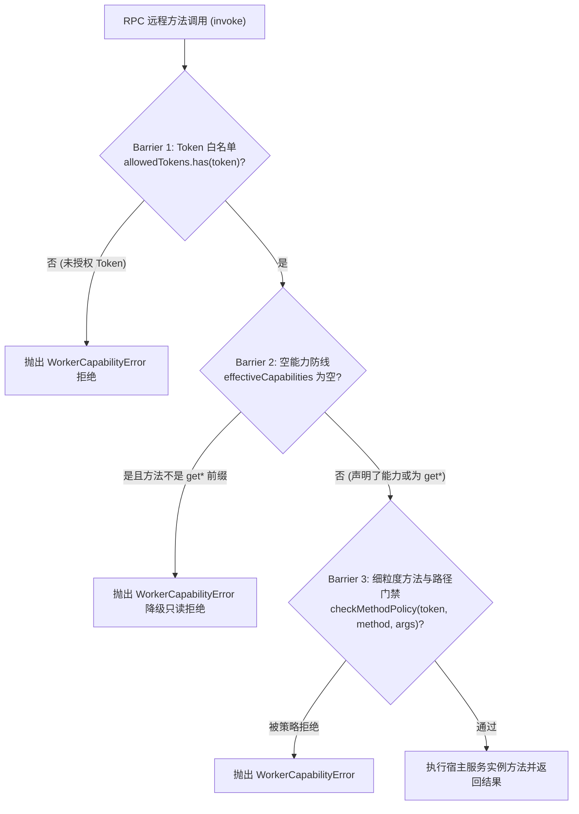

# 插件信任边界矩阵（Trust Boundary）

<!-- doc-version: sdk=3.7.5 -->

> **适用范围**：OpenLearnV2 插件宿主，`inline` / `worker_threads` / `child_process(process)` 三种执行模式。
>
> 本文与 [能力权限矩阵](./plugin-capability-matrix.md) 互补：后者描述 **“能做什么”** 的权限字符串；本文描述 **“插件运行在什么防护边界内”**。

---

## 1. 执行模式对照

| 模式                | 适用对象                                          | 崩溃隔离          | 文件系统                                                        | 进程/Worker                                                      | eval / new Function   | 网络                             | 备注                                                               |
| ------------------- | ------------------------------------------------- | ----------------- | --------------------------------------------------------------- | ---------------------------------------------------------------- | --------------------- | -------------------------------- | ------------------------------------------------------------------ |
| `inline`            | • 宿主内建插件<br>• 数据库迁移/宿主启动前必要扩展 | ❌ 与宿主同上下文 | ✅宿主用户全部权限                                              | ✅可 spawn / worker                                              | ✅执行字符串          | ✅不可拦截                       | 仅限完全可信代码；策略层禁止第三方插件使用                         |
| `worker_threads`    | • 宿主内的稳定插件                                | ✅ 线程级         | ✅宿主用户全部权限                                              | ✅可 spawn / worker（同进程内核问题仍可通过 child_process 逃逸） | ✅执行字符串          | ⚠️ 原生不受限（无 preload 拦截） | 是**资源崩溃**隔离，不是**安全**沙箱；策略层已强制对第三方插件禁用 |
| `process` + `rw/ro` | • 第三方/社区插件（默认）                         | ✅ 进程级         | 仅 `pluginDir` + 宿主 `node_modules`（只读/读写由 policy 决定） | ❌ 禁止子进程/worker                                             | ❌ 禁止字符串代码生成 | 🛡️ 默认拒绝 + 获批域名宿主代发   | 默认推荐（`plugin-net-preload.cjs` + 宿主 IPC 代理）               |
| `process` + `off`   | • 合法需要 spawn / 原始联网 / 写外部路径的插件    | ✅ 进程级         | 全部用户权限                                                    | ✅                                                               | ✅                    | ✅                               | 逃生舱；必须人工审批 + 审计                                        |

> **默认执行模式建议**：第三方插件强制默认 `process + rw`。`execution-policy.ts` 会将所有非内置且不在 `OPENLEARN_TRUSTED_INLINE_PLUGINS` 中的插件强制改写（coerce）为 `process` 模式，禁止使用 `inline` 与 `worker_threads`。

---

## 2. 五大能力面矩阵

| 能力面                      | `inline`               | `worker_threads`        | `process (rw)`                 | `process (ro)`                 | `process (off)`        |
| --------------------------- | ---------------------- | ----------------------- | ------------------------------ | ------------------------------ | ---------------------- |
| 读取插件目录                | ✅                     | ✅                      | ✅                             | ✅                             | ✅                     |
| 写入插件目录                | ✅                     | ✅                      | ✅                             | ❌                             | ✅                     |
| 读取宿主源码/ `.env` / 迁移 | ✅                     | ✅                      | ❌                             | ❌                             | ✅                     |
| 读取 / 写入宿主数据库库文件 | ✅                     | ✅                      | 仅 `plugin_*` 命名空间         | 仅 `plugin_*` 命名空间         | ✅                     |
| 拉起子进程                  | ✅                     | ✅                      | ❌                             | ❌                             | ✅                     |
| 创建 worker                 | ✅                     | ✅                      | ❌                             | ❌                             | ✅                     |
| `eval` / `new Function`     | ✅                     | ✅                      | ❌                             | ❌                             | ✅                     |
| 出站网络                    | ✅（不可拦截，同宿主） | ⚠️ 不受限（同进程线程） | 🛡️ 默认拒绝 + 获批域名宿主代发 | 🛡️ 默认拒绝 + 获批域名宿主代发 | ✅ 完全放行（逃生舱）  |
| CPU hog / 死循环            | 全宿主影响             | 吃 CPU 但需 watchedog   | 受限于进程级资源（P2）         | 受限于进程级资源（P2）         | 受限于进程级资源（P2） |

---

## 3. 服务 RPC 门禁与三重安全防线（ServiceHost）

宿主主线程通过 `ServiceHost` 处理来自 Worker/Process 插件的 RPC 远程方法调用。无论是服务端 Worker 还是浏览器端 Worker，均统一由**三重安全防线（3-Tier Security Barriers）**严密守护：



### 3.1 三重安全防线详解

1. **Security Barrier 1：Token 级别白名单门禁**
   - 宿主依据插件清单计算出的 `allowedServiceTokens` 实施硬门禁；
   - 任何未显式授权给该插件的 Token（例如试图访问未声明的私有服务），在进入反射前即刻被拦截；
   - 若 `allowedServiceTokens` 为空集合，按 Fail-Closed 原则彻底拒绝一切 RPC。
2. **Security Barrier 2：空 manifest 能力兜底只读门禁（高频踩坑点！）**
   - **设计规则**：若插件清单中的 `capabilitiesProposed` 为空数组 `[]`（或管理员未审批授予任何能力），插件将受到强制只读降级锁定 —— **只允许调用名称以 `get*` 开头的方法**；
   - **错误现象**：若插件尝试调用任何非 `get*` 前缀的写入/修改方法（如 `set*`、`create*`、`register*`、`delete*`、`save*` 等），宿主直接抛出：
     `WorkerCapabilityError: Capability denied for actor plugin:<id>: empty manifestCapabilities, only 'get' methods allowed`；
   - **规避方案**：任何需要写数据库、注册路由、发送总线指令或操作白板的插件，必须在 `manifest.json` 中显式声明所需能力（例如 `lesson:write`、`whiteboard:write`、`vfs:write` 等；能力名必须逐字取自真实能力表，不存在 `storage:readwrite` / `classroom:write` 这类写法）。
3. **Security Barrier 3：方法与路径级策略门禁（纵深防御）**
   - 由 `packages/core/plugin-host/method-policy.ts` 集中判定，双端（Node Worker / Browser Worker）共享同一规则逻辑；
   - 包含 Action 注册降级（未获 `agent:tool` 权限时将 `exposeToAgent` 强制重写为 `false` 而不直接崩溃）、敏感数据读写范围校验等。

---

## 3.2 前端视图 Iframe 沙箱与 Opaque Origin 边界

除后端/Worker 沙箱外，平台前端扩展视图（如白板卡片、浮动面板、独立 Page）运行在严格隔离的 HTML5 `<iframe>` 沙箱中：

1. **沙箱属性配置**：
   - **view 通道**（可视沙箱页）强制使用 `sandbox="allow-scripts allow-forms allow-downloads"`；
     注意这与 **frame 通道**（隐藏 iframe，跑 `frontend.js`）不同 —— 后者只有 `sandbox="allow-scripts"`
     （`src/plugin-host/sandbox-frame.ts` 的 `PLUGIN_SANDBOX_ATTR`）。两个 iframe 的沙箱属性不要混用。
   - **严格禁止 `allow-same-origin`**，杜绝第三方视图窃取宿主 Cookie、DOM 或越权向主站同源接口发起请求。
2. **Opaque Origin (`null`) 的浏览器行为红线**：
   - 由于缺失 `allow-same-origin`，iframe 的运行源为 **Opaque Origin（`origin: "null"`）**；
   - **禁止直接访问本地存储**：在 iframe 内部直接调用 `window.localStorage` 或 `window.sessionStorage` 会直接触发浏览器 DOMException `SecurityError` 崩溃；
   - **禁止直接相对路径 `fetch()` / XHR**：由于没有同源域名，直接 `fetch('/api/...')` 会因为无 Host 导致请求失败，或被浏览器 CORS 策略直接拦截；
   - **统一通信介质**：所有视图逻辑必须且只能通过平台注入的 `window.OpenLearnPluginBridge` 接口（`bridge.api.*`、`bridge.storage.*`、`bridge.ui.*`、`bridge.invokeCommand`、`bridge.getContext`）
     —— **没有** `bridge.state.*`；view 通道不提供状态子对象与宿主进行双向通信与状态同步。

---

## 4. Node Permission Model（process 模式）

策略取值：

| policy | 含义                                       |
| ------ | ------------------------------------------ |
| `rw`   | 读插件目录 / 共享依赖 + 写插件目录（默认） |
| `ro`   | 全部只读                                   |
| `off`  | 关闭权限模型（逃生舱）                     |

构造的 flags（Node v22+ / v24+）：

```text
--permission
--disallow-code-generation-from-strings
--allow-fs-read=<pluginDir>/*
--allow-fs-write=<pluginDir>/*          # 仅 rw
--allow-fs-read=<root>/node_modules/*   # 共享依赖
```

**固定不提供的 flags**：

- `--allow-child-process`
- `--allow-worker`

否则插件可拉起不受权限模型约束的孙进程 / worker，沙箱形同虚设。

### 3 个已知缺口与边界现状

1. **网络拦截与边界划分**：
   - 虽然 Node 官方目前仍无 `--allow-net` 启动旗标，但平台在 `process` 模式（默认 `rw` / `ro`）下通过子进程入口注入 `plugin-net-preload.cjs` 与宿主 IPC 代理实现了网络沙箱闭环：
     - **原始底层连接完全阻断**：原始 Socket、UDP (`dgram`)、DNS (`dns.lookup`/`resolve*`)、TLS 与 HTTP2 底层连接均被彻底封锁并抛出 `ERR_ACCESS_DENIED`。
     - **应用层受控代发**：`fetch` 与 `http(s).request` 仅放行在 `plugin_network_grants` 表中获批的目标域名，并通过 IPC 通道（`ol-net-proxy`）转交宿主代发。宿主侧内建防 SSRF 校验（阻断本地环回、私有 IP、云元数据地址与 DNS 重绑定）。
     - **白名单怎么变成白名单**：清单的 `network.outbound` **只是申请**，写入授权表需要管理员显式动作 —— 安装/更新时勾选「批准出站域名」（`x-approve-network-hosts`），或事后在插件中心 → 插件设置 → 「出站网络域名」里逐条批准/撤销（`GET/POST/DELETE /api/plugins/:id/network-grants`，仅 administrator）。未批准即零白名单（fail-closed），插件发起的任何出站请求都会被拒。回环/私有/保留地址与通配符**永远不可批准**，界面上会连原因一起列出。
     - **执行模式边界覆盖**：`inline` 与 `worker_threads` 模式不受 `plugin-net-preload.cjs` 约束，同进程共享宿主网络栈；但平台在加载策略层（`execution-policy.ts`）已实施强门禁，所有非内置且未受显式信任的第三方插件一律强制改写（coerce）为 `process` 模式运行，从而杜绝不受信代码在无网络拦截模式下运行。
2. **CPU 不受 permission model 约束**：吃 CPU 但让出 event loop 的插件仍可通过探活；需要进程级 watchdog/resource quota（P2）。
3. **读取的共享依赖范围**：防的是宿主 `.env`/源码，不能阻止插件读取所有 `node_modules` 内的文件（只含 JS 依赖）。

---

## 5. 运营建议（管理员操作）

| 指令                                            | 预期行为                                           | 风险 |
| ----------------------------------------------- | -------------------------------------------------- | ---- |
| 默认安装社区插件                                | process + rw                                       | 中   |
| 安装需要联网/spawn 的插件                       | process + off + 审批 + 审计                        | 高   |
| 内置插件                                        | inline                                             | 中   |
| 混合高危命令（`plugin.*` / `lesson.delete` 等） | 非管理员须 `approved=true` 或进入 pending 命令队列 | —    |

**切忌**把 `worker_threads` 对用户描述为“沙箱”。

---

## 6. 配套测试建议

```bash
# 网络加固与代理防 SSRF 验证
pnpm vitest run packages/core/worker-runtime/__tests__/plugin-net-hardening.test.ts

# 真实子进程权限收敛与 raw socket 拦截
pnpm vitest run packages/core/worker-runtime/__tests__/plugin-permission.test.ts

# 执行模式网络覆盖与信任边界防漂移测试
pnpm vitest run packages/core/worker-runtime/__tests__/plugin-trust-boundary-network-modes.test.ts

# Token allowlist 负向
pnpm vitest run src/plugin-host/__tests__/service-host-allowlist.test.ts

# Worker 原语安全性
pnpm vitest run packages/core/worker-runtime/__tests__/sandbox-confinement.test.ts

# 插件代码静态门禁
pnpm vitest run packages/core/esm-loader/__tests__/plugin-code-security.test.ts
```

---

## 7. 分发与来源身份认证边界（Issue #143）

在运行时沙箱之前，平台在安装与更新阶段实施发布者身份与代码完整性事前防御：

| 插件来源               | 完整性要求                         | 签名要求                  | 策略处理                                                                                           |
| ---------------------- | ---------------------------------- | ------------------------- | -------------------------------------------------------------------------------------------------- |
| `builtin`              | 宿主系统内部内置                   | 免验签                    | 宿主上下文同级信任                                                                                 |
| `local`                | 可选声明                           | 可选提供                  | 管理员直接上传操作，有签名则强验；未签名允许显式放行并记录审计                                     |
| `community` / `remote` | **强制**声明 `integrity` (SHA-256) | **强制**要求 Ed25519 签名 | 强安全门禁：缺哈希拒绝、缺签名拒绝、未配置公钥拒绝、哈希篡改或签名非法拒绝（错误码 `COMMUNITY_*`） |

- **防重放与防冒名**：签名载荷绑定 `openlearn-plugin-attestation-v2\n<id>\n<version>\n<integrity>`，禁止版本降级或假冒其他插件 ID。
- **已装插件兼容**：已安装插件在宿主升级重启时不强制二次验签，确保平滑运行。

---

## 8. 长期路线图

1. **网络隔离演进**：子进程 host proxy + 默认拒绝已在 PR #32 交付；后续将跟进更细粒度的流控配额、eBPF 网络层审计与 `worker_threads` 模式安全网探索。
2. **共享依赖 range enforcement**：worker 流量目测 + SBOM。
3. **进程资源配额**：watchdog timeout / memory cap / cgroup（host 侧）。
4. **Permission policy evolution**：`rw/ro/off` 增加 `network` granular gate。

---

## 8. 关联文档

- `reference/plugin-capability-matrix.md` — 权限字符串真源
- `architecture/plugin-worker-isolation-l1-proposal.md` — P1/P2 isolation 实施报告
- `plugin/plugin-lifecycle.md` — 生命周期与 reload/rollback
- `plugin/plugin-manifest-spec.md` — manifest schema 与 capabilitiesProposed
