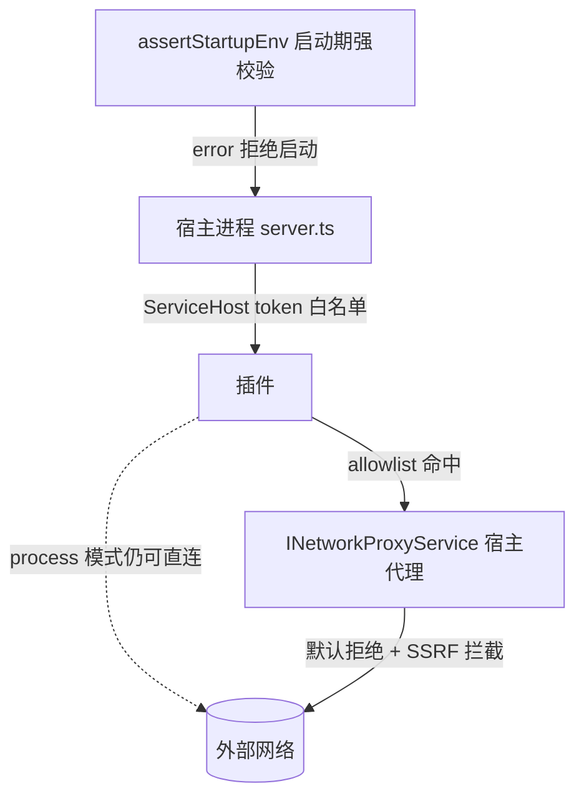

# 插件信任边界与部署链路加固审计（2026-10-14）

> **审计日期**：2026-10-14（本报告于 2026-10-15 按修复过程重建并入库）
> **审计对象**：`openlearn-next`（仓库 `OpenLearn-Next-V2`）
> **基线**：`main@9244703`（已包含 PR #26 / #28 / #29 / #31 / #32 / #53）
> **方法**：只读代码审查 + Vitest 定向回归；本轮审计以「先修信任边界、再修部署链路」为原则推进，所有修复按 PR 合入。
> **环境**：Node.js v22，pnpm 10.33.4，Linux

本报告记录 2026-10-14 这一轮针对 **插件执行信任边界** 与 **服务器/部署硬化** 的审计发现、处置状态和残余风险。历史背景见 [结构梳理与代码审计报告](./AUDIT_REPORT.md)（2026-10-13，对象 v0.6.0）与 [公测上线演练记录](./DEPLOY_REHEARSAL.md)。

---

## 1. 审计范围

| 面 | 覆盖内容 |
| --- | --- |
| 插件执行隔离 | `inline` / `worker_threads` / `child_process(process)` 三种模式的防护边界、Node Permission Model、资源限制 |
| 插件 ↔ 宿主 RPC | `ServiceHost` token 白名单、`allowedServiceTokens` 缺省语义、事件/命令转发 |
| 插件出站网络 | 是否存在 host 侧代理、manifest allowlist、默认拒绝与 SSRF 阻断 |
| 环境变量 | 管理员可配置的安全开关是否「拼写错误会静默回落」 |
| 部署链路 | Docker 构建/入口降权/迁移/健康探针/备份恢复是否有自动化演练 |
| 文档 | 信任边界矩阵、配置规范与实现是否一致 |

不在本轮范围：业务功能正确性、前端渲染、课程内容数据模型、AI 提示词质量。

---

## 2. 信任边界现状（修复后）



| 边界 | 修复后行为 |
| --- | --- |
| RPC token | `allowedServiceTokens` 未注入时 **fail-closed**（等价于拒绝全部 token），不再静默放行 |
| 出站网络 | 插件经 `@openlearn/core:INetworkProxyService` 走宿主代理；manifest `network.outbound` 为 per-plugin allowlist；未声明即默认拒绝；loopback / 私网 / metadata 地址先阻断 |
| 环境变量 | `assertStartupEnv()` 在 `startServer()` 最早期执行，非法值 fail-fast 而非回落默认 |
| 部署 | `docker-rehearsal` CI 在 main / tag / Docker 相关变更时构建镜像并跑迁移与健康探针 |
| 进程权限 | `process` 模式固定不给 `--allow-child-process` / `--allow-worker`；`rw/ro/off` 由 Node `--permission` 落实 |

---

## 3. 发现与处置

严重度：**高** = 可直接越权/越界；**中** = 会削弱隔离或部署可靠性；**低** = 文档或可维护性问题。

| # | 严重度 | 发现 | 证据 | 状态与 PR |
| --- | --- | --- | --- | --- |
| TB-01 | 高 | `ServiceHost` 在未注入 `allowedServiceTokens` 时会放行全部 token，单点配置遗漏即等于打开 RPC 面 | `packages/core/worker-runtime/service-host.ts` 旧逻辑 | ✅ 已修（PR #31）：`allowedServiceTokens` 未注入即拒绝；有 `service-host-allowlist.test.ts` / `sandbox-confinement.test.ts` 负向用例 |
| TB-02 | 高 | 插件出站网络不受宿主约束；`process` 模式下 Node 无 `--allow-net`，任意出站 | [plugin-trust-boundary §4](reference/plugin-trust-boundary.md) | ✅ 部分修（PR #32）：新增 `INetworkProxyService` 宿主代理、`manifest.network.outbound` allowlist、默认拒绝与 SSRF 基础拦截；**原始 net/http/fetch 仍不受限**，见残余风险 R-01 |
| TB-03 | 高 | 管理员可配置的安全开关只做宽松归一化：拼错 `OPENLEARN_PLUGIN_PERMISSION=rw-only`、`OPENLEARN_WORKER_LIVENESS=flase`、`OPENLEARN_PLUGIN_MAX_HEAP_MB=128MB` 会静默回落默认甚至更宽策略 | `packages/core/worker-runtime/plugin-permission.ts`、`plugin-limits.ts`、`liveness-monitor.ts` | ✅ 已修（PR #53）：`server/security/env-validation.ts` 启动期强校验，`error` 拒绝启动 |
| TB-04 | 高 | 生产环境可把 `OPENLEARN_ADMIN_PASSWORD` / `OPENLEARN_TEACHER_PASSWORD` 设为用户名，靠「首次登录强制改密」兜底 | `packages/core/db/index.ts` | ✅ 已修（PR #53）：生产环境用户名口令直接拒绝启动 |
| TB-05 | 中 | 公测演练依赖人工步骤，镜像构建/入口降权/迁移/健康探针没有 CI 固化 | `docs/DEPLOY_REHEARSAL.md` | ✅ 已修（PR #29）：`.github/workflows/docker-rehearsal.yml` |
| TB-06 | 中 | CORS / 健康探针 / 主机网络逻辑内联在 `server.ts`，难以独立审查与测试 | `server.ts` | ✅ 已修（PR #28）：拆为 `server/middleware/cors.ts`、`server/routes/health.ts`、`server/utils/host-network.ts`，并补 `stage4_arch_resilience.test.ts` |
| TB-07 | 中 | 信任边界散落在 capability matrix 与代码注释里，管理员无法快速回答「某模式能做什么」 | 文档缺口 | ✅ 已修（PR #26）：`docs/reference/plugin-trust-boundary.md` |
| TB-08 | 低 | 信任边界矩阵第 5 节表格首行被误写成 `<|channel|>`，Markdown 表格渲染异常 | `docs/reference/plugin-trust-boundary.md:91` | ✅ 已修（Issue #144） |
| TB-09 | 低 | 本报告落地后，`plugin-trust-boundary.md` §4/§7 仍写「网络 unrestricted」「长期路线图：host proxy」 | `docs/reference/plugin-trust-boundary.md:83,122` | ✅ 已修（Issue #144） |

---

## 4. 残余风险

| # | 风险 | 说明 | 建议 |
| --- | --- | --- | --- |
| R-01 | `worker_threads` / `inline` 模式原始网络不受限 | 虽已由 `plugin-net-preload.cjs` 封锁 `process` 模式原始网络，但 `worker_threads` 与 `inline` 同进程共享网络栈不受拦截 | 当前已由 `resolvePluginExecutionMode` 在加载期强门禁强制对第三方插件降级至 `process` 模式兜底；中长期探索 Worker 线程级沙箱或全面统一 process 隔离 |
| R-02 | 出站 allowlist 的可见性 | ✅ 已修：安装向导逐条列出清单声明的出站域名并默认不批准；管理员另有 `GET/POST/DELETE /api/plugins/:id/network-grants` 查看/批准/撤销。**复查时发现原描述低估了缺口**：`approvePluginNetHosts` 当时在整个仓库里没有任何调用方 —— 不只是「UI 没展示」，而是授权链路根本不存在（第三方插件永远拿不到出站权）。现已在安装/更新路径接受 `x-approve-network-hosts` 补上该链路，回环/私有/保留地址与通配符一律不可批准并回显原因 |
| R-03 | CPU 饥饿不等于崩溃 | ✅ 已修（本报告收尾复核时核实）：`packages/core/worker-runtime/plugin-quota.ts` 的 `startProcessQuota()` 在子进程 spawn 处启动 1s 一次的 `/proc/<pid>` 采样，按 `OPENLEARN_PLUGIN_MAX_RSS_MB`（默认 512）与 `OPENLEARN_PLUGIN_CPU_QUOTA_MS`/`_WINDOW_MS`（默认 8000/10000）判定，超限 `SIGKILL` 后交给既有崩溃看门狗（指数退避 + 熔断）。存活探活（`liveness-monitor.ts`）负责「卡死但零 CPU」的另一半——两者是互补的两条检测路径，不是替代关系。**复核时补上的缺口**：这五个调参键此前不在 `assertStartupEnv` 里，而解析器对非法值是静默回落默认的（`20s` / `512MB` / 开关写成 `of` 都会被无声吞掉）—— 与 TB-03 同一类问题，现已逐个纳入启动期强校验 |
| R-04 | 信任边界文档漂移 | TB-08 的渲染缺陷与 TB-09 的「网络 unrestricted」表述仍留在文档里，容易与 #32 之后的实现矛盾 | ✅ 已修（Issue #144）：同步 `plugin-trust-boundary.md`，并加入自动化防漂移测试 |
| R-05 | 环境校验只覆盖 `server.ts` 入口 | `cli.mjs` 的子命令（doctor/migrate/backup）不经过 `assertStartupEnv()`，理论上仍可用非法环境变量运行非服务命令 | 视需要在 CLI 子命令入口复用同一校验器；服务入口已覆盖 |
| R-06 | 部署侧其余已知项 | AI Provider 种子失败只告警不拒绝启动；`TRUST_PROXY` 跳数必须等于真实反代层数；恢复后的 AI Key 依赖备份时的 `ENCRYPTION_KEY` | 维持 `docs/DEPLOY_REHEARSAL.md` 的「仍未关闭的风险」清单，纳入每次发布检查 |

---

## 5. 验证命令与结果

```bash
# 信任边界与运行时回归（含网络代理、token allowlist 负向用例）
pnpm vitest run packages/core/worker-runtime
# → 213 passed

# 启动期环境变量强校验
pnpm vitest run server/__tests__/env-validation.test.ts
# → 9 passed

# 类型检查
pnpm lint
# → 通过
```

复跑合并命令（worker-runtime + env 校验）在本报告基线上为 **23 files / 222 tests passed**。

---

## 6. 本轮 PR 清单

| PR | 作用 |
| --- | --- |
| #26 | 插件信任边界矩阵与执行模式指引（文档） |
| #28 | CORS / 健康探针 / 主机网络模块化重构 + 架构韧性测试 |
| #29 | Docker 发布演练 CI（构建镜像 + 迁移 + 健康探针） |
| #31 | `ServiceHost` token 白名单 fail-closed |
| #32 | 插件出站网络 host 代理 + manifest allowlist + 默认拒绝 |
| #53 | 启动期环境变量强校验（fail-fast） |

---

## 7. 后续建议

1. **优先**：补文档 PR 修正 TB-08/TB-09，把信任边界矩阵与 #32 后的实现对齐。
2. **优先**：插件安装/启用界面展示出站 allowlist，避免「静默拿到网络能力」。
3. **P2**：进程级资源配额（CPU/内存），补齐 R-03。
4. **跟进 Node 运行时**：一旦出现网络权限模型，评估把 `process` 模式的原始网络也纳入 `--permission`。
5. **回归公测材料**：把本报告与 `docs/DEPLOY_REHEARSAL.md` 的残余风险并入上线检查清单。

---

> 本报告是 2026-10-14 审计的**重建版**：原始本地草稿 `audit-2026-10-14.md` 未提交且已丢失，现按修复后的代码与 PR 记录重新整理。若与 `main` 后续变更冲突，以代码为唯一真源。
